<p style="text-align:center">
  
</p>

<p>
  
  
  
</p>

> **TL;DR** - A support site runs osTicket and a Mattermost chat server. Creating a ticket hands us a temporary `@delivery.htb` email, which we use to register and self-validate a Mattermost account, because the validation link lands back in our own ticket. Inside Mattermost, a team channel leaks SSH credentials (`maildeliverer`) for the foothold. Root comes from the Mattermost DB config, which holds MySQL creds, where the `root` user's hash lives, cracked with a hashcat ruleset applied to a password hint found in the same chat.

---

## Recon

As always, starting recon with a full nmap scan.

```bash
nmap -sV -sC -p- -oA nmap/delivery 10.129.73.168
```


Ports 22, 80 and 8065 open. Starting with the easiest, port 80.

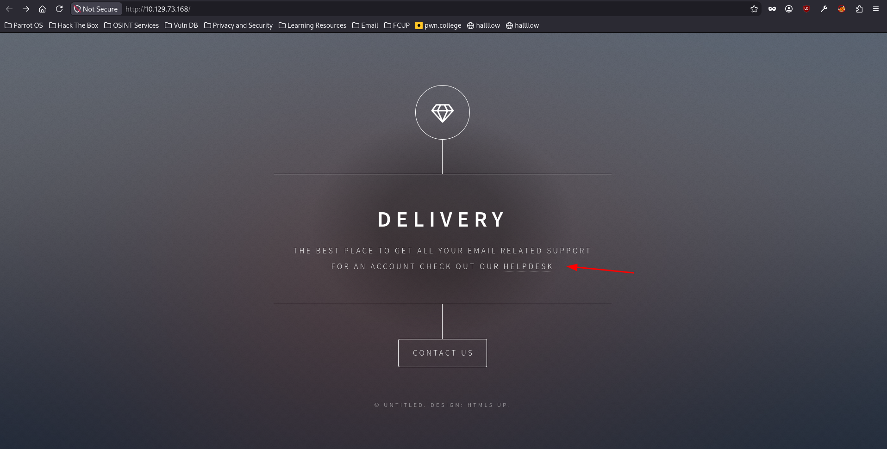

A simple page with a `helpdesk` hyperlink that redirects to `helpdesk.delivery.htb`, so I added that to `/etc/hosts`.

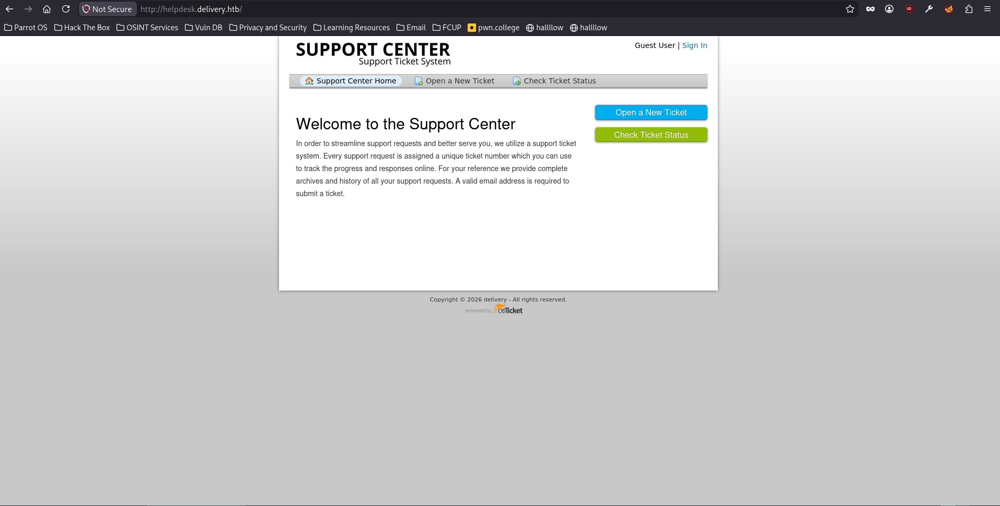

The helpdesk is an `osTicket` support system, with self-registration, but it requires email validation, so it's not a direct entry point.


After poking at a few CVEs with no luck, I moved to the third port, 8065.

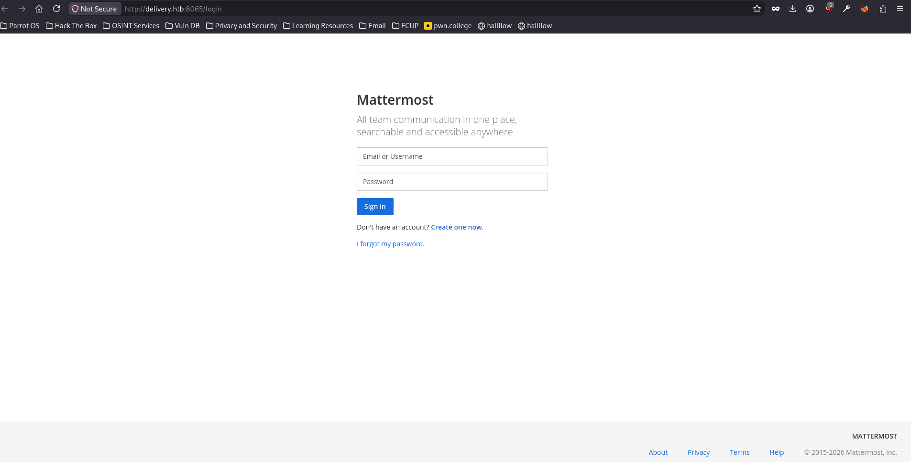

That's a `Mattermost` chat server.

---

## Foothold - chaining osTicket and Mattermost

Mattermost registration needs a validated `@delivery.htb` email, which I don't have. But osTicket gives me one: every ticket gets a temporary `@delivery.htb` address, and I can read everything sent to it through the ticket view. So osTicket becomes my mailbox, and the two apps chain together.

I created a ticket, which assigned a temporary email address for tracking it.

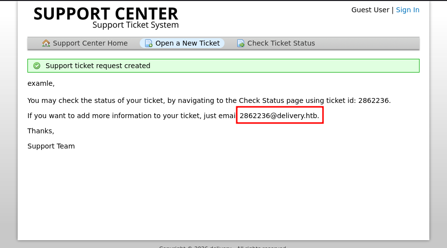

I registered on Mattermost using that temporary email.

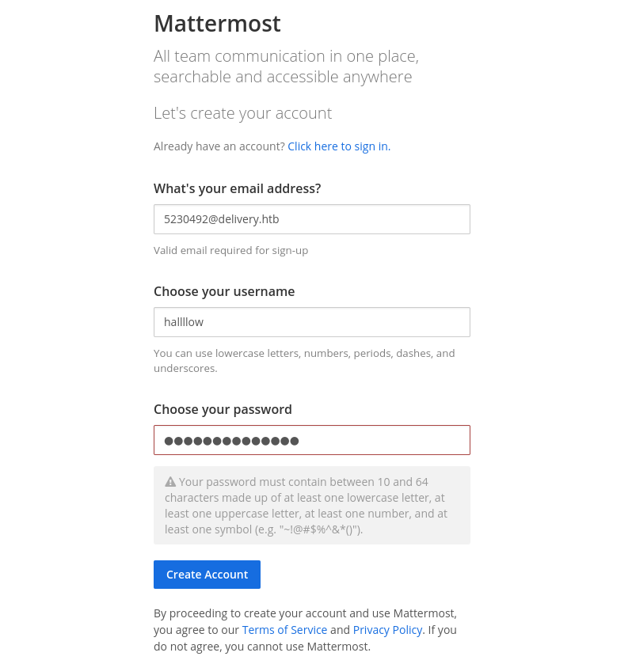

The validation email arrived in the osTicket thread.

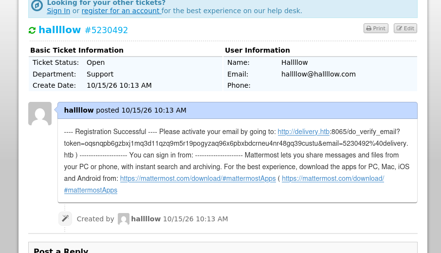

Clicking the link activated the account, and I was in as a valid Mattermost user.

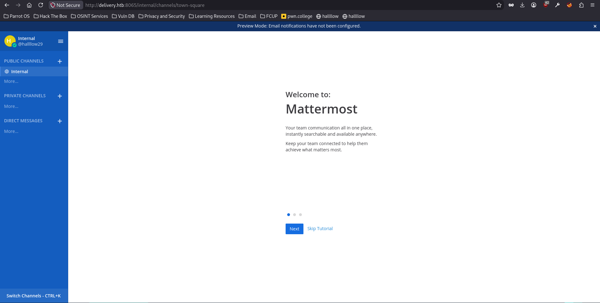

A team channel had plaintext credentials sitting in the history.

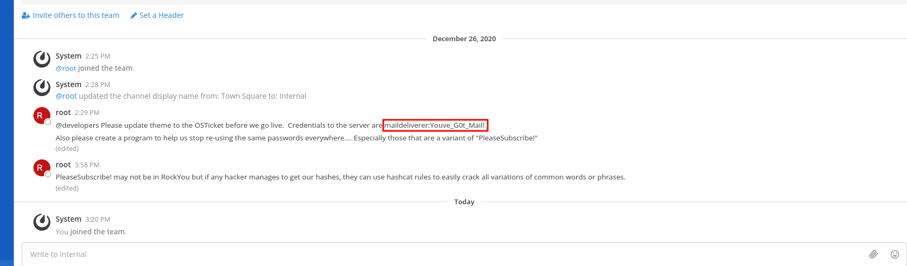

The creds were `maildeliverer:Youve_G0t_Mail!`. I tried them over SSH.

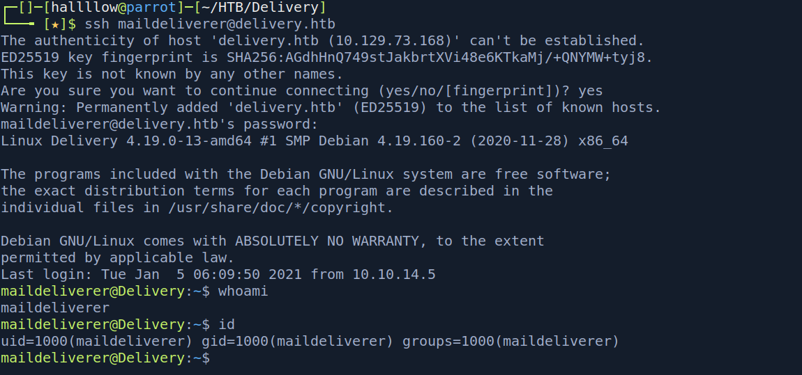

### user.txt

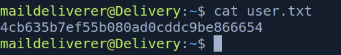

---

## Privilege Escalation - Mattermost DB to cracked root hash

Enumerating as `maildeliverer`, the Mattermost config held database credentials.

```bash
cat /opt/mattermost/config/config.json   # mmuser:Crack_The_MM_Admin_PW
```

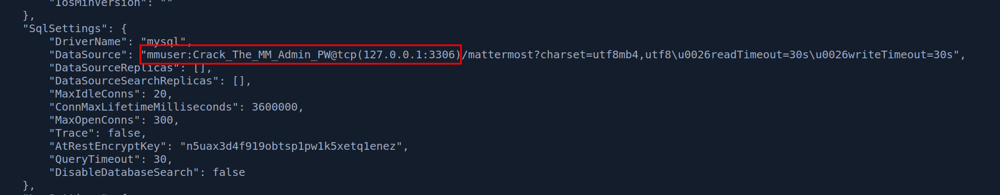

MySQL was running locally (from the initial enumeration), so I logged in with those.

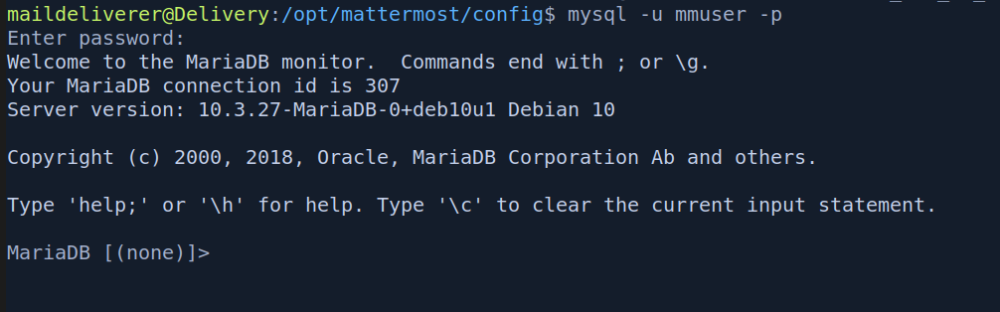

In the `Users` table there was a `root` account with a bcrypt password hash, which I dumped.

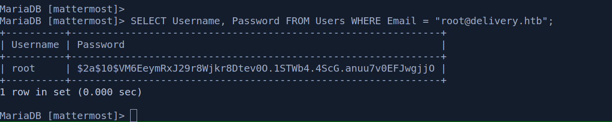

A straight hashcat run against bcrypt was far too slow. But the Mattermost chat had explicitly hinted at a password pattern (`PleaseSubscribe!` and a note about using rules). That's the shortcut: instead of brute-forcing, generate candidates from the hint using a ruleset.

I generated a wordlist by applying `best64.rule` to the hint, then cracked the hash:

```bash
echo 'PleaseSubscribe!' | hashcat --stdout -r /usr/share/hashcat/rules/best64.rule > wordlist
john --wordlist=wordlist --format=bcrypt hash
```

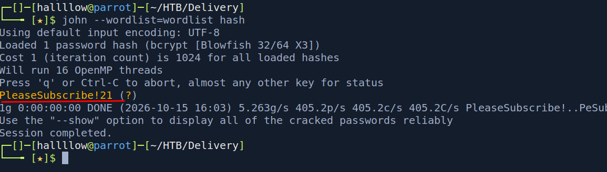

The password was `PleaseSubscribe!21`, and it was reused for the system `root` account.

```bash
su root   # PleaseSubscribe!21
```

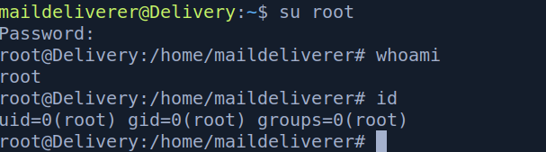

### root.txt

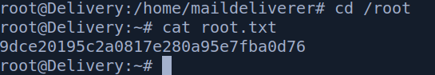

---

## Conclusion

Delivery's foothold is the highlight: nothing is "exploited" in the classic sense, you just realise that an osTicket mailbox can validate a Mattermost account, and chain two legitimate features into access. It's a great lesson that trust boundaries between apps are themselves an attack surface.

The root step reinforces a credential-hygiene theme: reused passwords (Mattermost `root` hash = system `root`) and, cleverly, a password hint dropped in chat that turns an unfeasible bcrypt crack into a few seconds of rule-based guessing.

The takeaway: when a service hands you a controllable email address, treat it as a mailbox you own, it can validate accounts elsewhere. And when a target drops a password hint, don't brute-force blind, feed the hint through a hashcat ruleset (`best64.rule` is the go-to) to generate realistic candidates.

---

## Kill chain summary

| Phase    | Vector                                                            | Result                                             |
| -------- | ----------------------------------------------------------------- | -------------------------------------------------- |
| Recon    | nmap                                                              | osTicket (80) + Mattermost (8065)                  |
| Foothold | osTicket temp email → validate Mattermost → read channel creds    | `maildeliverer:Youve_G0t_Mail!` → SSH - user.txt   |
| Priv esc | Mattermost `config.json` → MySQL → `root` hash                    | bcrypt hash of system root                         |
| Root     | hashcat `best64.rule` on chat hint → password reuse               | `PleaseSubscribe!21` - root.txt                    |

## References

- osTicket - https://osticket.com/
- Mattermost - https://mattermost.com/
- hashcat rule-based attack - https://hashcat.net/wiki/doku.php?id=rule_based_attack